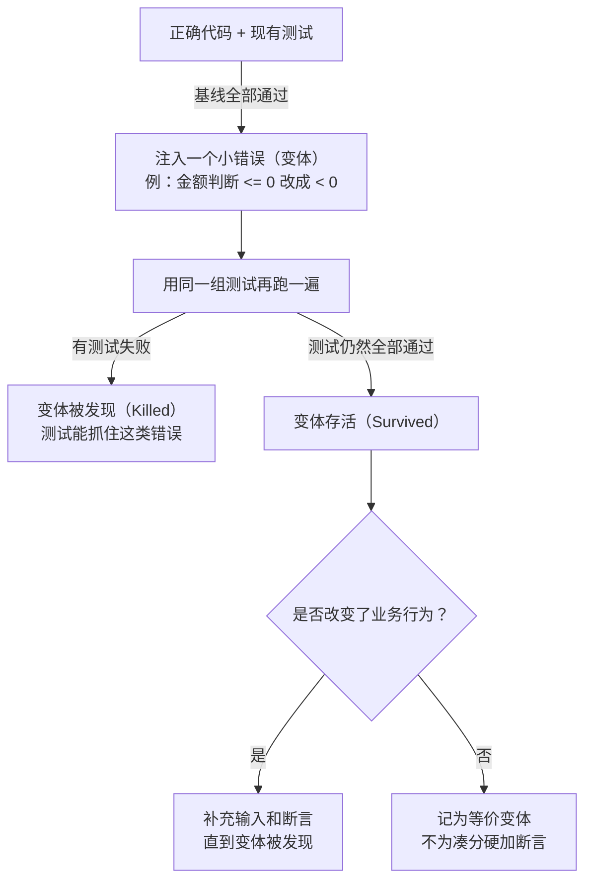

# AI 全栈开发方法与实践（研发培训初稿 v0.1）

> **沉淀说明**
> - 来源：《AI 全栈开发方法与实践｜研发培训初稿 v0.1》
>   https://cheetah-mobile.feishu.cn/docx/HQ61dgbA1o9zwxxjqIJcGpMDnqg
> - 沉淀时间：2026-10-27，全文逐字保留（仅格式转换：飞书分栏拉平、标注框转引用块）。
> - **图片与画板未随文沉淀**（75 张截图 + 22 个画板）：仓库运行环境缺少飞书
>   `drive:file:download` 权限，图片链接指向飞书原文，有权限的同学可对照查看；
>   补齐权限后可批量下载到 `course/assets/` 并替换链接（方法见 `skills/README.md`）。
> - 与本仓库的关系：**本文档是 cc4-journey 案例的方法论来源**——旅程各阶段
>   （journey/00–05）按本文档「需求梳理 → PRD → 设计 → 分阶段开发与验收 →
>   部署交付 → 复盘沉淀」设计，对应关系见各 journey 文档与 `course/` 下的材料。

---

**AI 全栈开发方法与实践｜研发培训初稿 v0.1**

> 📋 此处为飞书画板（未随文本沉淀），见原文档对应位置。

# 相信 AI，拥抱 AI

从我司真实项目和行业进展，看清 AI 已能承担哪些工作，以及为什么开发者需要掌握 AI 开发。

> 📋 此处为飞书画板（未随文本沉淀），见原文档对应位置。

## 相信 AI：从我司真实案例看它能做到什么

### 我司案例 C1｜2025 年 5 月：AI 已能参与面向生产场景的后端开发

**3 个工作日，约 9,700 行代码，几乎全部由 AI 生成。**我司开发者用 AI 开发了 OA 与银行对接的后端，涵盖支付校验、回执处理、状态查询和通知。

**复杂在整条支付链的协同与可靠性：**银行回执不等于支付完成，还要异步查询状态、回写 OA；多个模块相互依赖，同时必须防重发、防漏发，并支持追溯和审计。

**① 想象中的开发：逐个完成模块**

写完模块 1，再写模块 2、3……最后组合成完整系统。

---

**② 实际的依赖：改一处牵动多处**

AI 为了实现新模块修改了共用模块，依赖它的已有功能也可能出问题。

---

**连日志也有工程要求：**在多进程与协程环境下，通过队列异步写入日志，避免阻塞业务；各模块带上同一个业务参考号，才能追踪一笔付款的完整过程。

### 我司案例 C2｜各业务团队用 AI 开发自己的业务中台

我司各业务团队已借助 AI 开发自己的业务中台，将日常管理需求转化为上线使用、持续迭代的系统。

#### ① 国际广告业务｜EasySales

**1 名没有任何开发经验的销管成员，借助 AI 独立开发，用 1 个月完成一期上线。**从需求梳理、产品设计到代码开发与持续迭代，都围绕团队的实际业务需求推进。

**现有 46 名在职用户，管理 2 万余条客户数据、1.6 万余条商机数据。**销售和销售管理人员已全面依赖系统产出的数据开展日常工作。

以飞书为日常工作入口，统一管理线索、客户、商机、日报和审批；AI 辅助提炼日报信息、识别客户与商机并提供跟进建议。部分 AI 经营分析能力仍在试用和验证中。

**客户看板｜统一资料与归属**


---

**停滞预警｜推动持续跟进**


---

#### ② 销售管理业务｜客户管理平台

**业务团队借助 AI，4 周完成客户管理平台一期上线并投入日常使用。**AI 参与前后端、数据表、UI 和部署，业务人员负责说明需求、确认方案和检查结果。

**① 工作台**


---

**② 权限配置**


---

#### ③ 机器人业务｜海外 CRM 与国内外销售运营中台

**海外数据看板＋飞书机器人：**1 名业务人员借助 AI，利用 **18 个工作日的工作空余时间**完成搭建。看板统一经营数据，机器人支持查数、提醒和进度回写。

**海外 CRM：**已上线内网，管理 **42,960 条客户、105,000 条跟进记录**。销售可通过网页或飞书查询客户、记录跟进、推进业务阶段。

**国内销售运营中台：**打通飞书表格、OA 与销售易 CRM，覆盖业绩、客户、销售过程等 **7 个业务板块**，自动同步数据、校验拜访并生成经营报表。

**海外数据看板**


---

**海外 CRM**


---

**国内销售运营中台**


---

#### ④ 智能出行业务｜CMG 大客户运营中台

**10 月 9 日上线，已开通 18 人，案例汇报当周模块使用超过 500 次。**覆盖商务运营、财务、工厂、售后、研发等职能，支撑大客户订单履约与跨部门协作。

将产品配置、价格、订单、物流和回款串起来，已录入 **214 条 SKU、165 个执行中价格**，支持经营看板、物流进度和产品 3D 拆解查看。

**据原案例反馈，商务时间释放率达 30%**，腾出的时间用于客户配置确认、签样等工作。

**经营看板**


---

**订单与物流**


---

**SKU 与产品配置**


---

**2025 年，AI 已经能参与生产场景的开发；如今，没有开发经验的业务人员也能借助 AI 做出团队日常使用的系统。专业研发更应该把工程经验与 AI 结合起来。**

### 模型进步：部分工程任务已出现数量级提升

| 具体任务 | 公开评测中的进步 |
|-|-|
| 代码优化 | Opus 4（2025-05）将同一起始代码加速约 3 倍；Mythos Preview（2026-04）约 52 倍，优化所得加速倍数约为前者的 17.3 倍。 |
| 长任务能力 | METR TH 1.1 的 50% 成功率口径：Opus 4（2025-05）约 1.67 小时 → Opus 4.6（2026-02）约 11.98 小时，点估计约 7.2 倍。 |
| COBOL 代码迁移 | OpenAI 2026-10-19 披露：相同低推理强度下，GPT-5.6 Sol 为 5.4%，GPT-6.1 Sol 为 86.6%，准确率提高 81.2 个百分点。 |

**① 代码优化结果**


---

**② 长任务跨度**


---

**③ 代码迁移准确率**


---

来源：[Anthropic](https://www.anthropic.com/institute/recursive-self-improvement)、[METR](https://metr.org/time-horizons/)（[原始数据](https://metr.org/assets/benchmark_results_1_1.yaml)）、[OpenAI](https://openai.com/zh-Hans-CN/index/low-resource-programming-languages/)。各项为特定任务指标，不等同于整体研发效率；METR 小时数按人类专家完成任务的耗时计。

**模型还在快速进步。把真实任务交给 AI，用今天的能力重新判断它能做到什么。**

## 拥抱 AI：AI 开发正在成为程序员的基本功

### 行业实践 01｜腾讯 · 国内

**50% 的新增代码由 AI 辅助生成。**


来源：[《2025 腾讯研发大数据报告》](https://developer.cloud.tencent.com/article/2582949?policyId=1004)｜页面发布于 2025-10-31

---

### 行业实践 02｜Google · 国外

**75% 的新增代码由 AI 生成，并经工程师批准。**


原文同时指出，这一比例高于去年秋季的 50%。

来源：[Google 官方文章](https://blog.google/innovation-and-ai/infrastructure-and-cloud/google-cloud/cloud-next-2026-sundar-pichai/)｜2026-04-22 发布

---

### 行业实践 03｜Anthropic · 国外

**合入生产的代码行中，超过 80% 可归因于 Claude。**


“90% 或以上”还包含脚本和实验代码，与这里的生产代码口径不同。

来源：[The Anthropic Institute：When AI builds itself](https://www.anthropic.com/institute/recursive-self-improvement)｜统计截至 2026 年 5 月

**会用 AI 开发，正在从附加能力变成基本功。现在就把它用到真实工作中，持续练习、验证和改进。**

接下来，讨论怎样把 AI 的开发能力转化为完整的项目交付。

# AI 全流程开发：借助 AI，从需求到上线的完整方法

理解 AI 带来的分工变化，掌握从需求到上线的推进方法，知道每一步如何组织任务、验证结果并持续改进。

> 📋 此处为飞书画板（未随文本沉淀），见原文档对应位置。

## AI 开发的变与不变

AI 已能参与需求分析、生成原型、跨栈实现、运行测试和排错。开发者也因此需要掌握新的工作方式：把业务目标转成任务，组织 AI 所需的资料与工具，通过反馈推动它完成交付。

> 📋 此处为飞书画板（未随文本沉淀），见原文档对应位置。

### 变了什么：能力扩展，方法随之调整

| 发生的变化 | 开发方式怎样调整 | 后文展开 |
|-|-|-|
| **工作范围扩大**  <br/>AI 降低了跨技术栈实现的门槛，一个人可以参与更多环节。 | 围绕完整业务结果开展工作，借助必要的学习、成熟工具和 AI，补齐需求、原型、前后端、测试与上线能力。团队据此重新划分任务与协作边界。 | 第 3 章、4.2 |
| **任务分工改变**  <br/>AI 可以读取仓库、修改文件、调用工具，连续执行任务。 | 交代目标、依据、边界与完成标准，让 AI 执行一批可验证的工作。人关注关键决策和阶段结果，任务按依赖推进。 | 2.2、2.5 |
| **试错成本下降**  <br/>原型、备选方案和技术实验更容易做出来。 | 需求明确时细化设计；仍有未知时，用原型或小实验取得反馈，再决定方案。设计深度随确定性和风险调整。 | 2.3、2.4、3.2 |
| **验证方式扩展**  <br/>AI 可以编写和运行测试、操作页面、审查代码并修复问题。 | 把可重复的检查变成 AI 能执行的反馈。测试预期来自需求或独立依据，实现与审查分开；业务取舍和关键验收仍需人确认。 | 2.5、3.4～3.6 |
| **项目知识成为执行依据**  <br/>规则、文档、接口和数据库说明会直接影响 AI 的后续工作。 | 维护清晰入口和当前有效资料，区分历史记录；把可检查的规范落到测试与工具中。复盘后更新规则，让不同成员与 Agent 使用一致的依据。 | 2.2、2.7、2.8、4.2 |

### 没变什么：业务目标、工程约束与交付责任

- **业务目标仍要明确。**解决谁的问题、哪些规则成立、优先做什么，仍需业务依据。AI 可以帮助澄清和比较方案，关键取舍由负责人确认。
- **工程约束仍然成立。**权限、数据一致性、模块依赖、性能和成本不会因 AI 生成代码而消失；AI 同样要在这些约束下设计、实现与验证。
- **交付仍以结果为准。**代码生成、测试通过和业务验收是不同的完成状态。团队仍需对合入、上线和实际运行结果负责。

因此，后文先讲如何与 AI 协作，再沿需求、架构、阶段开发与交付展开；复盘和项目整理贯穿每轮迭代。具体方法从下一节开始。

## 与 AI 协作：把任务说清，给对资料

开始一个任务，先说明要解决的问题，提供当前依据，再约定可检查的结果。需求、设计、开发和排错，都可以用这套基本方法。

### 把任务说清：提示词技巧

**示例｜同一个页面修改任务，两种交代方式**

| 表达方式 | 任务说明 |
|-|-|
| 信息不足 | 把客户编辑页优化一下，专业一点。 |
| 交代清楚 | **目标与原因：**销售经常在手机上修改客户备注。让保存入口容易找到，保存失败时保留输入，便于重试。  <br/>**范围与依据：**沿用当前字段、权限和组件库，本轮只调整已有编辑页。先阅读页面代码与当前接口约定。  <br/>**执行与结果：**简要说明拟改位置，遇到会改变业务规则的问题再问我。完成后展示页面，实际检查手机宽度、保存成功和保存失败三种情况，说明未完成或未验证项。 |

后一种说明给出了判断设计的依据：保存操作是否方便、失败后是否需要重新输入，比“专业一点”更容易落实和检查。

1. **同时说清“做什么”和“为什么”。**写出本轮目标和使用场景，再补充约束、期望产物与完成条件。简单任务说清关键点即可；任务复杂或有歧义时，再补足信息。
2. **执行前校准理解。**任务复杂时，让 AI 用一两句话复述目标，指出资料冲突和关键缺口。能从代码或文档查到的先查；影响范围、业务规则或验收的问题，集中提出，由人决定。
3. **用样例表达预期。**有满意的页面、接口或文档时，说明希望借鉴的是布局、结构还是行为。让 AI 检查样例在当前任务中是否适用，保留本项目已经确认的规则。

**小练习：**选一条自己常用的“帮我优化一下”或“把这个问题修好”，补上原因、边界和完成条件；再让 AI 复述，检查它是否理解了同一个任务。

### 给对资料：上下文管理

任务说清后，还要让 AI 找到正确的项目背景、代码和已确认规则。先给阅读入口，再按本轮任务补充资料，减少无关日志、过期方案和其他任务细节的干扰。

| 怎么给 | 具体做法 |
|-|-|
| **项目入口保持精简** | 把项目目标、架构概要、全局约束和资料导航放入工具支持的项目规则文件。入口按需求、开发、审查等任务，指向适用的通用规范、语言与项目规则；详细设计和历史记录按需读取。让 AI 说明本轮实际加载的规则，避免每次都加载全部资料。 |
| **本轮资料围绕任务** | 提供当前代码版本、相关需求、涉及的代码与接口、数据结构和已有测试，说明修改范围与验收条件。让 AI 先读入口，再定位具体文件；排错日志在需要时补充。 |
| **区分当前、历史与待确认** | 标明哪些是已确认规则、哪些是旧方案或讨论记录。出现冲突时，业务规则回到已确认需求，实际实现核对代码和环境；不能只凭文件日期判断。尚未解决的冲突要明确列出。 |

**小练习：**面前有当前需求、接口说明、旧版权限方案和一份待讨论的导出需求。为“修改客户备注”选出本轮依据，说明旧方案与导出讨论为什么暂不进入任务。

本节解决“这次应该给 AI 哪些资料”；**2.8 项目整理**进一步解决“怎样把长期积累的资料整理成持续可用的状态”。

#### 实战技巧 1

> 💡 **要点**
> **上下文用到约 1/2～2/3 时，先收尾并整理交接摘要，再换新会话继续任务。**

**什么时候用：**工具显示上下文已用约 1/2～2/3 时，开始准备交接；若 AI 已反复忽略约束、引用旧方案，可以提前换会话。没有占用显示时，按这些信号和任务阶段判断；开始无关任务或需要独立审查，也适合另开会话。

**怎么用：**选当前任务的一个小阶段收尾：保存代码与已确认决定，记录测试结果和未解决问题，再生成交接摘要。新会话先读取摘要和必要文件，核对实际状态后继续；不必为每个小步骤重开，也不要把整段旧对话和无关日志搬过去。

```text
请为【当前任务】准备换会话交接。
1. 检查本轮是否已到可交接的节点；如有操作未完成，说明当前状态和如何收尾。
2. 将已确认决定、已完成改动与验证结果写回对应项目文件。
3. 输出交接摘要：目标与范围、当前分支／提交及未提交改动、已完成项、验证结果、未解决问题、下一步和资料路径。
4. 保留继续排查所需的线索；详细日志通过路径引用，已否定方案不要写成当前规则。
5. 在摘要末尾注明：新会话先读摘要与相关文件，核对代码和测试的实际状态；发现冲突先指出，再继续下一步。
```

**经验依据：**长上下文中的无关信息和干扰内容可能降低模型表现。1/2～2/3 是为收尾和交接预留空间的经验范围，并非所有模型通用的性能阈值。参考：[Chroma：Context Rot](https://www.trychroma.com/research/context-rot)、[Anthropic：上下文工程](https://www.anthropic.com/research/effective-context-engineering-for-ai-agents)。

> 📎 **要点**
> **案例印证**
> - **我司案例 C1：**多轮对话或重开对话后，AI 会忘记之前的要求。他把 PRD 和代码架构放进每次对话都会带上的项目规则，AI 始终在项目需求下生成代码。
> - **外部案例 E3：**规则、Skill 和角色说明分三层加载：会话常驻（约 300 行的入口和全局约束）、按阶段加载、按需查询；不同阶段配不同强度的模型；审查交给用完即关的子 Agent，每次都从干净的上下文开始。

**项目推进主线｜2.3～2.6**：需求 → 架构 → 分阶段开发与验收 → 上线交付。

## 需求梳理：拆到 AI 不需要猜为止

AI 没有降低需求分析的重要性，反而放大了需求定义的重要性。

信息不完整时，AI 会按"常见做法"把缺的部分补上，而且补得很自然，不容易被发现。我们在一个数据分析 Agent 项目里就遇到过：需求只说"统计各团队的报告提交率"，AI 生成的 SQL 里却多了一条"报告截止前一周内入职的人不计入"。没有人提过这条规则，是 AI 自己加的。代码能跑，结果看起来也合理，但统计口径已经不是业务要的了。

> 📎 **要点**
> **案例印证**
> - **外部案例 E3：**这个团队有 2～3 人，借助 AI 重建一套约 90 万行代码的视频剪辑系统。转码参数、超时后的错误处理、老数据缺字段算不算坏数据，这些细节没写清时，AI 没有停下来确认，做出的结果和预想差很多。之后他们在需求阶段同时加了人工审查和 AI 审查。

所以这一节要回答的问题是：**一个需求要拆到多细，才能交给 AI 去实现？**

本节用一个需求贯穿始终：**员工出差去其他国家，回来在线提交差旅报销，上传当地票据，审批后由财务付款。**

报销谁都觉得简单，可很多公司报销贴一张发票就要半小时。加上"跨境"这一个条件，马上会冒出一串没人说清楚的规则：外币票据按哪天的汇率折算？各国票据格式不同，没法统一验真，由谁审核、怎么审核？差旅标准按国家和城市不同，超了怎么办？没有发票的当地交通、小费怎么报？直接交给 AI，它很快就能生成表单、审批流和付款逻辑，看上去很完整，但这些问题的答案它都不知道，只能猜。

### 先统一写法

每条需求规则都写成一句话：

> 当【触发条件】时，【用户或业务能观察到的结果】。

一条规则只对应一个条件、一个结果。条件不同、结果也不同，就拆成两条；条件不同但结果一样，就合并成一条。

下面用这个格式，看两种常见的错误。

### 错误情况一：拆得不够

> ❌ 外币票据按汇率换算成人民币。

这句话看起来没问题，但按哪天的汇率、汇率从哪里取、保留几位小数，全部留给了 AI 决定。AI 大概率会直接按提交当天的汇率算，而这不一定是财务要的口径。判断一条规则有没有拆够，看三点：

1. **有没有歧义词**：规则里不能有没定义的形容词和笼统动词，比如"及时""合理""友好""异常""处理""支持""尽量""近期""超标"。出现了，就换成数字、状态或具体行为。
2. **能不能写出验收**：能按"给定……当……那么……"写出一条测试，而且"那么"后面是从外部能观察到的结果，即用户看到了什么、系统记录了什么。"正确处理""给出提示"不算。
3. **情况有没有漏**：成功、每一种失败、重复操作、超时，每种情况要么有规则，要么明确写"本版本不做"。怎么系统地找全这些情况，下面的正确示范会完整演示。

### 错误情况二：拆过头了

> ❌ 调用汇率服务接口，按消费日期查询汇率，结果缓存 24 小时；折算金额存入 amount_cny 字段。

这已经不是需求，而是实现方案。写得太细，等于在设计开始前就替 AI 做了决定；如果和现有代码不一致，还会把 AI 带偏。而且满篇实现细节，反而让人看不出这条规则真正想达到什么效果。判断有没有拆过头，也看三点，任何一点命中就要移到设计阶段：

1. **词汇**：出现了类名、函数名、字段名、表名、接口路径或错误码。
2. **替换**：如果换一种实现方式（换数据库、换框架、改字段名），这条规则也要跟着改吗？要改，说明它是实现方案。
3. **归属**：这条内容该由谁拍板？业务或财务决定的，留在需求里；开发或架构决定的，移到设计。比如"按消费日汇率折算"是财务口径，留下；"汇率结果缓存 24 小时"由开发决定，移走。

例外：已经定好、必须遵守的外部条件，比如财务系统的付款接口，写进"约束"部分，不写成需求规则。

> ✅ 外币票据按消费日当天公司指定来源的汇率折算为人民币，保留两位小数；审批和付款都以折算后的人民币金额为准。

这一条两组检查都能通过：没有歧义词，能写出验收，也没有涉及任何实现方式。

### 正确示范：完整梳理一遍

凭经验去想异常，往往只能想到自己踩过的那几个。要找全，得靠固定的拆法：先列出流程节点，再用固定的几类问题对每个节点逐个追问。

**第一步：收集材料，让 AI 先复述。** 把现有报销流程、差旅标准、财务制度、已知问题和期望结果交给 AI，让它复述理解，并标出哪些是事实、哪些是推测、哪些待确认。

**第二步：列出流程节点。** 从员工发起到看到结果，按顺序写出每一步：

> 员工填写报销单 → 上传票据 → 系统识别与校验 → 部门负责人审批 → 财务审核 → 付款 → 员工查看结果

**第三步：每个节点按六类问题追问。**

| 类别 | 追问什么 | 跨境报销（示例） |
|-|-|-|
| 输入边界 | 值正好在临界点、为空、超出范围时怎么办 | 住宿费正好等于差旅标准；票据金额为负数（退款票）；出差跨月 |
| 状态冲突 | 对象处于不允许的状态时怎么办 | 报销单已在审批中，员工想改金额；已付款的单据发现问题 |
| 依赖故障 | 依赖的系统不可用、很慢、返回错误时怎么办 | 当地节假日没有当天汇率；票据识别失败或识别不清；付款被银行退票 |
| 时序与重复 | 重复操作、同时操作、过程中状态变化怎么办 | 同一张票据被两张报销单使用；多人出差分摊同一笔费用；审批中途差旅标准调整 |
| 权限与身份 | 没有权限、权限中途变化怎么办 | 审批人休假或离职；替同事代提报销；跨部门出差的费用归属 |
| 版本兼容 | 老版本、老规则、历史数据怎么办 | 标准调整前出差、调整后提交，按哪版标准；线上化之前的纸质单据 |

**第四步：有状态的对象，画"状态 × 操作"表。** 列出对象可能处于的所有状态和员工能做的操作，每一格都要填上结果：

| 报销单状态 | 修改 | 撤回 | 删除 |
|-|-|-|-|
| 草稿 | 可以 | — | 可以 |
| 部门审批中 | 不可以 | 可以，退回草稿 | 不可以 |
| 已驳回 | 可以，改后重新提交 | — | 可以 |
| 财务审核中 | 不可以 | **待确认** | 不可以 |
| 待付款 | 不可以 | 不可以 | 不可以 |
| 已付款 | 不可以 | 不可以 | 不可以，发现问题走冲销 |

"待确认"正是这张表的价值：不填满它，"财务审核中能不能撤回"这类问题往往要等到测试甚至上线后才被发现。

还要特别注意时间差。最容易漏的一类异常是"结果来晚了"：财务已经付款，单据显示"已付款"，几天后银行却退票了。这时单据回到哪个状态？员工从哪里知道要更新收款账户？这类问题只有沿着时间顺序把流程走一遍才会暴露。

**让 AI 负责枚举，人负责取舍。** 第三步和第四步可以直接交给 AI：

> 以下是【功能名】的流程节点：【节点列表】。请对每个节点，按输入边界、状态冲突、依赖故障、时序与重复、权限与身份、版本兼容六类，列出可能出现的边界和异常情况，并给出建议的处理方式。标出哪些需要业务方决定。不要写代码。

**第五步：由人拍板，并按影响分级。** 前面找出的每种情况，AI 可以给出几种处理方式和各自的影响，但选哪一种必须由人决定。决定之后，每种情况归入一级，不能空着：

- **必须处理**：涉及资金、合规、数据正确性，或者经常发生；
- **提示即可**：偶尔发生，用户自己能恢复；
- **本版本不做**：极少发生、后果可以接受，但要写下来，留作已知问题。

还没有结论的，保留为待确认问题，不要自动变成开发需求。

**第六步：写成规则和验收。** 用统一格式写出每条规则，并配上验收条件。需要看到页面才能判断的问题，用原型继续澄清。最后的产出长这样（表中数值为示意）：

| 规则 | 验收 |
|-|-|
| 外币票据按消费日当天公司指定来源的汇率折算为人民币，保留两位小数；审批和付款都以折算后的金额为准。 | 给定一张外币票据，当员工提交报销单，那么单据显示按消费日汇率折算的人民币金额，审批页和付款单上的金额与之一致。 |
| 同一张票据已出现在其他未作废的报销单中时，不能提交，并提示重复票据所在的单据编号。 | 给定一张已在其他报销单中使用的票据，当员工再次上传并提交，那么提交被拦截，页面显示原单据编号。 |
| 住宿费超过该城市差旅标准时，可以提交，但必须填写原因，并在审批流中增加一级分管领导审批。 | 给定住宿费超过标准的报销单，当员工提交，那么不填原因无法提交；提交后审批流中多出分管领导节点。 |
| 已付款的报销单被银行退票时，单据退回"待付款"，并通知员工更新收款账户。 | 给定一张已付款的报销单，当银行返回退票，那么单据状态变为待付款，员工收到更新收款账户的通知。 |

所有节点和类别都有了结论，状态表每一格都填满，每条规则都通过了前面两种错误的检查，需求梳理才算完成，可以进入设计。

需求拆分的方法用于检查后续产出；具体操作见 [3.1 需求梳理与 PRD](https://cheetah-mobile.feishu.cn/docx/HQ61dgbA1o9zwxxjqIJcGpMDnqg#doxcn2fjPew9ZLgtVVrk82jvTI3)。

## 架构应该设计多细：根据当前边界和技术未知选择

> 📋 此处为飞书画板（未随文本沉淀），见原文档对应位置。

*需求较稳定时细化设计；需求仍在变化时先确定必要结构，再逐步完善。两种情况都要分阶段验证。*

架构设计先把系统的组成与协作方式讲清楚：有哪些模块、各自负责什么，一次业务操作经过哪些模块、读写哪些数据，以及必须遵守哪些权限和外部接口约定。

**代码怎么组织：**例如，接口层接收请求，业务层处理规则，数据访问层读写数据库。这是在划分代码职责，几层代码可以放在同一个应用里。具体分层方式见 3.3 后端开发及附录“后端基础与规范细则”。

**系统怎么部署：**应用、数据库和文件存储运行在哪里、怎样连接，哪些需要分开部署。先讲清职责与调用关系，再根据性能、运维成本和故障恢复要求决定部署方式。

**设计要细到什么程度：**需求明确、改动代价高的部分提前细化；仍在探索的部分先保留必要模块与约束。涉及尚未验证的新技术、外部接口或性能要求时，先做小验证，再细化相关设计。需求明确，只说明“要做什么”清楚了，不代表“怎样实现”已经验证。

**路径一：当前版本范围较清楚。** 先梳理业务架构，包括角色、流程、业务边界、状态与数据关系；再写与它对应的技术实现说明。两份材料需要相互引用：一份解释要完成什么及业务关系，另一份解释准备用什么方式实现和验证。避免复制成两份容易冲突的长文。

**路径二：需求仍会持续变化。** 先确定最小架构、现有技术栈、数据与权限边界、关键接口和不可轻易撤回的选择。每轮围绕一个问题或假设探索，通过原型或小功能验证后再扩展；不一次性设计所有未来模块，也不无边界地让 AI 发散开发。

无论走哪条路径，都要求 AI 解释设计取舍。重点是判断方案是否满足当前需求、是否存在更简单的实现，以及哪些结论还需要代码、官方资料或实验支持。

```text
针对当前版本，为每个模块说明：
1. 它解决哪项已确认需求；去掉后哪条真实流程会失败？
2. 最简可行方案是什么？与当前方案相比，代价和限制是什么？
3. 哪些判断来自现有代码或材料，哪些是尚未验证的假设？
4. 如何用小实验或测试验证关键假设？
5. 最终效果是什么，怎样验收？
不要仅重复“可扩展、高可用、最佳实践”等结论；指出具体依据。
```

**架构审查要专门检查复用。**AI 每次接到新需求都像从头开始，写出的代码局部最优，全局不一定。项目越大，越容易出现同一功能的多种实现。设计阶段先让 AI 搜索已有实现，再由人判断新增代码能不能复用、该不该合并。

> 📎 **要点**
> **案例印证**
> - **我司案例 C1：**最初没有整体架构，让 AI 一个模块一个模块地写。AI 为满足眼前需求去改之前的模块，依赖它的其他模块随之出错，写到第四、五个模块只能放弃。先写好 PRD 和代码架构后，三个工作日完成了整个项目。
> - **外部案例 E3：**项目初期重复代码明显增多；同一功能已有多种实现时，AI 不会主动收敛，而是继续打补丁。他们因此在设计阶段加入了架构审查。

### 外部案例 E1｜把架构方案变成可核对的设计

> 📎 **要点**
> **项目背景：**一个 AI 视频生成平台已有原型和旧代码，需要重新设计第一版架构。先让 AI 写出业务架构及对应的技术实现稿，再逐项核对**作用、实现方式、最终效果与验收方法**。

**架构审查示范：**每组按“原方案 → 追问与解释 → 修订结果”阅读，看一次具体追问如何改变设计。

#### 01｜范围：先收窄第一版范围


---


---


---

#### 02｜复用：复用成熟能力，隔开旧系统的复杂依赖


---


---


---

#### 03｜必要性：删除独立 Release 模块，保留当前成片的安全切换


---


---


---

#### 04｜失败场景：请求超时，不等于对方没有执行


---


---


---

#### 05｜数字要实测：并发上限用实测确定


---


---


---

#### 06｜模型边界：已有确定性代码，直接复用并明确模型边界


---


---


---

#### 实战技巧 2

> 💡 **要点**
> **让 AI 逐项解释架构设计的必要性，并比较是否有更简单的实现方案。**

**什么时候用：**AI 给出初版架构后、准备进入开发前，或需求变化需要调整架构时。

**怎么用：**从业务目的出发，检查每项设计的必要性、复用依据、复杂度和失败场景；能简化的提出替代方案，必须保留的说明理由，并把结论同步到架构与验收条件中。

```text
对照已确认需求，逐项审查当前架构。
每项说明：解决什么问题、为什么必要、已有实现能否复用、有没有更简单的方案。
比较替代方案对性能、成本和失败恢复的影响；不能只用“最佳实践”作理由。
按“审查问题—当前设计—替代方案—取舍依据—验收条件”输出对照表，
把待确认事项和待实测参数单独标出，确认后同步修改两份架构文档。
```

*来源：2026-08-08 至 08-09 的架构审查对话、原架构、修订架构 v1.4 及技术核对稿 T-01～T-31。提问按原意润色，方案与回复要点按主题整理；各组三图展示设计调整过程，不代表功能已经完成。*

## 按阶段开发与验收：避免一次性堆积偏差

> 📋 此处为飞书画板（未随文本沉淀），见原文档对应位置。

*阶段开始前定义范围、用例和验收条件；不通过时修正当前阶段。*

AI 一次实现过多功能时，需求偏差、接口偏差和代码问题会相互叠加。拆阶段的目的，是缩小每次需要判断的范围，让错误在进入下一阶段之前暴露。阶段宜围绕能够验证的业务结果划分，而不只是按“前端全部完成、后端全部完成”划分。

**任务按依赖拆，阶段按业务结果验收。**先确定本阶段要交付的业务结果，再按依赖和修改范围拆任务：有依赖的顺序推进，边界清楚、互不影响的可以并行，汇合后再验证。一个任务可包含相关接口、页面和数据修改；实现中仍可围绕一条行为循环测试。**人工确认放在关键决策和阶段验收节点**，不要求每写完一个接口就等待审批；业务规则、关键接口、数据变更方案或质量标准发生变化时，先确认再继续。下面报销示例的 A、B、C 是三个验收阶段，每个阶段都可拆成若干开发任务。

每阶段先写清：本轮目标、依赖、明确不做的内容、输入与预期结果、自动测试、人工验收动作和进入下一阶段的条件。**验收标准也要先评审：**由业务负责人或未参与编写的同事检查规则是否正确、边界是否遗漏、结果是否可观察；AI 协助查歧义与冲突。确认后再开始实现，测试预期来自已确认需求或独立参考。

例如，“上传成功后可以剪辑”还不够明确：文件保存完成是否就能进入编辑器？转码未完成时显示什么？失败后能否重试？把这些结果写清，才能避免实现和测试一起理解错。标准需要调整时，先说明业务原因与影响，再同步测试和实现。

**把工程质量放进阶段计划。**开始时先读取项目规范，确认本轮可执行的检查命令；实现中围绕一条行为完成“独立预期 → 失败用例 → 最小实现 → 相关回归”；启动或部署后再做冒烟，人工确认阶段结果后继续。测试失败先判断原因；AI 删改断言等测试内容的，要由人确认。

> 📋 此处为飞书画板（未随文本沉淀），见原文档对应位置。

**TDD：先把预期写成测试，再开发**

TDD（Test-Driven Development，测试驱动开发）是一种开发方法：先选一条要实现的行为，写测试并确认它因该行为尚未满足而失败，再实现使测试通过，最后在测试保持通过的前提下重构。这个小循环通常称为“红—绿—重构”。

**为什么在 AI 开发中有用？**如果先让 AI 一次写完功能，再根据实现补测试，它可能把同一个误解同时写进代码和测试。例如，需求要求金额必须大于 0，实现却允许 0；测试若沿用这一判断，就可能全部通过，业务规则却仍然错误。TDD 把“0 应被拒绝”这样的预期提前固定下来，让实现接受检查。

> 📋 此处为飞书画板（未随文本沉淀），见原文档对应位置。

**TDD 带来的价值：**开发前先想清调用方式和预期结果；用小步反馈尽早暴露偏差；留下可重复运行的测试，帮助后续改需求或重构时发现已覆盖行为的退化。

**大型项目怎么用：**先按业务结果划分阶段，再在每个任务内，把权限、金额、状态流转、重复请求等关键行为逐条做完。新增规则、修改规则和修复缺陷时尤其适合使用。可以先列完整的用例清单，再逐条编写测试和实现；不要求先写完整个项目的测试代码，也不要求每个小循环都人工审批。

纯文案、样式调整或探索性原型，按风险选择验证方式。TDD 不能替人确认业务规则，也不能替代集成测试和阶段验收。[方法参考：TDD 的基本循环](https://martinfowler.com/bliki/TestDrivenDevelopment.html)；测试编写与工具用法见 [3.4.3 单元测试](https://cheetah-mobile.feishu.cn/docx/HQ61dgbA1o9zwxxjqIJcGpMDnqg#doxcn0LL28GClvHQKXJUPqtM37c)。

> 📌 **要点**
> **贯穿全程的四条原则**
> 1. **照需求写测试，不照代码写：**测试预期和验收标准来自已确认的需求或独立参考，不让 AI 照着刚写好的实现去写。
> 2. **失败先查原因：**测试或检查失败时，先判断是实现、需求、环境还是测试本身的问题，再改对应的地方；改动了测试预期、检查项或阈值的，单独拿出来由人确认。
> 3. **验收后再推进：**本阶段的自动检查和人工验收都通过，才开始依赖它的下一阶段。
> 4. **自检与独立审查各司其职：**写代码的 AI 先检查自己的改动并运行相关测试，再由独立 Agent 或同事审查；自检不能替代独立审查，关键结论与阶段验收由人判断。质量阈值单独配置，修改要经人确认。

| 教学阶段 | 这一阶段交付什么 | 人工验收动作 |
|-|-|-|
| A：填写并保存草稿 | 可录入多条费用明细（含币种和原币金额）并上传票据；外币按确认的汇率口径折算；保存后重新进入仍能读取。 | 录入一笔外币费用并上传票据，保存后刷新，核对原币金额、折算金额和票据都在。 |
| B：提交报销单 | 必填项和金额校验、重复票据拦截、超出差旅标准须填原因；无权限操作和重复提交得到明确处理。 | 提交一次，查看状态；用已报销过的票据再提交，确认被拦截；连续点击提交，确认没有生成第二张单。 |
| C：审批与付款 | 部门负责人和财务依次审批，可通过或驳回；财务登记付款后，申请人能看到结果。 | 切换角色走完整流程，检查错误角色无法审批；驳回后申请人能修改并重新提交。 |

自动测试检查权限、状态、并发与失败路径；人检查需求理解、交互和业务结果。没有新页面的后台阶段，由负责人核对测试与数据结果。

```text
本轮只完成阶段 B：提交跨境报销单。
先列范围、测试用例和人工验收步骤，并逐项关联已确认的业务规则。
先审查验收标准：是否有歧义、遗漏边界或无法观察的结果；列出需要负责人决定的问题。
标准确认后再实现，限定修改范围；需求或接口冲突先说明影响。
完成后报告代码版本、实际检查结果、人工操作入口与未完成项。
测试失败不得通过删断言或降低标准解决；人工验收确认后，再推进依赖本阶段的下一阶段。
```

**人和 AI 的分工：**AI 承担起草、实现和检查的大部分工作，人守住方向、取舍和最终判断。

| 环节 | AI 负责 | 人负责 |
|-|-|-|
| 需求与设计 | 起草需求、验收标准和设计文档；扫出含糊、矛盾和缺漏。 | 确定需求和边界；取舍方案；确认高风险点。 |
| 实现 | 按约定的流程写代码和测试。 | 确认关键协议、数据表等红线改动。 |
| 检查 | 分维度审查代码，运行测试和质量检查。 | 读需求、设计、关键代码和验收报告；裁决分歧。 |
| 验收 | 汇总检查结果，生成验收报告。 | 按角色实际操作，决定能否合入上线。 |

> 📎 **要点**
> **案例印证**
> - **外部案例 E3：**工作流有两条原则：质量越往前控越可控；运动员和裁判员分开。AI 自审的报告经常显示“通过”，实际仍有遗漏，于是改成独立的审查 Agent 加可执行的检查命令。覆盖率阈值只写“通过”时，AI 会改条件让检查过关，于是阈值移到单独的红线配置，一改动就停下等人确认。
> - **我司案例 C1：**把核心业务的开发步骤写成一份流程文档（先写数据校验类，再写数据库类、服务、接口，最后写单元测试），每条业务链都让 AI 按同一流程完成，单元测试跑通才算完成。一个下午完成了 4 条核心流程。这里单元测试放在最后写；按本节的做法，可以改成每条业务链先写失败用例，再按同一流程实现，避免测试照着已经写好的代码来写。
> - **外部案例 E4：**这个团队负责的系统一年内从不到 5 万行扩展到 31 万行，90% 以上代码由 AI 辅助编写。负责人先亲手完成两个最复杂模块的迁移，把过程沉淀成 AI 可执行的步骤，再交给全组按步骤推进。

### 外部案例 E2｜先定义阶段结果，再确定验收条件

> 📎 **要点**
> **阶段计划：**与外部案例 E1 是同一个 AI 视频生成平台项目，开发划分为 M0～M6，每阶段定义结果与进入下一阶段的条件。

**怎么拆阶段。** 文档设置 M0～M6，共七个编号阶段。先建立基础能力与可验证的任务机制，再进入真实生成链路和实际结果验收。

| 阶段 | 计划结果 | 主要检查方式 |
|-|-|-|
| M0 | 登录、项目、素材上传与鉴权播放可用。 | 基础技术验证及对应页面确认。 |
| M1 | 排队、防重复提交、重启恢复可验证。 | 故障恢复与并发测试。 |
| M2 | 汽车视频真实链路跑通。 | 页面确认和真实结果验收。 |
| M3 | 产品视频中间素材链形成。 | 检查真实素材、工作区和恢复证据。 |
| M4 | 完整产品视频生成。 | 画面、衔接、旁白、字幕等效果验收。 |
| M5 | 指定镜头可以重生成。 | 检查受影响转场、新旧结果切换和失败保旧。 |
| M6 | 正式部署与最终回归。 | 真实入口与部署后的业务操作。 |

**① 分阶段推进**


---

**② 明确验收条件**


---

**例：M1 通过后，为什么视频业务还没完成？**M1 用 fake Provider 验证排队、防重复与恢复；M2 接入真实汽车视频生成，检查实际生成结果。两阶段验证的对象不同。

| 阶段 | AI 本轮任务 | 人工或负责人核对 | 进入下一步的依据 |
|-|-|-|-|
| M1：任务机制 | 用可控 Provider 验证重复、排队、重启恢复等机制。 | 看实际测试记录与重启前后状态，确认失败没有被掩盖。 | 本阶段约定的机制检查成立；不是视频成片质量证明。 |
| M2：真实链路 | 接真实生成路径，走通汽车视频的输入到输出。 | 实际查看输入对应的成片、失败反馈与用户操作。 | 真实业务结果符合本阶段要求，才扩展后续链路。 |

```text
按当前项目的阶段计划，本轮只完成 M1 的任务机制。
先列目标、测试输入、预期和人工核对动作，说明哪些依赖使用可控替身。
运行后分别报告机制结果、尚未接入的真实能力与下一阶段条件。
未经本阶段验收，不提前把 M2 的真实业务结果写成已完成。
```

*来源：精简架构与技术核对稿。以上为阶段计划；历史交接记录有“跳过 M5”和真实成片待验证项。*

## 上线与完整交付：把完成标准提前放进计划

上线不宜等代码写完才考虑。开始设计时就应明确目标运行环境、身份入口、数据依赖和部署约束；每阶段验证自己的结果，最终再按真实使用路径验收。

| 检查层次 | 能够说明什么 | 仍需继续检查什么 |
|-|-|-|
| 代码与构建 | 源码能编译、打包，相关静态检查通过。 | 运行环境与业务行为是否正确。 |
| 自动测试 | 所覆盖输入和条件下满足预期。 | 未覆盖条件、页面体验和真实依赖。 |
| 测试环境联调 | 前后端与数据可以在指定环境协作。 | 正式配置、真实账号与上线后的业务链。 |
| 上线后业务验收 | 用户从正式入口完成指定业务操作。 | 后续运行、异常和其他业务范围。 |

**贯穿迭代的做法｜2.7～2.8**：阶段复盘与项目整理，随每轮迭代反复应用。

## 阶段复盘：把经验放到正确的位置

每个阶段结束或出现反复偏差时，都可以做一次复盘：找出实际问题、原因和检查遗漏，把有效改进落实到测试、项目规则或可复用方法中，再验证下一轮是否改善。

复盘按证据推进，有证据到哪一步就写到哪一步，不为凑齐"五个为什么"去推测人或组织的动机：

| 复盘问题 | 要得到什么 |
|-|-|
| 偏差是什么 | 实际结果和预期哪里不一致，有日志、截图或数据为证。 |
| 直接原因 | 哪段实现、哪条规则或哪个假设导致了偏差。 |
| 为什么检查没发现 | 缺了哪个用例、哪类检查，或者验收标准本身有遗漏。 |
| 最小改进 | 修实现，并补上能防止复发的测试；确有必要时才新增规则。 |
| 怎样证明有效 | 原问题能被同一测试抓住，修复后通过，相关回归不受影响。 |

团队采用一项改进时，由负责人核对依据与适用范围，用代表任务验证后再推广。共同约定保留来源和版本，旧入口指向现行资料，避免出现多套有效规则。

| 产物 | 放在哪里 | 怎样维护 |
|-|-|-|
| 具体缺陷的保护 | 相关测试文件与必要实现。 | 让同类错误能够再被抓住；保留明确预期。 |
| 当前业务与工程规则 | 对应业务目录，或 ENGINEERING.md 的既有入口。 | 写范围、依据、适用条件；规则变动同步测试。 |
| 可复用工作方法 | 团队工作手册或规则库。 | 先检查重复与冲突，明确适用范围，经审阅和代表任务验证后采用。 |
| 当前任务交接 | 临时交接摘要，链接到现行资料。 | 写目标、已完成、当前状态、下一步、未验证项；不复制整套文档。 |

**改进要落到能执行的检查上。**只写在规则文件里的要求，对 AI 更像叮嘱，上下文一长就容易被忽略；能用测试、lint、hook 或门禁检查的，就交给检查来执行。工作流本身也是这样迭代出来的：先用最小流程跑通，遇到问题再补环节，不要一开始就设计一套完整流程。

> 📎 **要点**
> **案例印证**
> - **外部案例 E3**回顾走过的弯路：纯自然语言写的规则，后来靠 hook 和 lint 才真正生效；一开始设想的“完美工作流”在实际推进中失败了，前后端各自先探索、再合并，才跑通。
> - **外部案例 E4：**规范没有停留在文档里，而是落成每次编码都加载的 AI 规则，并前置到提交前的 AI 预审。

## 项目整理：文档、数据库、后端行为与代码

> 📋 此处为飞书画板（未随文本沉淀），见原文档对应位置。

需求仍在变化时，可以先以最小架构分阶段探索。但 AI 有个习惯：每改完一轮，都爱写一份新文档。时间一长，仓库里新旧文档并存，即使已经有了最新说明，AI 仍会被前面的过期内容干扰、分散注意力，代码也跟着越改越乱。很多时候代码变乱，是因为文档先乱了。所以开发到一定阶段，要停下来做一次项目整理：**把分散的探索结果，整理成下一轮开发可以依赖的当前说明。**

**什么时候整理：**出现下面任一信号，就先暂停新功能，做一次整理。

- 同一个问题，让 AI 改了两次还没改好。反复改不好，往往说明它读到的资料已经互相矛盾。
- AI 开始引用已经过期的方案。
- 文档、数据库与代码对不上。

没有这些信号时，负责人也可以按阶段主动安排。架构已经细化、比较稳定的项目，开发过程中不需要频繁整理，在整体开发完成后统一整理一次，再据此规范代码、提升代码质量。

**先让 AI 看全，再由人判断什么重要。**老项目体量大、隐式逻辑多，靠人逐行读很难建立全局认知。由熟悉业务的人圈定高风险范围和优先级，让 AI 在这些方向上穷举扫描调用链、数据访问和历史兼容分支，人再判断哪些问题先处理。

> 📎 **要点**
> **案例印证**
> - **外部案例 E4：**面对 31 万行代码，核心开发圈定 P0/P1 级的排查方向，AI 负责穷举扫描，短时间内定位了 10 个靠肉眼很难发现的性能隐患。他们的体会是：经验的价值正在从“能看全”转向“能判断什么重要”。

> 📎 **要点**
> **我司案例 C3｜Python → Go 项目的整理过程。**下方文档与 SQL 的前后对比均来自这一项目。按“文档 → 数据库 → 后端行为 → 代码”顺序，说明每一步怎么整理。来源：[项目案例原文](https://cheetah-mobile.feishu.cn/wiki/KN34wnm8wiM3dkk50fScZxlmnpe)及整理前后仓库资料。

### 整理文档：按业务分层，让 AI 找到当前规则

借用 DDD 按业务划分边界的思路，建立“**根入口 → 业务目录 → 当前说明**”的阅读顺序。根 README 说明项目做什么、每个目录负责什么；业务目录指向当前规则、接口、数据与代码。合并重复说明，修正过期结论，把临时方案和历史记录移出默认阅读路径。分目录只是组织方式，规则与实现仍要核对。

**再规定什么时候读。**根入口只保留目录导航和通用约束；进入需求、开发或审查阶段时，读取对应业务说明、接口约定和工程约束；遇到具体问题再查历史和排错资料。例如修改报销提交接口，先读报销规则和接口约定，再按需要查权限与事务说明。切换会话时，从任务状态和验证记录恢复进度。

**先看目录：**原来接口说明、业务规则、历史方案与运维记录平铺；整理后按 identity、usage、reporting 等业务，以及 integrations、operations、security 等职责归位。

**整理前｜多类文档平铺**


---

**整理后｜按业务与职责分层**


---

**再补导航：**README 写清“遇到什么问题，先读哪份文档”。本例在固定版本对比中，docs 顶层 Markdown 从 46 篇整理为 7 篇，其余归入下级目录；重点是让 AI 沿入口找到相关业务和现行规则。


**正文也一起整理。**AI 写仓库介绍和业务文档时，习惯按时间线往后追加：哪天改了什么、哪次发布出了什么问题。读的人和 AI 都要从头读到尾，才能拼出现在的做法，中途还会被过期的步骤带偏。整理时改成按用途组织。例如发布指南，把按日期追加的版本、故障和回执，整理成“范围 → 回归 → 部署 → 验收 → 回滚”的操作步骤：每次发版先写清发版范围，再按步骤执行；每次发布的历史证据另行留存。

**整理前｜按日期追加经过**


---

**整理后｜按发布步骤查阅**


---

接入说明同理：把鉴权定稿、口径更新、上线经过等混排内容，改成按计量、金额与 Token、数据读取、运行配置等业务问题查阅。当前规则写在对应主题，历史记录保留日期与版本。

**整理前｜历史与现行规则交织**


---

**整理后｜按业务问题查阅**


---

**历史资料也要有交代。**只把旧材料搬进 archive 还不够：归档持续追加后，方案、发布回执、核验记录和故障记录混在一起，归档本身又变得难找。本例整理后，主线不再保留旧归档目录，改用一份说明文档统一交代：原应用在哪个历史分支和固定提交、迁移期资料保留在哪个版本、当前仍需保留哪些测试输入、以后怎样查阅历史文件。

**整理前｜归档文件持续堆积**


---

**整理后｜一份说明交代历史位置**


---

**防止再次变乱，要有维护规则。**先判断一份内容归谁维护，再决定写在哪里：

| 出现的内容 | 维护方式 |
|-|-|
| 某条业务规则变化 | 更新所属领域的主题文档，其他地方引用它，不复制完整规则。 |
| 多个模块共用的规则 | 只写在一处（例如身份规则只放身份目录），各接入文档引用，不各写一套。 |
| 过期说明和阶段结论 | 修正现行说明，历史通过 Git 查阅，不按日期不断复制同一方案。 |
| 目录、文件名或入口变化 | 同步根 README 和相关互引，用检查脚本核对链接、导航和结构约定。 |

整理完成后，仓库入口统一链接现行的 PRD、架构、接口与工程规范；团队成员各自的 AI 都从这个入口读取资料，规则变更随代码一起评审。

### 整理数据库：从实际结构形成总 SQL 和说明

同一项目的 SQL 目录积累了大量单次工单，其中混有已执行、待执行、失败或未采用的方案。**整理的起点是从指定运行环境导出或只读获取实际结构**，记录环境与时间，再结合业务和代码依赖确认哪些对象要纳入当前基线。历史 SQL 留作变更记录，AI 从新的结构入口理解数据库。

> 📋 此处为飞书画板（未随文本沉淀），见原文档对应位置。

**前后对比：**原来按日期查找零散工单；整理后先读 schema.sql 和 README.md，了解完整结构、来源与适用范围。

**整理前｜单次工单堆积**


---

**整理后｜完整结构有统一入口**


---

**这一步交付三样东西：**

| 资料 | 具体写什么 |
|-|-|
| schema.sql | 这一版本采用的完整表、字段、约束与索引，用于空库初始化和结构审查；在隔离空库执行验证，并与来源快照核对。 |
| README.md | 来源环境、核对时间、代码版本、业务含义、保留或排除对象的理由，以及与实际库的差异和待核实项。 |
| 工单与历史记录 | 每次增量 SQL 的执行顺序、状态与回执。新变更执行核对后，同步总结构和说明。 |

下面这份工单只做约束校验，能说明一次操作，不能还原完整数据库；是否生效要核对执行回执。


**保留两个关键区分：**从初始化文件排除临时或备份表，不等于删除运行库中的表；schema.sql 用于空库初始化，已有环境升级仍走增量工单。本例 README 也标注了 total_tokens 后续更新尚未重新核验生产表，开发时应确认目标环境的实际状态。

### 整理后端行为：说清每个操作的输入、响应与结果

沿一条业务链梳理：谁能调用、输入什么、成功和失败返回什么、会写哪些数据、触发哪些任务或通知。把正常、空数据、无权限、参数错误、重复请求和依赖失败的预期补齐，并与代码及实际运行核对。整理后的接口说明应能直接用于前后端联调和测试。

### 梳理代码：让实现与前面的说明对应起来

沿“入口 → 业务逻辑 → 数据访问 → 后台任务或外部调用”定位相关代码与测试，核对职责和依赖。发现冲突先确认当前业务规则，再决定改说明还是改实现；需要重构时分批修改并回归验证。

**最后用下一次需求检验整理结果：**例如修改金额口径，让 AI 从 README 找到业务说明、相关表、接口、代码和测试，列出实际路径及修改范围。能沿这条链找到依据，整理才真正帮助了后续开发；阶段结束后继续更新受影响的资料。

```text
先梳理当前项目，固定代码版本、目标环境和业务范围。
1. 文档：按业务边界组织根入口、目录与现行说明；合并重复，归档过期内容。
2. 数据库：从实际结构快照核对依赖，整理 schema.sql、README 和工单状态。
3. 后端行为：补齐输入、权限、响应、异常、数据变化与外部调用。
4. 代码：定位以上规则对应的实现与测试，列出冲突和待确认项。
先提交整理结果和拟修改清单；代码重构分阶段回归，数据库变更另走工单。
最后用一个具体需求，演示从入口找到规则、表、接口、代码与测试的完整路径。
```

# 走向全栈：借助 AI 补齐能力

**这一部分的目标：**团队里很多人以前只做前端或只做后端，也不一定写过需求和 PRD。借助 AI，一位资深后端可以较快达到 80 分前端工程师的水平，需求和 PRD 也能写到 80 分；只做前端的同学同样可以补上后端。测试、排错和安全审计学完后不一定达到专业岗位的深度，但足以正常推进大部分项目的开发。

本章按开发环节讲解工具、操作步骤和结果检查，并在各节末尾介绍相关 Skill。实操案例统一待补充；当前的短例子仅说明单项用法，不作为连续跟练项目。项目推进与阶段验收沿用第二章的方法。

> 📋 此处为飞书画板（未随文本沉淀），见原文档对应位置。

## 用 AI 梳理需求与编写 PRD

> 📋 此处为飞书画板（未随文本沉淀），见原文档对应位置。

本节直接体验课程提供的 **forge-prd-entity v2.0**：把原始想法交给 AI，回答它的问题，再得到可供前端实现的 PRD。需求要梳理多细、怎样检查缺漏，按 [2.3 的方法](https://cheetah-mobile.feishu.cn/docx/HQ61dgbA1o9zwxxjqIJcGpMDnqg#doxcnfkVpxfp08wVDM7UolNc9Qh)执行。

**实操案例：待补充。**使用时准备原始需求、业务资料、参考界面与 Skill 完整包。

### 认识并加载课程提供的需求 Skill

**forge-prd-entity｜把零散想法整理成可开发的需求。**本课使用 v2.0，面向内部管理系统等 B 端场景；先整理需求梳理卡，关键问题由业务方确认，再生成文字 PRD。


**怎样使用：**把客户表格、会议记录和现有界面一起提供给 AI，让它问清影响实现的字段、角色和操作规则。确认梳理卡后继续生成 PRD；梳理深度按 2.3 执行。到 3.2 做出原型后，还可调用第三阶段，把原型截图和对应说明整理成图文 PRD。

本课完整包：forge-prd-entity v2.0。解压后保留 SKILL.md、references、scripts 和 tests，放入所用工具的 Skill 目录（如 Codex 项目内的 .agents/skills/forge-prd-entity/），具体位置见附录“Skill 的安装与调用”。

📎 附件（见飞书原文）：**forge-prd-entity-v2.0.zip**

```text
请读取项目中 forge-prd-entity 的 SKILL.md，报告实际读取的路径和版本。
我们先体验需求梳理阶段，使用我接下来提供的原始需求与业务资料。先不要编写前端代码。
```

### 输入原始需求，完成一轮梳理与问答

把原始描述直接交给 AI，不必先替它整理一遍。先得到梳理卡，再回答会影响本期范围、状态、权限和流程的问题。

```text
请使用 forge-prd-entity v2.0，完成需求梳理阶段。
原始需求：销售团队的客户资料散在多份表格和聊天记录里，查找与更新不方便。希望做一个内部客户管理模块，支持客户列表、筛选、新增和编辑；具体字段、状态、谁能看和改，还需要结合业务资料确认。
补充材料：【附现有表格、业务制度、会议记录或界面；没有的写“未提供”】。
先给需求梳理卡，把已确认事实、建议和待决策项分开。每轮优先问影响本期实现的关键问题，给出选项、推荐及影响；不要代替业务方决定制度、数值和范围。
这一轮只梳理需求，不生成 PRD，不写代码。
```

**结果检查：**梳理卡是否准确表达目标与对象；待决策问题是否影响实际流程；AI 是否把未确认的建议写成事实。

```text
上一轮问题的回答：
1.【问题与已确认答案】
2.【问题与已确认答案】
请据此更新同一份需求梳理卡，保留我的范围决定。按第 2.3 节的方法检查遗漏，只追问尚未解决且影响本期实现的问题；对未确认项保持标记，不用常见做法补齐。
```

#### 实战技巧 3

> 💡 **要点**
> **有规范时，先手写示范，再让 Skill 按示范扩展；没有规范时，先让 AI 起草，再由人审核。**

**什么时候用：**用 AI 梳理多个功能的需求，需要统一写法和拆分粒度时。

**怎么用：**已有规范时，先手写一两个功能的流程、状态、规则和验收作为示范，让 forge-prd-entity 按同样的结构和粒度扩展其余功能，再由人审核。没有规范时，直接让它先梳理，人逐项审核、修改，确认后再生成文字版 PRD。

```text
下面是我手写的【1～2 个功能】的需求梳理示范：【粘贴示范】。
请按示范的结构、写法和拆分粒度，梳理【其余功能列表】。
示范里没有覆盖到的情况，列为待确认问题，不要自行补充规则。
```

#### 实用 Skill｜grilling：按决策依赖逐轮澄清

**作用：**适合对需求、架构或方案做深入追问。它先梳理决策之间的依赖：前提已明确的问题在同一轮提出，每题附推荐与理由；依赖未决答案的问题留到下一轮。能从代码或资料查明的事实由 AI 查，人来做取舍，最终确认双方理解一致。 [课程原文](https://cheetah-mobile.feishu.cn/docx/KH9idlSlOoUnlTxDhzBcPCdkn6c#doxcnxkOSnaqxaj4C9LEQjgv6oc) · [公开版本](https://github.com/mattpocock/skills/blob/main/skills/productivity/grilling/SKILL.md)。

```text
请使用 grilling，继续澄清需求梳理卡中的【待决策项】。
先读已有材料，把能查到的事实查清；梳理哪些决定依赖哪些前提。
每轮一起提出前提已明确的问题，每题给出推荐、理由和影响；依赖本轮答案的问题留到下一轮。
根据我的回答继续推进，最后列出达成的共识与仍未确认的事项。经我确认后，将结论写回同一份需求梳理文件。
```

### 继续生成 PRD，将确认版本交给前端

关键问题确认后，在同一任务中继续调用 forge-prd-entity 的文字版 PRD 阶段。页面范围、主要跳转、字段、角色和状态要求在这里写清楚；进入 3.2 后，AI 依据它安排布局、选组件并写代码。

```text
请使用 forge-prd-entity，基于已确认的需求梳理卡进入文字版 PRD 阶段。
按“项目背景 → 整体架构 → 产品设计”组织，保存为 PRD.md；已有文档则按当前结构局部完善。
把确认的页面范围、跳转与操作、必要字段、状态、权限、错误反馈和验收条件写清楚。沿用已确认的业务规则，不新增制度或擅自缩小范围；未决项单独标记。
完成后给出文件位置、关键流程入口和仍待确认事项，供我核对后交给前端实现。
```

**本节完成后：**手上应有已确认的需求梳理结果和 PRD.md。用一条实际业务链核对文档，解决会阻塞该链实现的缺口，然后把同一份 PRD 与现有工程一起交给 3.2。原型试用出现新的业务决定时，再局部回写 PRD。

## 用 AI 完成界面设计与前端开发

沿用 3.1 已确认的 PRD，把功能做成能操作、能修改、能继续接入后端的前端工程。先看完整流程，再按顺序展开每个节点。


**怎样配合：**AI 编码工具负责读写工程、运行命令和调用浏览器；Skill 为当前任务提供方法、规则及配套资源。可以在同一轮任务里组合调用，不需要人手动在几个工具之间反复搬运。下面按节点拆开，便于理解每个 Skill 解决什么问题。

**实操案例：待补充。**使用时准备 PRD.md、参考图、当前工程与本轮操作路径；下文的客户管理片段仅用于说明操作方法。

### 界面设计：把功能组织成清楚的页面

第二章已经讲过先确认需求、控制每轮范围。这里直接使用确认后的 PRD，先选一个代表页面，决定信息怎样排列、主操作放在哪里、不同状态如何呈现。客户管理页可以先做列表、筛选和编辑区，确认后再扩展其他页面。

1. 把 PRD、品牌规范、参考图和现有工程交给 AI，说明目标用户、设备和本页的主要任务。
2. 让 AI 给出简短的布局说明：哪些信息最重要，用户按什么顺序操作，主按钮与次要按钮如何区分。已有设计系统时沿用其规则。
3. 把设计落实到一个代表页面，实际查看信息密度、窄屏布局和主操作，再确定其余页面共用的字体、颜色、间距与状态样式。

**本节点产出：**代表页面的布局与设计约定，作为选组件和实现页面的依据。

#### 实用 Skill｜frontend-skill：组织布局、层级与视觉表达


**解决什么问题：**功能虽然齐全，页面却只有一堆同样大小的卡片，主操作不突出、文字层级不清、各处样式不一致。这个 Skill 帮助 AI 先组织内容与操作，再决定视觉细节。

**怎样工作：**先确定视觉方向、内容结构和交互表达，再用布局、字号、留白、对齐与克制的动效落实。它会区分展示型网站和应用界面：官网强调品牌与视觉重点，工作台强调导航、任务与信息密度；最后检查页面是否易读、是否出现无意义的装饰。

**怎么用：**提供 PRD、页面用途、目标设备、品牌与参考图。让它先说明布局选择，再在当前工程中实现。缺少合适组件时接着调用 ui-library-selector；完成后回到设计 Skill 统一页面表现。

```text
请使用 frontend-skill，读取 PRD.md、参考图和当前工程，设计客户管理页。
这是高频使用的内部工作台，重点是快速查找、筛选和编辑客户。先说明信息层级与主操作安排，再完成一个代表页面。
沿用已有品牌和组件约定，统一字体、间距与状态表达。需要选组件时配合 ui-library-selector。
启动预览，检查桌面和手机布局，说明设计选择与需要我确认的地方。
```

**看什么结果：**能否一眼找到本页任务与主操作；信息多时是否仍容易浏览；相关页面是否沿用同一套设计。下方是本课使用的完整包，保留 SKILL.md、agents 配置及许可证；安装位置见文末附录。

📎 附件（见飞书原文）：**frontend-skill.zip**

#### 设计阶段的其他 Skills：按需要选择

[UI UX Pro Max（ui-ux-pro-max）](https://github.com/nextlevelbuilder/ui-ux-pro-max-skill)**｜检索设计依据，形成一致的界面。**它通过本地数据与脚本提供风格、配色、字体、交互、可访问性和技术栈建议。新页面可生成整体设计方案；已有页面的问题可定向查询，不必重建整套设计。确认后的全局规则保存到 MASTER.md，各页面只记录差异。

**怎么用：**按仓库安装说明配置客户端，提供 PRD、产品类型、品牌、设备与现有技术栈。新项目用 --design-system；局部问题用 --domain；技术栈实现用 --stack。先确认检索结果适用再采用；需要保存时指定项目目录，读取已有 MASTER.md，避免覆盖确认过的设计。

```text
请使用 ui-ux-pro-max，为客户管理工作台建立设计方案。先读取 PRD、品牌、已有设计规则和实际技术栈。
需要整体方向时用 --design-system；具体表单、焦点或布局问题用 --domain 定向查询；实现细节再结合 --stack。检查结果是否适合本项目。
将方案应用到客户列表页让我比较；确认后保存到当前项目的设计目录。已有 MASTER.md 先读取，其他页面只记录差异，不自动覆盖既有设计。
```

**看什么结果：**一套能落实到页面、后续可以继续读取的设计规则。获取与安装：[仓库安装说明](https://github.com/nextlevelbuilder/ui-ux-pro-max-skill#installation)。

[**Anthropic frontend-design**](https://github.com/anthropics/skills/blob/main/skills/frontend-design/SKILL.md)**｜为页面形成明确的设计方向。**当页面容易落入通用模板时，可用它作为主设计 Skill。它先根据需求规划颜色、字体、布局和设计原则，再对照需求审查方案，之后写代码并做视觉复查。它与本课的 frontend-skill 是两项不同资源；同一轮选定一个主设计方向即可。

```text
请使用 frontend-design，根据 PRD、品牌参考与当前工程设计客户工作台。先给出紧凑的颜色、字体和布局方案，解释它怎样服务本页任务；再实现一个代表页面并通过截图复查。保留现有业务流程。
```

**看什么结果：**有理由的设计方案、实现代码与预览。获取：上方官方 SKILL.md 所在目录，保留许可证及配套文件。

[**Anthropic canvas-design**](https://github.com/anthropics/skills/blob/main/skills/canvas-design/SKILL.md)**｜制作页面需要的静态视觉素材。**需要海报、封面或静态视觉稿时使用。它先形成视觉表达方案，再输出 PNG／PDF；交互页面仍由前端工程实现。

```text
请使用 canvas-design，为产品介绍页制作一张静态视觉稿。输入是品牌参考、画面尺寸、必须出现的内容和展示场景。先说明视觉方向，再输出 PNG，并保留可继续修改的设计说明。
```

**看什么结果：**符合尺寸与内容要求的静态图片或 PDF。获取：上方官方目录及配套字体、资源。

#### 可选设计方式｜先用 Figma 或 Stitch 确认方案

需要比较多种视觉方案、在画布上精细修改或与设计人员协作时，把这一步放在组件选型与页面实现之前。输入仍是同一份 PRD，选定后将设计上下文交回当前工程。


**Stitch｜从需求与参考快速尝试界面方案。**只给 AI 一张效果图，它往往复刻不到位；在 Stitch 里画好的页面本身带有代码，交给 AI 后更容易按原样实现。Stitch 里还能逐个编辑按钮的跳转，把整条交互流程完整走一遍。打开 [Google Stitch](https://stitch.withgoogle.com/)，先做一个代表页面，再扩展同一条业务链。

1. 输入 PRD 中本轮页面的需求、目标设备、参考图与品牌约束；需要沿用的内容明确写出。
2. 生成少量备选方案，比较布局和信息密度，选定一版后指出具体区域继续修改。
3. 沿用选定的设计规则扩展相关页面，并连接主要交互；可用 DESIGN.md 保存或传递设计规则。
4. 选定后导出：Stitch 提供多种导出方式，例如通过 MCP 直接交给编码 AI、导入 Figma 继续精修，或下载代码包，以界面实际提供的选项为准。把导出结果与 PRD 一起交给 AI 接入目标工程，再核对实际组件和浏览器效果。

```text
根据这份已确认的 PRD，为【代表页面】生成 2 个界面方案。用户是【角色】，设备是【电脑／手机】，核心操作是【操作】。
保留 PRD 的字段、状态与操作规则，重点比较布局和信息密度，沿用附件中的品牌与参考风格。
我选定一版后，再保持同一套设计规则生成【关联页面】，并串起【主要操作路径】。
```

用法参考：[Google：Stitch 设计与原型能力](https://blog.google/innovation-and-ai/models-and-research/google-labs/stitch-ai-ui-design/)、[DESIGN.md 设计规则](https://blog.google/innovation-and-ai/models-and-research/google-labs/stitch-design-md/)。提示里写了某个组件库，还要在工程中检查实际导入与组件使用。

**Figma｜组织组件、精细调整并连接交互原型。**适合需要细调布局、复用设计系统，或邀请他人评论与确认设计的场景。

1. 按 PRD 建立代表页面的 Frame；需要时分别准备桌面与手机尺寸，沿用现有设计库。
2. 用组件、Auto layout 和统一的颜色／字体／间距规则组织页面；通过可视化编辑调整对齐、密度和尺寸。
3. 在 Prototype 中连接按钮与目标页面，设置返回、弹层等交互，再用预览实际走一遍业务链，分享链接收集反馈。
4. 把选定 Frame 链接、PRD、组件映射与目标工程交给支持 Figma MCP 的 AI。AI 读取设计上下文并实现代码；已有条件时可用 Code Connect 映射代码组件，最后在浏览器中比较与验证。

```text
根据这个已确认的 Figma Frame【链接】和 PRD.md，在当前工程实现【页面／操作路径】。
先通过可用的 Figma 工具读取设计上下文，结合工程中的组件与样式规则进行实现；已有组件映射优先复用。
保留 PRD 中的业务行为，补齐设计稿未展示的加载、空数据和错误状态。
运行后比较布局与交互，检查桌面和手机，给出预览地址、截图和未完成项。
```

官方操作参考：[连接与预览原型](https://help.figma.com/hc/en-us/articles/360040314193-Guide-to-prototyping-in-Figma)、[Auto layout](https://help.figma.com/hc/en-us/articles/360040451373-Guide-to-auto-layout-in-Figma)、[Figma MCP](https://developers.figma.com/docs/figma-mcp-server/)、[Code Connect](https://developers.figma.com/docs/code-connect/)。具体接入方式以账号可用能力为准。

**本环节的结果：**选定的页面设计、可体验的交互路径，以及可供 AI 实现的设计上下文。设计稿、导出的页面代码都要继续按项目结构接入和验证；已有可运行原型时，可直接在该工程上改进。

### 组件选型：找到合适的实现并接入工程

设计方向确定后，把页面拆成表格、筛选、表单、弹层等具体组件。先检查工程已有实现，再比较缺少或明显不足的部分；复用是否合适，要看它能否达到本页的质量目标。

**本节点产出：**选用哪些具体组件、从哪里获取、为什么采用，以及接入后实际运行的结果。

#### 实用 Skill｜ui-library-selector：把设计需求落实到组件来源

**解决什么问题：**很多设计 Skill 能告诉 AI 页面应该呈现什么效果，但 AI 仍可能不知道该用哪套成熟组件，于是反复全网搜索、混用多套库，甚至从头手写。ui-library-selector 补上的是“选材料”这一步：先弄清页面目标，再选择合适的组件来源，按需查找并接入。设计 Skill 负责最终的组合和打磨。


**机制一：先区分不同的使用场景。**同一产品的公开官网、登录后台、数据工作台，面对的用户、权限、主要任务和视觉目标可能不同。先分别判断，再决定是否共享组件库。官网的品牌表达与后台的操作效率需要各自评估。

**机制二：把选择依据写出来。**为每类页面列出质量目标并分配合计 100% 的比较权重，再用它比较现有实现与候选。比如后台可侧重操作效率、维护性和性能；官网可侧重品牌与视觉表达。框架兼容、必要的键盘操作等硬约束先检查，不由加权分数抵消。权重帮助说明取舍，实际评分仍要有依据。

**机制三：分别选择三层能力。**每类页面通常保留一个行为基础来源、一个主要视觉效果来源和一套动画编排方案。某层可以沿用现有实现，也可以不新增。

| 层次 | 解决什么 | 常见来源与用法 |
|-|-|-|
| 行为基础 | 输入、表单、表格、弹层、焦点等交互 | 已有组件；[Ant Design](https://ant.design/)、[MUI](https://mui.com/)、[Mantine](https://mantine.dev/)、[shadcn/ui](https://ui.shadcn.com/)；需要高度定制时再看交互原语。 |
| 视觉效果 | 首屏视觉、背景、文字或展示效果 | [React Bits](https://reactbits.dev/)、[Magic UI](https://magicui.design/)、[Aceternity UI](https://ui.aceternity.com/)；普通后台通常无需专门增加。 |
| 动画编排 | 页面切换、滚动联动、多个元素的时序 | 沿用现有动画；需要时使用 [Motion](https://motion.dev/)、CSS 或 View Transitions。 |

**机制四：定向查找，比较具体组件。**检索顺序是现有工程 → 对应库的官方 Skill／MCP → registry CLI → 官方文档。只查本页需要的分类；查看源码、依赖和接入预演后再安装。组件源码留在目标工程，Skill 维护选择规则与检索索引。

**机制五：用运行效果验证选择。**接入后跑项目的类型检查、构建和相关检查，再在浏览器操作桌面与手机页面，检查焦点、空数据、错误反馈和性能。若公开页面强调强视觉效果，还需比较具体效果组件、减少动态效果设置及静态降级。只列库名、只通过构建，都不足以说明这次选择更好。

**与设计 Skill 怎样配合：**设计 Skill 明确布局与质量目标 → ui-library-selector 选定来源与具体组件 → 官方工具获取当前实现 → 设计 Skill 回到页面组合、响应式与视觉打磨。

**操作示例（以客户管理页为例）：**让 AI 读取 package.json、锁文件、组件目录和主题配置，确认技术栈与包管理器；只处理这轮需要的表格、筛选和编辑弹层。例如已有 Ant Design 时，先检查这些组件是否满足需求；确有明显不足，再比较替换收益、依赖和维护成本。

```text
请使用 ui-library-selector，结合 PRD 和当前 React 工程，为客户管理页选择并接入组件。
1. 检查依赖、包管理器、组件目录和主题。如果工程还包含公开官网，分别判断官网与后台的目标，不先给全站统一选库。
2. 列出本页的质量目标、比较权重和硬约束，评估现有实现。分别确定行为基础、视觉效果和动画方案，允许沿用或不新增。
3. 只查本页所需的表格、筛选、表单和编辑弹层。给出具体候选、改进点及接入成本，通过官方 Skill／MCP、registry 或官方文档确认当前用法。
4. 第三方 registry 组件先 search、view、add --dry-run，核对将修改的文件和依赖，再用项目现有包管理器接入。
5. 配合主设计 Skill 完成页面。运行项目检查，并在浏览器验证筛选、新增、编辑、手机布局、键盘和空数据／错误状态。
输出组件选择理由、代码位置、实际检查结果与未验证项。
```

**怎么获取：**[仓库首页：问题、机制与示例](https://github.com/wangwei-wade/ui-library-selector-skill)；[SKILL.md：完整执行流程](https://github.com/wangwei-wade/ui-library-selector-skill/blob/main/ui-library-selector/SKILL.md)。在项目中按下方命令安装并选择当前客户端，或使用课程完整包。重新加载 Skills 后确认实际加载的是新版本。

```text
npx skills add wangwei-wade/ui-library-selector-skill
```

📎 附件（见飞书原文）：**ui-library-selector.zip**

**使用范围：**它面向 React 组件选型与接入。其他技术栈可借鉴比较方法，但应使用对应生态的组件和安装方式；只改几处间距或颜色时，无须重新选库。

#### 选型示例｜官网与后台为什么可以使用不同组合


看图时先比较用户与主要任务，再比较三层来源。图中的库是候选示例；实际决定仍由当前工程、具体组件与运行效果共同支撑。

### 页面实现：先跑通一个代表页面，再扩展

把确认后的布局与组件落实到当前工程。先做“客户列表 → 新增 → 保存 → 返回列表”这一条路径，再沿用相同规则扩展页面。页面与组件负责展示和交互，数据访问模块负责请求；后端未就绪时在这一层提供模拟数据。

1. 读取 PRD、设计约定和选用组件，实现代表页面的导航、输入、校验与反馈。
2. 用模拟数据覆盖加载、空数据、保存成功和失败，清楚标记哪些能力仍在模拟。
3. 启动项目，实际操作代表路径；确认后再按本轮范围扩展其他页面，保留一致的视觉与组件规则。

```text
读取 PRD.md、已确认的设计和当前工程，完成“客户列表 → 新增客户 → 保存 → 回到列表”。
设计未明确的地方使用主设计 Skill；需要补充或改进组件时使用 ui-library-selector。
在工程中接好导航、输入校验、加载、成功／失败和返回。后端尚未就绪的部分使用独立的模拟数据模块，页面通过统一接口访问。
先完成这一条路径，启动项目，给出预览地址和操作步骤，在浏览器实际走通后报告结果。确认后再扩展下一批页面。
```

**本节点产出：**可编辑源码、预览地址、能实际点通的操作路径，以及仍使用模拟数据的能力清单。

#### 可选 Skill｜web-artifacts-builder：在 Claude 中交付交互演示

**解决什么问题：**当演示包含多组件、路由和状态时，手工拼一个单文件页面容易失去工程结构。[Anthropic web-artifacts-builder](https://github.com/anthropics/skills/blob/main/skills/web-artifacts-builder/SKILL.md) 提供初始化与打包脚本：先建立 React 工程并实现交互，再把代码和资源打包成可在 Claude 中展示的 HTML artifact。

**怎么用：**安装完整 Skill 目录及 scripts，把要演示的流程与 PRD 交给 AI。让它按脚本初始化、实现并打包，同时保留源工程。适合对话中的交互演示；当前已有前端工程时，继续在现有工程中开发即可。

```text
请使用 web-artifacts-builder，把 PRD 中的客户列表、新增表单与保存反馈做成交互演示。使用模拟数据，按 Skill 的初始化与打包脚本生成 artifact，保留源工程。给出启动和操作步骤，并实际检查导航、校验与保存反馈。
```

**看什么结果：**可打开的交互 artifact 与源码。演示中的状态与数据仍需按真实系统要求接入；打包完成后也要走一遍目标流程。获取：上方官方目录，保留 scripts 与许可证。

### 浏览器修改：边体验、边反馈、边复查

在浏览器里实际使用页面，再把问题交给 AI 修改。先看信息和操作是否清楚，再检查功能是否符合 PRD。截图用来定位布局问题；输入、返回、保存和权限表现需要实际操作。


1. 打开预览页面并走一遍本轮路径；支持选择元素的工具可直接选中目标，否则截图圈出区域。
2. 反馈写清四件事：位置、问题、目标、保持不变的内容。让 AI 定位相关文件后局部修改。
3. 刷新同一页面，检查修改点及相关操作，再看桌面和手机布局。业务规则变更同时更新 PRD 与验收项。

```text
只调整截图中选中的案例卡片：统一缩略图与标题的对齐，减少摘要的视觉干扰，让当前选中状态更清楚。保留卡片内容、点击行为和整体页面结构。
在当前工程中做局部修改，刷新预览；检查这一张卡片及相邻卡片在桌面和窄屏下的效果。
```

| 检查 | 看什么 | 常见失败 |
|-|-|-|
| 设计 | 信息结构、布局与组件质感、对齐与间距、窄屏和手机端适配、主按钮是否可见。 | 要求改善信息组织，却只换字体、圆角和颜色。 |
| 功能 | 按 PRD 实际点一遍：导航与返回、输入校验、加载与失败反馈、各角色权限、重复操作、刷新后数据一致性与流畅度。 | 按钮能看到却不能操作；备注不能保存；权限状态没有体现。 |

查看控制台与网络请求，帮助区分页面问题和接口问题。每轮让 AI 先自行操作、记录问题和修复结果，再由人确认关键路径。

```text
请在浏览器中检查本轮客户管理页面：列表与返回、筛选、输入校验、保存成功／失败、重复点击，以及窄屏布局和键盘操作。
分别列出发现的问题与已修复的问题，附关键截图；仍使用模拟数据的能力和未执行的检查单独说明。
```

**本节点产出：**定位清楚的问题、修改后的页面和复查结果。

#### 实用 Skill｜apple-design：按用户任务检查体验


**解决什么问题：**页面看着整齐，使用时却可能找不到返回、点不中按钮、看不懂错误提示，或者只能用鼠标操作。[apple-design](https://github.com/dickwu/apple-design-skill) 是依据 Apple HIG 整理的社区 Skill，帮助 AI 有顺序地审查这些体验问题。

**怎样工作：**先识别目标平台、用户、页面任务及可检查的材料，再按需读取参考规则，从可访问性、平台习惯、视觉、交互和内容五个角度审查。输出问题位置、影响程度、依据和具体改法，也记录值得保留的设计。网页只采用适用的原则，平台特有规则按实际环境判断。

```text
请使用 apple-design 审查客户管理页，目标路径是“打开客户 → 编辑 → 校验 → 保存 → 返回列表”。
结合当前网页与目标设备读取适用指南，检查导航、输入、焦点、触控、加载与错误反馈。按影响列出问题位置、原因、依据与具体改法。
在保留 PRD 业务规则的前提下修复，然后实际走完路径；截图无法证明的交互或尚未检查的项目，标记为待验证。
```

**看什么结果：**有位置和依据的问题清单，以及修复后的操作结果。安装：

```text
npx skills add dickwu/apple-design-skill
```

#### 实用 Skill｜Impeccable：有针对性地打磨已有页面

**作用：**[Impeccable](https://github.com/pbakaus/impeccable) 覆盖界面规划、实现、审查与改进。本节用它打磨已有页面：critique 找体验与层级问题，audit 检查可访问性、性能和响应式，polish 修整交付前的细节。需要从零规划界面时可用 shape；局部问题按需选择 layout、typeset、clarify 等任务。

**怎样工作：**当前公开版本（v4.7.1）先通过 context 读取项目、设计规则及目标页面，再加载对应任务的操作说明。init 用于建立长期产品上下文；已有页面的局部修改可依据现有实现继续，不必每轮重做 init。新增页面与全面重设计需要补齐产品背景；产品事实与设计规则分别保存在 PRODUCT.md 和 DESIGN.md。

**怎么用：**在项目根目录按仓库说明运行 npx impeccable install，选择客户端并重新加载。调用时明确页面与任务，让 AI 按已安装版本读取 context 和操作说明；先审查，再针对发现的问题修改，最后比较实际页面。

```text
请使用 impeccable，对【客户管理页面路径／路由】做 critique。
先按当前安装版本读取项目 context、现有 PRD 和设计约定；保留已确认的产品事实与视觉风格。局部改进不重新初始化整套产品设计。
优先检查信息层级、阅读顺序和主操作，再按发现的问题选择 layout、clarify 或 polish。
修改后在浏览器比较桌面与手机效果，复查相关交互；列出仍未验证的部分。
```

**看什么结果：**针对具体问题的改动及前后对比；init 或某条命令运行结束后，仍以页面效果和操作结果判断是否解决。获取与安装：[官方仓库安装说明](https://github.com/pbakaus/impeccable#installation)。

#### 实用 Skill｜web-design-guidelines：把界面问题定位到代码

**解决什么问题：**需要直接查出界面代码里遗漏的规则，例如表单标签、焦点或交互细节。[Vercel web-design-guidelines](https://github.com/vercel-labs/agent-skills/blob/main/skills/web-design-guidelines/SKILL.md) 每次先读取最新 Web Interface Guidelines，再审查指定文件，按 file:line 输出问题，便于定位和修复。

```text
请使用 web-design-guidelines，审查【客户管理页面与组件的实际文件路径】。先获取最新规则，再逐项检查，输出文件、行号、问题和修改建议。
修复后重新检查相关文件，并在浏览器验证对应交互。
```

**看什么结果：**可定位到代码的问题记录。输入应包含具体文件或目录；动态行为还需运行验证。获取：上方 Vercel 官方 Skill 目录。

#### 实用 Skill｜prototype：用一个小实验比较不确定的方案

**解决什么问题：**[prototype](https://cheetah-mobile.feishu.cn/docx/KH9idlSlOoUnlTxDhzBcPCdkn6c#doxcnV7f14omk6fXoyoqHEMfqIL) 用一个临时、可操作的实验回答一个设计问题。**UI 模式**在同一路由切换不同界面方案，便于直接比较；**LOGIC 模式**生成可分享的单 HTML，通过按钮和状态展示验证规则与状态流转，业务人员也能操作。

**怎么用：**先写清这次要回答的问题，再选 UI 或 LOGIC；保持业务条件一致，展示每次操作后的相关状态，记录结论。原型默认用内存数据，只实现验证问题所需的内容。确认有效的设计再落实到正式工程；实验及结论留在临时分支并给出链接，主线保留经过验证的决定。

```text
请使用 prototype 的 UI 模式，比较客户编辑表单的操作栏放在末尾与固定底部两种布局。
在临时试验页面中提供切换入口，字段、校验和业务流程保持一致。我会检查按钮可见性、末尾字段遮挡和键盘操作。
确认后把选定布局落实到正式页面，记录比较结论，临时实验单独保存。
```

**逻辑验证的调用例：**“请用 prototype 的 LOGIC 模式，验证客户负责人变更后谁能继续编辑。用一个可双击打开的 HTML 展示角色、负责人和权限状态，提供切换身份、转交负责人的按钮；每次操作显示结果与状态，让业务方确认规则。”  
**获取：**[课程原文](https://cheetah-mobile.feishu.cn/docx/KH9idlSlOoUnlTxDhzBcPCdkn6c#doxcnV7f14omk6fXoyoqHEMfqIL) · [公开完整目录](https://github.com/mattpocock/skills/blob/main/skills/engineering/prototype/)。保留 UI.md、LOGIC.md 及配套配置。

#### 实战技巧 4

> 💡 **要点**
> **每轮只反馈一个明确问题，并在确认修改结果后再处理下一个问题。**

**什么时候用：**在浏览器中体验页面，需要调整布局、样式或交互时。

**怎么用：**附上当前截图、操作步骤和预期结果，并说明需要保持不变的部分。让 AI 先定位相关文件，再做局部修改；每轮复查修改点及相关交互，确认后再处理下一个问题。

```text
本轮只修改【页面／元素】的【一个明确问题】。
当前截图与操作步骤：【附图并说明如何复现】；预期结果：【希望如何变化】。
保持不变：【业务规则、字段、其他布局或交互】。
先定位相关文件，再做局部修改；完成后刷新同一页面，检查修改点及相关交互，并给出前后对比。
```

### 接入真实接口：把可操作原型继续做成产品

先确认接口约定，前后端可以并行推进。接入时先贯通“新增客户并重新查询”这一条小链：复用已有页面，把数据来源、身份与权限接到真实系统，再逐步完成其余能力。

| 原型里的行为 | 继续开发时要完成什么 | 怎样检查 |
|-|-|-|
| 浏览器本地数据 | 按约定接入 API 与数据库，统一字段、状态和错误格式。 | 保存后重新查询，确认读到服务器记录；请求失败时保留输入并显示原因。 |
| 演示角色切换 | 接入真实登录与服务端权限；前端根据结果呈现可用操作。 | 分别用有权限和无权限账号操作，并验证服务端拒绝越权。 |
| 模拟附件、固定成功提示 | 接入真实上传、任务状态和结果；覆盖加载、空数据、失败及重试。 | 检查真实请求和返回结果，不能由计时器或固定文案决定成功。 |

**具体操作：**确认请求与响应字段、错误格式、登录和权限依赖 → 替换数据访问模块中的模拟调用 → 实际保存并重新查询 → 用有权限和无权限账号检查操作结果。前端隐藏字段只能控制显示，字段是否返回与操作是否允许由服务端执行。

```text
读取 PRD、当前前端和已确认的接口约定，先接通“新增客户并重新查询”。
核对字段、响应、错误格式、登录与权限依赖；缺失约定先确认。
复用当前页面，把该操作的数据访问换成真实 API；覆盖保存中、成功、失败和无权限，失败时保留输入。
检查网络请求与重新查询结果，给出已接通能力、仍使用模拟数据的部分和人工验收步骤。
```

**本节点产出：**与真实接口连接的业务路径、检查结果及剩余模拟项。3.3 继续讲后端实现；3.4、3.5 分别讲测试与安全检查；3.6 讲联调和目标环境验收。

## 用 AI 完成后端开发：先定技术栈，再按原则实现

后端要在绕过页面、多人操作、请求重复或依赖失败时，仍然守住业务规则和数据边界。本节先选技术栈，再落实规范、按原则实现并分阶段验收；请求链路、分层模式和具体写法放在[附录“后端基础与规范细则”](https://cheetah-mobile.feishu.cn/docx/HQ61dgbA1o9zwxxjqIJcGpMDnqg#doxcniwtiR9Ki3u4brT8yiSnQIc)，需要时按项查阅。

> 📋 此处为飞书画板（未随文本沉淀），见原文档对应位置。

> 💡 **要点**
> **实操案例：待补充。**

### 先选定技术栈

**已有项目，优先沿用现有技术栈。**团队的评审经验、依赖、数据和部署方式已经建立在它之上。新项目、独立组件，或现有栈出现经过验证的瓶颈时，再重新评估。

| 选型输入 | AI 改变了什么，仍要看什么 |
|-|-|
| 实现成本 | AI 降低编码和试做原型的门槛，但不同语言、框架和任务的效果仍有差别。 |
| 运行时属性 | 生成方式不会消除 GC、内存管理、并发模型等约束；按所用版本和真实负载验证。 |
| 生态与运维 | 继续考察库、部署、监控、中间件和维护能力，不能只比较写代码的速度。 |
| 验证成本 | 代码生成加快后，评审和测试更容易成为瓶颈。静态类型能提前发现部分错误，业务正确性仍要验证；动态语言也可配合类型检查。 |
| 模型与工具支持 | 用当前模型、依赖版本和代表性任务检验效果。主流生态通常更容易找到资料，但不能仅凭语言热度判断代码质量。 |

**常见场景的候选起点。**下面用于缩小范围，最终由现有约束和验证结果决定。

| 场景 | 优先考虑 | 要评估的代价 |
|-|-|-|
| 已有项目 | 沿用现有栈 | 迁移还涉及数据、接口、下游与运维，第四部分有我司 Python → Go 的迁移案例。 |
| 网络服务、基础设施 | Go | 并发与部署较直接；尾延迟敏感时，实测内存分配、GC 和整体调用链。 |
| 全栈产品、原型、内部工具 | TypeScript + Node.js | 利于复用前端经验；CPU 密集任务应隔离到工作线程、进程或计算服务，避免阻塞事件循环。 |
| 数据处理、AI 编排、脚本与内部服务 | Python | 生态适配度高；用测试和类型检查补强约束。性能关键路径按解释器、库和负载实测，必要时使用原生库或独立组件。 |
| 复杂企业业务、既有 JVM 体系 | Java | 事务和中间件生态成熟；需评估框架复杂度、资源占用及团队经验。 |
| 对内存安全、资源控制或性能要求较高的组件 | Rust | 所有权机制可降低部分内存错误风险；同时评估学习、编译与调试成本，以及 unsafe / FFI 边界。 |

语言特性参考：[Go GC 指南](https://go.dev/doc/gc-guide)、[Node.js 事件循环](https://nodejs.org/en/learn/asynchronous-work/dont-block-the-event-loop)、[Python 运行时与线程](https://docs.python.org/3/howto/free-threading-python.html)、[Rust 所有权](https://doc.rust-lang.org/book/ch04-01-what-is-ownership.html)。

**选型时避免四个误区：**

1. “AI 都会写，选什么都行”：运行时、生态和维护成本仍有区别。
2. “AI 会写，我就不用学”：可以借助 AI 跨栈，但要补齐评审、排错和运维能力，并用代表性任务检验。
3. “新语言、新框架一定更好”：先验证库和 API 是否存在、与当前版本兼容，能否稳定构建、测试和部署。
4. “迁移便宜，所以随便选”：AI 可以辅助迁移，仍要核对数据、接口、兼容性和回退方式。

**犹豫时，让 AI 对两三个候选做最小原型。**用相同业务、数据规模、环境和正确性要求比较延迟、吞吐、资源消耗与部署维护成本。原型用来检验关键疑问，不以一次跑分决定全部架构。

**AI 负责生成候选、实现原型、执行检查；人确定业务约束、审阅证据并承担取舍。**把场景、候选、选择、代价和重新评估条件写成一份选型记录。

```text
本轮只做后端技术选型，不写业务代码。
先读取现有项目的语言、框架、依赖和部署方式；已有项目默认沿用，说明是否存在必须更换的证据。
如需新选型：说明性能、并发、数据与团队约束，给出两到三个候选及各自代价。
对关键不确定项做最小原型，在相同条件下测试并报告结果，不凭印象下结论。
输出选型记录：场景、候选、选择、代价、重新评估的条件。
```

### 按技术栈落实开发规范

技术栈选定后，“遵循主流规范”要落到这门语言、这个框架和当前仓库。先读 AGENTS.md、CONTRIBUTING、现有目录和工具配置，再选择适用的官方约定。已有项目保持一致；新项目选择一套能执行的约定。PEP 8、Go Code Review Comments、具体框架规范各有适用范围，不能全部叠加成互相矛盾的规则。参考：[Python PEP 8](https://peps.python.org/pep-0008/)、[Go Code Review Comments](https://go.dev/wiki/CodeReviewComments)。

| 约定写在哪里 | 内容 | AI 完成后怎样核对 |
|-|-|-|
| 项目入口 AGENTS.md | 技术栈、当前资料位置、常用检查入口；保持简短。 | AI 报告读取的文件与适用规则，能定位后续说明。 |
| 工程说明 ENGINEERING.md | 命名、职责、错误处理、事务、日志、测试与交付要求。 | 用一条实际请求核对，不只检查文档格式。 |
| 工具配置 | 本项目 formatter、lint、类型检查等版本与规则。 | 运行仓库已有命令；不为消除错误随意禁用规则。 |
| 测试与阶段清单 | 哪些行为必须成立，什么时候人工验收。 | 命令实际执行，并区分通过、失败、未执行与待人工确认。 |

**培训讲原则，细则写进项目。**错误码、事务与并发写法、日志字段、金额和时间表示等约定，写进 ENGINEERING.md，并从 AGENTS.md 指向它，让 AI 开发前读取适用规则。更多写法见附录“后端基础与规范细则”。

**把能自动判断的约定交给工具执行。**格式、静态检查、类型检查和测试在本地运行，并由 CI 在待合入版本上复核。删除断言、降低覆盖率阈值、扩大忽略范围或修改检查脚本，都应作为规则变更单独审查。需要强制执行时，使用受保护的 CI 检查和合并规则；与业务代码一起可被任意改写的本地脚本，只能辅助检查。

```text
先阅读仓库的开发约定和工具配置，不立即大范围改代码。
列出：技术栈、已有检查命令、职责划分、错误和日志约定、与本轮任务相关的测试。
缺少规则时参考该语言/框架官方规范，给最小补充建议及原因，不引入另一套重复工具。
本轮实现沿用这些约定；完成后运行检查，报告命令、结果和范围。
遇到规范冲突先说明来源与影响，不用关闭规则或吞掉错误来通过。
```

### 后端开发的六条原则

用这六条原则检查设计与实现，再把适用的具体规则写进项目 ENGINEERING.md。

| 原则 | 含义 | 让 AI 说明什么 |
|-|-|-|
| **分层解耦** | 接口入口、业务处理、数据访问各负其责；模块通过清楚的接口协作。分层不等于拆成多个服务。 | 规则放在哪一层，为什么放在那里；是否沿用现有边界。 |
| **规则收口在服务端** | 身份、权限、状态和业务校验由服务端核实，页面校验帮助交互。 | 哪些输入需验证，怎样拒绝越权、非法状态和伪造数据。 |
| **接口即契约** | 明确输入、输出、错误和兼容性；对外对象与内部存储结构分开。 | 先写接口约定，再实现；变更影响哪些调用方。 |
| **守住数据一致性** | 明确哪些写入必须一起成功；并发、重复与外部调用失败不能破坏业务约束。 | 事务边界是什么，失败、冲突和重复后如何处理与恢复。 |
| **失败可见、可追溯** | 错误不能吞掉或伪装成功；关键操作保留可关联的记录。 | 失败返回什么，日志如何定位，同时避免记录敏感数据。 |
| **简单够用** | 结构匹配当前规模、团队与真实演进需求。 | 最简可行方案是什么；增加一层或一个组件解决了什么问题。 |

**架构取舍的两个实例：**

| 实践 | 变化与结果 | 对应的判断 |
|-|-|-|
| Segment｜2018 | 目的地投递链路曾拆为 140 多个服务，3 名工程师大部分时间用于维持运行；后来把目的地代码合入单一服务，减少重复部署和维护。 | [团队原文](https://www.twilio.com/en-us/blog/developers/best-practices/goodbye-microservices)：架构带来的独立性，是否抵得过实际协作与运维成本。 |
| Prime Video｜2023 | 一个音视频质量监控服务把组件合入同一进程，减少编排和跨组件传帧开销，团队报告基础设施成本降低超过 90%。 | 范围是这一监控服务。[原文留存 PDF](https://www.wudsn.com/productions/www/site/news/2023/2023-05-08-microservices-01.pdf)；[Amazon CTO 对该案例的说明](https://www.allthingsdistributed.com/2023/05/monoliths-are-not-dinosaurs.html)。 |

先观察真实调用方式、故障和成本，再决定保留、拆分或合并。两种架构都可能合理，关键是能否解决当前问题。

```text
实现前，先说明本次改动怎样满足六条原则：
规则放在哪一层；哪些判断在服务端完成；接口约定是什么；
失败、并发和重复请求时数据会怎样；失败时返回什么、记录什么；
有没有更简单的做法。
不适用的条目说明原因即可，具体写法遵循项目 ENGINEERING.md。
```

### 实现一个接口：先回答四个问题，再写代码

下面用一个接口或业务动作演示后端实现。实际项目按 2.5 的阶段计划拆任务：每项先定预期，实现后自检并运行相关测试；在已确认的范围内按依赖继续推进，到关键决策或阶段验收节点再请人确认。后端实现前先回答四个问题：请求经过哪些层、需要哪些数据结构变化、怎样守住权限和并发、失败时怎么处理。

```text
本轮只实现一个业务动作（例如“提交申请”），先分析和给用例，再修改代码。
请阅读当前业务规则、模块入口、接口约定和实际数据库结构资料。
规则：【该动作已确认的业务规则，例如仅本人草稿可提交、金额为正、状态和操作记录保持一致】。
请说明：
1. 请求经过哪些入口、业务层、数据访问层；现有代码位置在哪里？
2. 需要哪些字段、约束或迁移？哪些已存在，哪些仍待工单执行？
3. 怎样检查权限、版本冲突、重复请求和写入结果？
4. 数据库或外部依赖失败后，返回什么、记录什么、能否安全重试？
先给正常与失败用例和验收动作，再实现最小范围。
完成后分别报告实际测试结果、数据核对证据、人工操作入口与未完成项。
不要把“代码生成完毕”作为本轮完成标准。
```

#### 实战技巧 5

> 💡 **要点**
> **按任务批次启用独立子 Agent，只给它本批所需资料，完成后由主 Agent 验收结果。**

**什么时候用：**一个阶段包含多个边界清楚、能分别验证的任务，或者长对话已积累大量排错记录时。主 Agent 负责阶段计划、共用规则、依赖协调与结果验收；子 Agent 专注完成当前子任务，结束后交回结果，下一批任务再按需要开启新的子 Agent。

**怎么用：**只给子 Agent 必要的目标、当前版本、资料、修改范围和验收条件，不复制整段无关对话。让它返回改动摘要、实际测试结果、未解决问题与证据路径，主 Agent 按需查看详细日志。这样能减少主上下文中的过程噪音，也让子任务从更聚焦的上下文开始。

```text
请将本阶段拆成可独立验证的任务批次，并标出依赖关系。
你保留统一需求、共享接口和阶段验收职责；每批适合委派的任务开启独立子 Agent。
子 Agent 使用独立上下文，只加载本批所需资料与共享约定，不带入无关排错记录。
任务说明包含：目标、代码版本、资料入口、修改范围、预期结果和验证命令。
同一共享文件的修改先协调；有依赖的任务按顺序推进。
子 Agent 返回结果摘要、改动位置、验证结果、未完成项和证据路径。
你核对结果，在集成后的版本上验证；人工验收通过后再进入下一阶段。
```

按任务边界切换上下文，不必每个小步骤都重开。仍在依赖连续排查线索的任务可继续原会话，任务完成后再切换。

> 💡 **要点**
> **避坑**
> - 已有项目默认沿用现有技术栈；更换要有经过验证的瓶颈证据。
> - "代码生成完毕"不是完成标准，要有测试结果、数据核对和人工操作入口。
> - 带条件的更新影响 0 行时 SQL 不会报错，必须检查实际影响行数。
> - 身份和数据归属从可信会话中取得，不信任前端传来的用户 ID 或角色。
> - AI 可能关闭规则或扩大忽略范围让检查通过；修改检查配置要单独审查。

#### 实用 Skill｜handoff：切换会话时交接进度

**作用：**把当前对话压缩成供新会话继续工作的临时交接文档：目标、已完成与进行中的工作、证据和下一步，并列出接手时建议调用的 Skills。已有需求、设计、提交和差异只引用路径或链接，保持摘要短而可追溯。

**怎么用：**切换会话时显式调用，并说明下一会话的任务。输出存到操作系统临时目录，去掉敏感信息，将完整路径交给新会话；接手后先核对仓库现状再继续。 [课程原文](https://cheetah-mobile.feishu.cn/docx/KH9idlSlOoUnlTxDhzBcPCdkn6c#doxcnUABs2rI0zT1cBZhIUTVkzg) · [公开版本](https://github.com/mattpocock/skills/blob/main/skills/productivity/handoff/SKILL.md)。

```text
请使用 handoff，为下一会话生成交接文档。下一会话的目标是：【填写】。
写清当前目标、已完成及证据、进行中工作、下一步和未验证事项，列出建议调用的 Skills。
现有需求、设计、代码、提交和 diff 用路径或 URL 引用，不重复整篇内容；去掉密钥和个人敏感信息。
只把交接文档写入操作系统临时目录，输出完整路径，不修改项目文件。
```

## 用 AI 做测试与排错：按层级验证

### 测试分层：每一层验证什么

**先分清哪些必做。**单元测试是基础，每个项目都要；集成测试、端到端测试和冒烟测试是必要的，接口和业务链完成时都要做；变异测试只用在资金、权限这类出错代价高的核心规则上。每层具体验证什么、什么时候跑，见下表。

> 📋 此处为飞书画板（未随文本沉淀），见原文档对应位置。

| 层级 | 验证什么 | 什么时候跑 | 常见遗漏 |
|-|-|-|-|
| **单元测试** | 金额、归属、状态等确定性业务规则；不依赖网络和外部系统。 | 实现每条规则时，及每次修改后。 | 只测正常值，漏掉 0、最小值等边界。 |
| **集成测试** | 接口、业务服务和数据库一起工作：数据写入、重复提交、事务回滚。 | 完成一个接口，或改动数据访问时。 | 只看接口返回，没核对数据库里的结果。 |
| **端到端测试** | 从页面按角色走完整业务流程，前端、后端、数据一起验证。 | 一条业务链贯通后，及合并、发布前。 | 只走成功路径，没换角色、没测失败和重复操作。 |
| **冒烟测试** | 启动或部署后，用少量关键路径快速确认主要能力可用。 | 每次启动、部署之后。 | 只看健康检查返回 200，没走真实业务。 |
| **变异测试（进阶）** | 故意改错代码，检验现有测试能否发现。 | 复杂项目的核心规则，合并前对本轮改动运行。 | 把覆盖率高当成测得对。 |

越往下层，测试越快、越多；越往上层，越接近真实使用、成本越高。各层互相不能替代：单元测试全绿不代表接口能写对数据，冒烟通过也不代表边界都测过。人工验收在这些自动测试之后进行，确认需求理解和真实使用体验。

> 💡 **要点**
> **实操案例：待补充。**

### 先确定测试范围与风险，再生成测试矩阵

**测试用例不要让 AI 全自动生成。**AI 缺少全局业务认知，生成用例时高度依赖 PRD 的质量：容易漏掉隐性关联的高危场景，又会发散出大量没价值的边缘用例，反而加重审查负担。更可靠的做法是人定范围和风险，AI 负责扫描代码、组合和填充用例，按五步推进：

| 步骤 | 人做什么 | AI 做什么 |
|-|-|-|
| 1 确定范围 | 审核并确认要测的接口，排除误报。 | 从代码变更和运行记录两个方向，收集受影响的接口清单。 |
| 2 风险分级 | 根据 AI 提供的信息判定风险等级，决定每个接口测多深。 | 读代码回答三个问题：改了多少、分支在哪、旧数据是否兼容。 |
| 3 设计分组 | 审核分组是否合理，补充业务上的特殊场景。 | 用判定表把条件先拆开再合并，得到最少的用例组合。 |
| 4 生成步骤 | 校验步骤是否匹配实际改动，补充边界条件。 | 按“一步操作、多维验证”展开可执行的测试步骤。 |
| 5 核对覆盖 | 最终确认没有盲区。 | 生成“接口 × 检查维度”的覆盖矩阵，标出未覆盖项。 |

> 📎 **要点**
> **案例印证**
> - **外部案例 E4：**团队由研发兼任测试。最初试过让 AI 全自动生成用例，很快暴露出上面的问题；和专业测试团队交流后，改为人主导、AI 辅助，整理成这套五步流程。

```text
本轮先规划测试，暂不批量生成测试代码。先完成第 1、2 步，集中确认范围和风险；确认后继续完成第 3～5 步，提交测试矩阵统一评审。已确认范围内的常规步骤连续推进；遇到业务规则不清、风险升级或需要调整验收标准时，再单独提出确认。
1. 范围：从本轮代码差异和运行记录，列出受影响的接口和调用方，每项附依据。
2. 风险：对每个接口回答改了多少、分支在哪、旧数据是否兼容，给出建议的风险等级。
3. 分组：按条件和预期结果用判定表先拆后合，给出最少的用例组合；金额、权限、状态、重复请求单独列出。
4. 步骤：按“一步操作、多维验证”写出可执行的测试步骤，预期来自已确认的规则。
5. 覆盖：输出“接口 × 检查维度”的覆盖矩阵，标出未覆盖和无法确认的项。
```

### 单元测试：验证关键业务规则

单元测试验证金额边界、数据归属、状态流转等确定性业务规则，通常通过隔离外部依赖保持快速、稳定。单元测试是一类测试，TDD 是安排测试与实现顺序的开发方法；两者可以配合。按 2.5 的方法开发一条新规则时，依次：

1. 从已确认的规则写出独立预期：输入什么、应该得到什么。预期来自需求，不来自 AI 当前写出的实现。
2. 先写用例并运行，确认它因目标行为缺失或错误而失败；环境或语法报错不算完成这一步。若已有实现已经满足预期，保留有效测试并说明现有覆盖，不为制造失败改坏正确代码。
3. 做最小修复，重跑同一用例直到通过，再运行相关回归。
4. 测试失败时先判断原因：实现错、需求理解错，还是测试本身写错。AI 改了测试预期或删了断言的，要说明原因，由人确认。

**边界值要单独写用例。**典型漏洞：规则要求金额"大于 0"，实现却写成"小于 0 时拒绝"；如果测试只覆盖正数和负数，测试会全绿，零金额却被放行。0、最小合法值、最大值、空值都应各有一条用例。

#### 实用 Skill｜tdd：按约定执行测试驱动开发

**这个 Skill 做什么：**把测试设计要求和执行顺序整理成 AI 可反复读取的工作说明，帮助它持续按约定推进。它本身不运行测试；实际编写代码、执行项目测试命令的是 AI 编码工具。即使不加载 Skill，也能通过清晰指令执行 TDD；使用它可以减少反复交代规则，以及长任务中漏掉步骤的情况。

**什么时候用：**本轮需求与测试范围确认后，开始实现新规则、修改已有规则，或修复已有复现条件的缺陷时调用。它在开发过程中使用，不必等整个项目写完。

> 📋 此处为飞书画板（未随文本沉淀），见原文档对应位置。

**除了先红后绿，这份 Skill 还要求：**

- **先约定测试入口。**列出在哪些公开接口或模块边界观察结果，确认本轮覆盖什么。这里的接口也包括模块对外提供的函数，不只指 HTTP API；已确认的边界直接沿用，新增或有歧义的再确认。
- **预期要有独立依据。**来自已确认需求、人工算例或已知正确结果，不能照抄实现的计算方式，避免代码和测试一起错。
- **围绕行为逐条推进。**一次写一个测试、做一份最小实现，再继续下一条；通过约定入口检查结果，避免把测试绑死在私有方法和内部调用顺序上。

**与常规 TDD 的区别：**本课程提供的版本把重构放在后续审查阶段，因此实现时按“红 → 绿”循环。这是该 Skill 的流程选择；重构仍要安排，并在重构后运行相关测试。

**怎么调用：**在支持 Skills 的 AI 编码工具中加载完整 tdd 目录，保留 tests.md、mocking.md 等配套文件；提供本轮需求、项目规范和已确认测试范围，再使用下面的指令。[课程所用版本](https://cheetah-mobile.feishu.cn/docx/KH9idlSlOoUnlTxDhzBcPCdkn6c#doxcn7xY1vUGjOM4oNKajVsyVRf) · [公开完整目录](https://github.com/mattpocock/skills/blob/main/skills/engineering/tdd/)。

```text
请使用 tdd Skill，开发本轮已确认的“提交报销单”规则。
先读需求、项目规范、已有设计与代码，以及 Skill 的 tests.md、mocking.md。
列出本轮要测试的公开接口或模块入口、关键行为和预期依据。已确认的范围直接沿用；新增边界或业务歧义先集中确认。
然后按行为逐条推进：
1. 从“金额为 0 应被拒绝”开始，按已确认规则写测试并运行。确认失败来自目标行为缺失或错误，不是环境、语法等无关问题。
2. 做最小实现，重跑同一测试和相关回归，通过后再处理下一条行为。
3. 已有实现已经满足的行为，说明现有覆盖；不要为制造失败而改坏正确代码。
可以先列用例清单，不要一口气写完全部测试再批量实现。不要照抄实现计算预期，修改已确认预期要说明原因并由人确认。
本轮完成后报告测试与规则的对应关系、实际执行命令、失败与通过记录，以及未验证项；重构安排在后续审查，并重跑相关测试。
```

**看什么结果：**应能看到每条规则对应的测试、实际运行记录和相关回归结果。只生成测试文件或口头说“已通过”不算完成；是否按流程执行，要以代码变化和运行结果核对。

### 集成测试：接口返回正确，还要核对数据结果

集成测试让接口、业务服务和一个隔离的临时数据库真正跑起来。接口返回成功只是第一步，还要重新查询数据，确认状态和记录都正确。重点覆盖三类情况：

- 重复提交、并发提交：只产生一条有效记录。
- 中途失败：例如写操作记录时出错，整笔操作回滚，状态保持原样。
- 越权：换一个身份操作，请求被拒绝，数据没有被修改。

集成测试应从公开行为验证业务结果；需要验证事务或数据约束时，可在隔离数据库中准备夹具和注入故障。测试要能发现行为错误，避免绑定无关的内部实现。

```text
请为“提交状态和事件必须共同成功”补一项集成测试。
只使用隔离临时数据库和真实 HTTP 服务。先创建草稿，再定向制造事件写入失败。
通过接口确认提交失败，并重新读取申请：状态仍为 draft，事件列表为空。
清理测试资源。不要 mock 掉被验证的事务，也不要对真实业务库注入故障。
同样保留顺序重复和两个并发提交的测试，检查是否只记录一条事件。
```

### 端到端测试：从页面按角色走完整流程

端到端测试模拟真实用户：打开页面、登录、填写、提交，再切换角色完成审批，最后核对结果。它同时覆盖前端、后端、数据和权限，但运行慢、容易受环境影响，所以只覆盖最关键的几条业务链，细节规则留给单元和集成测试。

1. 先用自然语言写验收场景：角色、操作步骤、每一步应看到的结果，包括失败和无权限的情况。
2. 让 AI 按场景生成自动化脚本，例如 Playwright；用页面上稳定的文字或标识定位元素，不依赖容易变化的样式。
3. 在独立测试环境、用测试账号运行；每次运行前准备数据，结束后清理。
4. 失败时保留截图、录屏和网络请求，先判断是功能问题还是脚本、环境问题。

```text
请为"申请人提交 → 审批人退回 → 申请人修改重提 → 审批通过"这条业务链编写端到端测试。
先列出验收场景：角色、步骤、每一步的预期结果，再加上"无权限审批"和"重复提交"两个失败场景，等我确认。
确认后使用项目现有的端到端测试框架；没有的话建议一个（如 Playwright）并说明理由。
在测试环境、用测试账号运行；每个场景前准备数据，结束后清理。
失败时保留截图和网络请求，并说明是功能问题还是脚本或环境问题。
报告运行命令和各场景结果，不要为了通过而放宽断言。
```

### 冒烟测试：部署后走一遍最短关键链路

冒烟测试在每次启动或部署后立即运行，用几分钟回答一个问题：这个版本的主要能力能不能用。它只走少量关键路径，不追求覆盖边界。

1. 检查服务健康，以及数据库、文件存储等依赖能否连通。
2. 用获准的测试账号走一条最短业务链：例如创建一笔申请、提交、再重新读取，确认数据确实写入。
3. 再验证一项关键拒绝：例如另一身份无法读取这笔申请。
4. 任何一步不符合预期，就停止发布，保留请求和日志。

只看健康检查返回 200 不算冒烟通过，它证明不了业务数据能写入和读回。冒烟脚本要写进部署步骤，每次发布都执行。

```text
请为本项目编写部署后的冒烟脚本，作为发布步骤的一部分。
依次检查：服务健康与依赖连通；用测试账号创建并提交一笔业务数据，再重新读取核对；另一身份访问被拒绝。
目标地址和测试账号从参数读取，只操作测试数据，结束时清理；任一步失败以非零退出码结束。
给出运行命令，并说明它和单元、集成、端到端测试分别覆盖什么。
```

### 进阶：用变异测试检验测试是否有效

测试全绿后，再问一句：**如果把业务逻辑改错，这组测试能发现吗？**变异测试就是有计划地向代码注入小错误，再用原有测试检查它们能否被发现。它检验的是测试的发现能力。

**什么时候用：**不必每个项目都做。它的代价是耗时间、耗 Token：每个变体都要把相关测试重跑一遍，变体越多越慢。所以只用在复杂项目和核心节点：金额、权限、状态流转等出错代价高的规则，或测试主要由 AI 生成、需要确认它们真能抓住错误时。范围先限定在本轮改动和关键模块。



*变异测试原理：故意把代码改错一处，看测试能不能发现。覆盖率只说明代码被执行过，变异测试检验的是断言能否识别错误。*

**业界做法：**

| 案例 | 怎么做 | 可借鉴的点 |
|-|-|-|
| [Google（2021）](https://research.google/pubs/practical-mutation-testing-at-scale-a-view-from-google/) | 在代码评审中只对本次改动生成变体，并过滤无效变体、限制数量。 | 放在合并前，只查本轮改动，成本可控。 |
| [Meta ACH（2025）](https://engineering.fb.com/2025/02/05/security/revolutionizing-software-testing-llm-powered-bug-catchers-meta-ach/) | 工程师先描述关心的错误类型，模型据此生成变体，再生成能抓住它们的测试。 | 用"可能犯的错"引导 AI 补测试。 |
| E3 视频剪辑系统重建 | 测试通过、覆盖率达标后仍发现断言薄弱，于是把变异测试接入验收。 | 质量阈值单独配置，调整需人工确认，防止 AI 为通过检查降低要求。 |
| [Uncle Bob 的 Agent 分工（2026）](https://www.youtube.com/watch?v=zcLPGC-tvgk&t=1305s) | 实现、清理、加固分给不同 Agent，由"加固"角色专门跑变异测试。 | 写代码和验证测试分开，减少实现者沿用自己的假设。 |

**Google｜改动范围内运行**

[查看论文介绍](https://research.google/pubs/practical-mutation-testing-at-scale-a-view-from-google/)

---

**Meta｜围绕风险补测试**

[查看工程实践](https://engineering.fb.com/2025/02/05/security/revolutionizing-software-testing-llm-powered-bug-catchers-meta-ach/)

---

**怎么用：**先确认现有测试能稳定通过，再选用项目语言对应的变异测试工具，例如 JS/TS 的 StrykerJS、Java 的 PIT、Python 的 mutmut。第一次只对一两个关键业务文件运行。以 StrykerJS 为例：

```bash
npm init stryker@latest   # 按向导选择项目的测试框架；mutate 范围先只选关键文件
npx stryker run           # 完成后打开命令输出的 HTML 报告
```

看报告时重点看"存活"和"未覆盖"的变体：它对应哪条业务规则、是否真的改变了行为、需要补什么输入和断言。核实和补测可以交给 AI：

```text
请检查本轮改动的测试有效性，使用项目现有测试框架和适配的变异工具。
先运行原实现，确认基线通过；限定本轮关键业务源码，每次只注入一个变体。
记录变体、关联规则、命令与结果，区分被检测、存活、未覆盖、等价和执行异常。
对存活变体，先判断是否改变可观察行为；有差异时补充输入和断言，不改已确认预期。
补测后验证：原实现通过，目标变体失败，并运行相关回归。
报告工具版本、范围、用时、得分口径和仍未解决的问题；不靠删测试或扩大忽略项提高分数。
```

### 失败时如何排错：复现、证伪，再修复

在 AI 编码工具中贴出失败命令、具体输入、预期、实际响应与日志，明确本轮允许检查的环境。先固定可复现条件，再让 AI 提出能用证据排除的假设。不要让它连续猜测后直接大范围重写。

保留复现所需的源码版本、输入、命令、退出码及失败与通过日志，供复核和后续回归使用。

#### 实用 Skill｜diagnosing-bugs：先复现，再定位原因

**作用：**为难定位的 Bug 或性能退化建立一个可反复运行、能区分“问题存在／已修复”的检查。这个检查可以是测试、接口请求、浏览器操作、日志回放或性能测量。先得到失败信号，再缩小复现、逐个验证原因，避免只读代码就猜结论。

**怎么用：**给出版本、输入、预期、实际结果与可操作环境，让 AI 先建立最短反馈循环。每次只改变一个相关因素，用证据验证假设；修复前补能暴露问题的回归测试，修复后重跑最初的完整场景，清理临时日志和实验。无法复现时先说明缺少的环境或证据。 [课程原文](https://cheetah-mobile.feishu.cn/docx/KH9idlSlOoUnlTxDhzBcPCdkn6c#doxcnl65ydLawgI8LyAeJ078LYd) · [公开完整目录](https://github.com/mattpocock/skills/blob/main/skills/engineering/diagnosing-bugs/)。

```text
请使用 diagnosing-bugs 排查这个问题。
源码版本：【填写】；复现步骤／命令：【填写】；预期与实际：【填写，附脱敏日志】；可用环境：【填写】。
1. 先建立并运行一个能暴露本问题的最短检查。若是偶发问题，记录条件和复现频率；若是性能问题，记录可比较的基线。
2. 缩小输入与步骤，提出能被验证或推翻的原因假设；一次改变一个因素，记录证据。
3. 定位后先补失败回归测试，再做最小修复；既复测最小用例，也重跑最初的完整场景。
4. 清理临时调试内容，报告原因、修复与验证结果。无法复现或缺少测试边界时明确说明，不把猜测当成结论。
```

> 💡 **要点**
> **避坑**
> - 测试预期来自需求，不让 AI 照着刚写好的实现去写预期。
> - AI 可能删断言、放宽条件或调低阈值让测试变绿；这类改动要单独拿出来，由人确认。
> - 接口返回成功不等于数据写对，集成测试要重新查询核对。
> - 健康检查返回 200 不等于冒烟通过，要走一条真实业务链。
> - 覆盖率高不等于测得对，核心规则用变异测试检验一次。

## 用 AI 做安全审计：检查代码，也验证真实访问边界

**先掌握三款基础安全审查工具：Semgrep、Gitleaks、Trivy。**分别检查代码中的常见危险写法、凭据泄露和依赖的已知漏洞，再让 AI 结合源码与业务规则核实，修复后复测。下面先讲清这三款工具的用法，最后介绍可按需补充的开源工具。

| 工具 | 本节用它检查什么 | 主要输入与结果 |
|-|-|-|
| Semgrep | 命令注入、危险 SQL 拼接等代码模式。 | 源代码 → 规则编号、文件位置、命中原因。 |
| Gitleaks | 当前文件和 Git 历史中的疑似密钥、密码与 Token。 | 目录或 Git 历史 → 文件、行号、规则与提交信息。 |
| Trivy | 依赖版本匹配到的已知漏洞。 | 依赖清单、锁文件 → 包名、版本、漏洞编号、修复版本。 |

这是本节选择的扫描模式和分工。Semgrep 产品还包含依赖与凭据扫描，Trivy 也支持配置与凭据检查；具体覆盖取决于版本、规则和启用的扫描器。越权、业务状态和敏感数据流仍需结合代码与实际请求核实。

> 💡 **要点**
> **实操案例：待补充。**

### 准备：固定范围，安装并检查工具能否运行

在项目根目录操作。记录代码提交、本次检查目录、Git 历史范围和需要验证的测试环境。依赖扫描准备项目实际使用的锁文件。以下为 macOS 安装与自检示例；已有团队环境沿用其受维护版本。

```bash
brew install semgrep gitleaks trivy
semgrep --version
gitleaks version
trivy version
mkdir -p reports/security
```

安装或自检失败时先修复对应工具，报告中保留失败原因。扫描报告放在本地受控目录，分发前脱敏；不要把原始密钥片段提交到仓库或培训文档。

### Semgrep：定位代码中的危险写法

先扫描源码，再追踪每条命中的输入、校验和调用关系。例如命令执行函数被命中后，要确认参数是否来自外部、能否绕过校验，以及该路径能否实际触发。

```bash
semgrep scan --config auto --json \
  --output reports/security/semgrep.json .
```

只检查部分文件时，把真实文件路径作为位置参数传入；-l 表示语言，不能当成文件列表。--config auto 需要联网获取规则，离线环境可改用已审查的本地规则文件。查看报告中的 results、errors 与扫描路径，同时核对跳过文件；命中通常包含 check_id、path、start.line 和说明。默认 scan 返回 0 也可能存在发现，需读取报告。

```text
读取 Semgrep 报告及对应源码，按规则逐条核实。
追踪外部输入、校验、危险操作和调用方，给出文件行号与触发条件。
区分已确认问题、误报和待核实，不把规则严重级别直接当作业务影响。
先提出最小修复与回归用例，确认后修改并复测。
```

命令与参数：[Semgrep 官方 CLI 文档](https://docs.semgrep.dev/cli-reference)。

### Gitleaks：检查当前文件与历史提交中的凭据

目录扫描检查当前文件；历史扫描检查 Git 提交中曾经出现的凭据。两者范围不同，已经从当前代码删掉的密钥仍可能留在历史中。

```bash
gitleaks git . --log-opts="--all" --redact=100 \
  --report-format json --report-path reports/security/gitleaks-history.json

gitleaks dir . --redact=100 \
  --report-format json --report-path reports/security/gitleaks-working-tree.json
```

历史扫描只覆盖本地已取得的提交；浅克隆或未获取的分支要单独注明。旧材料中的 detect 是旧入口，新版文档采用 git 和 dir。默认发现泄露时退出码为 1；结合日志、有效 JSON 和扫描范围判断，不能把所有非零退出一律吞掉。

报告中重点看 RuleID、File、StartLine、Commit 等定位信息。开启 --redact 后仍要检查所用版本的报告：交给 AI 或分享前，去除 Secret、Match 等可能带出原文的字段，只保留定位与脱敏摘要。确认是真实有效凭据后，先撤销或轮换，再清理代码及相关暴露位置；删除文件不能撤销凭据。

```text
根据脱敏后的 Gitleaks 定位信息核实：它是实际凭据、测试样例还是误报？
不要复述密钥内容。列出所在文件、提交范围、用途和需要负责人处理的轮换事项。
代码改为从受控配置读取，确认凭据已失效后再复扫当前文件与约定历史范围。
```

用法与扫描范围：[Gitleaks 官方说明](https://github.com/gitleaks/gitleaks#usage)。

### Trivy：检查第三方依赖的已知漏洞

先更新漏洞库，再扫描依赖。拆成两步，便于分清是下载失败还是扫描失败，也能为首次下载留出足够时间。

```bash
trivy fs --download-db-only --timeout 30m

# 上一步成功后，使用本次准备好的缓存扫描
trivy fs --skip-db-update --scanners vuln --format json \
  --output reports/security/trivy.json .
```

核对报告中实际识别的清单、包名和 InstalledVersion，再查看 VulnerabilityID、Severity 与 FixedVersion。让 AI 沿锁文件追踪直接或间接依赖，核实受影响版本与调用情况，选择兼容的修复版本；升级后重跑构建、相关测试和扫描。记录漏洞库更新时间。Java 等项目若需要额外索引库，应按实际报错和官方说明准备。

```text
读取 Trivy 报告与项目锁文件，按受影响包整理问题。
说明当前版本、直接或间接依赖、上游公告和可用修复版本。
结合项目使用方式评估影响；没有修复版本的项保留状态，不隐藏。
给出最小升级方案及兼容性验证，升级后重新构建、测试并扫描。
```

下载缓存与扫描参数：[Trivy 官方 filesystem 文档](https://trivy.dev/docs/latest/guide/references/configuration/cli/trivy_filesystem/)。

### 让 AI 核实、修复并复测：每一步留下依据

**先确认扫描真实完成。**逐项记录工具版本、命令、范围、退出码、错误日志和报告位置。文件存在、JSON 能解析只是起点，还要检查 errors、跳过范围和识别出的依赖；“0 条发现”与“工具没跑完”分开记录。禁止用 || true 或 || echo "[]" 把失败包装成空结果。

| 步骤 | 让 AI 做什么 | 保留什么依据 |
|-|-|-|
| 核实扫描线索 | 阅读源码、锁文件和必要调用方，核对触发条件与实际影响。 | [tool] 来源、规则或漏洞编号、定位信息、确认／误报／待核实。 |
| 独立检查业务 | 结合角色、资源归属和状态，检查读取他人申请、越权审批、敏感信息进入日志或模型等问题；可用 ASVS 选适用项。 | [llm] 发现与代码依据；待验证条件。 |
| 复现并修复 | 在已确认环境使用两个测试身份验证拒绝越权与允许合法访问；按确认的原因做最小修复。 | 请求、预期、实际结果与修改位置。 |
| 复测并报告 | 重跑相关扫描、同一复现和回归，检查修复未破坏合法操作。 | 已修复、仍开放、待确认、未执行及原因。 |

```text
本轮按已确认范围进行安全审计。先报告三个工具的可运行状态、版本、扫描命令与范围。
保留各工具的退出码和错误信息，检查报告有效性及实际覆盖；失败或跳过不得标成无问题。
对脱敏后的工具线索逐条核实，再独立检查权限、业务状态和敏感数据流。
每项标记 [tool] 或 [llm] 来源，给出定位、触发条件、影响、证据和建议。
确认后做最小修复，在测试环境复测原问题与合法路径，分别报告结果和未完成项。
```

本节依据：[代码安全审计三件套：能力边界与用法](https://cheetah-mobile.feishu.cn/docx/R4i9dtVR5o2BzYxVxL9c3fUInSf)；命令按上列官方说明核对。

### 更多开源工具：AI 代码审查与专项检查

基础扫描之后，可以根据项目特点补充以下工具。前两款侧重 AI 辅助代码安全审查，后三款分别面向依赖、特定语言和 AI 应用组件。

| 工具与官方来源 | 主要作用 | 适合什么时候用 |
|-|-|-|
| **OpenAI｜**[**Codex Security**](https://github.com/openai/codex-security)  <br/>Apache-2.0 | 结合代码上下文查找安全问题，核实候选漏洞，生成修复补丁并验证修复。支持整个仓库、指定目录或 Git 变更，可通过 Codex 插件、CLI、SDK 或 GitHub Action 使用。 | 适合进一步检查鉴权、权限和跨模块调用等需要理解上下文的问题，也可复核基础工具的发现。开源的是工具代码；运行仍需配置相应模型服务与访问权限。 |
| **Anthropic｜**[**Claude Code Security Reviewer**](https://github.com/anthropics/claude-code-security-review)  <br/>MIT | 使用 Claude 理解代码变更，分析潜在安全漏洞；以 GitHub Action 接入 PR，可将发现写入审查评论，支持自定义审查与误报过滤规则。 | 适合在代码合入前增加自动安全预审，需要 Claude API 凭据。官方明确提示该 Action 应用于可信 PR，接入外部贡献流程时要控制执行权限。 |
| **Google｜**[**OSV-Scanner**](https://github.com/google/osv-scanner)  <br/>Apache-2.0 | 根据 OSV 漏洞数据库检查项目依赖与容器软件包，识别受影响版本并提供升级建议；部分生态支持调用分析，帮助判断漏洞相关函数是否被使用。 | 适合专项检查第三方依赖和升级风险。这一用途与 Trivy 的依赖扫描有重叠，可按项目生态和团队流程选择。 |
| **Meta｜**[**Infer**](https://github.com/facebook/infer)  <br/>MIT · [官方介绍](https://fbinfer.com/) | 对 Java、C、C++、Objective-C 做静态分析，查找空指针、资源或内存泄漏，以及所支持语言中的部分并发问题。 | 适合使用这些语言的后端、移动端或底层组件，在提交代码时提前发现容易导致崩溃和不稳定的缺陷。 |
| **腾讯朱雀实验室｜**[**AI-Infra-Guard**](https://github.com/Tencent/AI-Infra-Guard)  <br/>Apache-2.0 | 面向 AI 应用提供风险自检，包括 Agent、MCP Server、Agent Skills、AI 基础设施漏洞和模型越狱评估。 | 适合项目接入 Agent、MCP 或外部 Skills 后，检查这些组件及调用链带来的额外风险；按实际接入的能力选择检查项。 |

**选择顺序：**先跑基础扫描，再按项目需要补充代码语义审查或专项检查；发现问题后，继续沿用“核实 → 修复 → 复测”的处理流程。

> 💡 **要点**
> **避坑**
> - "0 条发现"和"工具没跑完"分开记录，不用 || true 把失败包装成空结果。
> - 扫描结果是线索，要结合源码核实；越权和业务状态问题，扫描工具通常发现不了。
> - 发现真实密钥，先撤销或轮换；删除文件撤销不了已泄露的凭据。
> - 报告交给 AI 或分享之前先脱敏，不复述密钥原文。

## 贯通联调、人工验收与上线

> 📋 此处为飞书画板（未随文本沉淀），见原文档对应位置。

*每一层检查解决不同问题，最终从真实用户入口验证整条业务链。*

> 💡 **要点**
> **实操案例：待补充。**

### 提交前自查与人工 Code Review

每轮代码准备合入共享分支时，先由实现者（包括 AI）自检并运行相关测试，再进入独立预审和同事审查。自检负责先发现并修复问题，独立审查负责从需求与完整差异重新检查；两者都不能替代负责人对关键结论的判断与阶段验收。

**操作 1：明确本次差异。**让 AI 检查当前分支和工作区，说明对比基线、已提交及未提交的改动。随后执行 git diff --check 检查工作区差异中的空白问题，并运行仓库已有的格式、静态检查和相关测试；已暂存或已提交的改动须按实际范围选择对应 diff。

**操作 2：提交一份能被审查的 PR。**让 AI 根据最终差异和实际测试记录填写下列内容，开发者核对后提交。审查者重点核对需求理解、接口与业务语义、关键设计和遗漏风险。

```text
改了什么：对应哪条需求，行为前后有什么变化
影响范围：模块、接口、数据与调用方
验证结果：执行了哪些命令和业务用例，结果是什么
请重点审查：需要判断的业务规则、设计取舍或兼容性
尚未验证：未执行项、原因与后续验证方式
```

**操作 3：在集成后的版本上再验证。**审查意见处理后重跑受影响测试；合并到共享分支后，核对共同约定和完整业务链。涉及接口或规则变化时，相关文档、调用方和测试随同更新。

**人工 CR 读什么。**AI 写代码越快，审查越容易成为整条流程的瓶颈。基础规范和明显的 Bug 先交给 AI 预审和自动检查过滤，人工审查上移一层：读需求文档，确认做的是不是要的功能；读设计文档，确认方案该不该这样设计；精读关键路径代码；看验收报告，确认实现符合设计。审查的问题从“你写得对吗”，变成“是否在正确的约束下解决了正确的问题”。

> 📎 **要点**
> **案例印证**
> - **外部案例 E3：**人工 CR 集中读四样：需求文档、设计文档、重要代码、验收报告。他们认为人工 CR 仍不可少：团队要为代码能否合入负责，读优秀代码也是个人成长的途径。
> - **外部案例 E4：**提交前要求先用 AI 多轮自查，修掉 AI 能发现的问题，再按模板提交 PR，写清改动点、影响范围和需要重点审查的业务逻辑。他们还用高阶模型审查低阶模型的产出，并让不同厂商的模型互相审查，覆盖面更全。

#### 实战技巧 6

> 💡 **要点**
> **提交 PR 前，让独立 Agent 根据需求和代码做一轮预审。**

**什么时候用：**本批改动已完成自检和相关测试、准备提交 PR 时。给审查 Agent 新的子任务或会话上下文，让它依据需求和代码重新检查，减少被实现过程中的假设带偏。它负责找问题与验证，修改仍交回实现者。

**怎么用：**提供已确认需求、代码基线与目标提交、完整差异、接口约定和检查项。按实际风险分配审查任务；结论必须带定位和依据，关键业务与设计取舍由人判断。

```text
请开启独立审查子 Agent；本轮只审查，不直接修改代码。
输入：已确认需求、项目规范、接口约定、比较基线与目标提交。
从完整差异追踪受影响调用方，重点检查本轮相关的权限、状态、事务、异常与兼容性。
每个问题给出文件行号、触发条件和依据；能运行的检查实际执行并报告结果。
返回已确认问题、待核实项和未检查范围，实现者的解释只作为线索。
修复后依据新提交复查；最终由负责人判断关键结论并验收。
```

#### 实战技巧 7

> 💡 **要点**
> **将同一批改动依次交给不同厂商的模型审查，每轮核实并修复问题后再进入下一轮。**

**什么时候用：**核心或复杂模块准备合入前，自查和独立预审都做过之后。

**怎么用：**把同一批改动依次交给不同厂商的模型审查，例如 DeepSeek、腾讯混元和 OpenAI 的模型。每轮先核实并修复成立的问题，再把最新提交与审查记录交给下一轮。不同模型可以补充检查角度，也可能出现相同遗漏；每条结论仍要核实依据，最终由负责人验收。

```text
请审查本批改动。你是第【N】轮审查者，比较基线为【基线提交】，当前版本为【最新提交】。
前几轮问题与修复记录见【审查记录】；核对当前代码，仍然存在的问题继续报告。
对照【需求文档／设计文档】和完整差异，检查逻辑、边界与异常、权限、数据一致性及项目约定。
每条问题写明文件与行号、触发条件、依据和修改建议；不确定的标为“待确认”。
本轮只审查，不直接修改代码。
```

### 联调、人工验收与部署验证

联调时核对字段、权限、状态、错误和部署配置，确保前后端能完成同一条业务流程。

1. 对齐接口与数据：逐项核对 PRD、页面字段、请求响应、数据库含义与错误处理。对出现的差异作明确决定并同步资料。
2. 运行相关自动测试与必要回归。测试失败时保留复现条件，按需求、实现、环境或测试本身定位原因；修改测试预期要说明原因，由人确认。
3. 由人按实际角色完成操作。除正常路径外，至少检查本项目关键的失败、权限和重复操作场景。
4. 整理交付依据：代码版本、当前结构、已执行与待执行迁移、部署配置要求、启动方式、验证入口和未完成项。
5. 在目标环境部署，检查服务与依赖；再从真实入口使用相应账号完成业务流程。
6. 观察日志和业务结果。需要回退时按已经验证的恢复方式处理；应用回滚、数据库变化和外部副作用分别考虑。

| 检查对象 | 操作示例 | 通过条件 |
|-|-|-|
| 完整流程 | 申请人保存并提交，审批人处理，申请人查看结果。 | 页面、接口、数据库对同一申请的状态一致。 |
| 权限 | 申请人尝试审批自己的申请，或读取无权访问的数据。 | 服务端拒绝不被规则允许的操作。 |
| 失败与重试 | 模拟提交失败，再按规则重试。 | 不误报成功，不意外重复创建申请。 |
| 部署入口 | 从交付地址重新打开页面并登录操作。 | 请求连到预期服务和数据环境，刷新后结果仍正确。 |

**补齐运行与恢复能力。** 将第 3.3 节的后端原则带到目标环境：检查环境、网络、配置、监控和数据恢复，避免系统只在开发者电脑上成立。以下演练在隔离测试环境进行，再把验证过的步骤写入正式交付说明。

**把冒烟写进部署步骤。**记录应用版本和目标环境；部署后先跑冒烟脚本：检查服务健康和依赖，用测试账号走一条最短业务链并重新读取结果。通过后再做人工验收；失败时停止推进，保留请求与日志。

| 验证内容 | 实际动作 | 检查结果 |
|-|-|-|
| 环境与配置 | 核对开发、测试、生产的数据库、文件存储及回调地址；凭据通过受控配置提供。 | 不会误连其他环境；凭据不进入前端包或代码仓库。 |
| 网络与入口 | 检查 HTTPS、网关转发、必要端口和访问范围；从实际使用设备操作。 | 请求能到达预期服务；数据库只允许必要来源访问。 |
| 超时与观测 | 设定合理超时，记录请求编号，监控关键失败并验证告警链路。 | 依赖失败可定位；重试有边界且不会重复产生业务效果。 |
| 持久化与恢复 | 在隔离环境重建应用实例，保留设计中的外部存储或持久卷，再读取原数据；恢复数据库及对应文件备份，核对关联与可读性。 | 持久数据不依赖临时应用实例；知道可接受的丢失窗口与恢复时间。 |
| 发布与回退 | 记录应用版本、迁移顺序及兼容要求，演练回退或数据修复。 | 明确哪些能回退、哪些需修复；应用回滚不被误当成数据自动恢复。 |

两个常见排查点：浏览器里的 127.0.0.1 指向访问者自己的设备，容器里的 127.0.0.1 通常指向该容器；监听 0.0.0.0 只说明监听接口，外部可达性还取决于端口映射、路由和访问控制。部署图应标明实际可达地址，不能把本地调通直接当成远端可用。容器方案中，要区分容器可写层与持久化挂载；仅重启容器仍能读取数据，不足以证明销毁重建后可以恢复。[参考：Docker 的存储说明](https://docs.docker.com/engine/storage/)

```text
请基于本轮确认的需求和阶段计划生成交付说明：
分别列出已实现、已运行的测试、尚待人工确认、未完成事项。
给出真实操作入口、账号角色要求、操作步骤和预期结果。
记录代码版本、数据库变更状态与部署依赖，说明失败时如何恢复。
不要把构建通过、测试环境通过和正式业务验收写成同一个完成结论。
```

> 💡 **要点**
> **避坑**
> - 构建通过、测试环境通过、正式业务验收是三件事，不写成同一个"已完成"。
> - 浏览器里的 127.0.0.1 指向访问者自己的电脑，本地调通不代表远端可用。
> - 只重启容器能读到数据，不能证明销毁重建后数据还在。
> - 应用回滚不会自动恢复数据库，数据变化要单独准备修复方案。
> - 实现者的解释只作为线索，预审结论要有代码定位和依据。

## 阶段复盘实操：用 AI 把问题变成改进

沿用 2.7 的复盘框架，把本轮对话、代码差异和运行记录交给 AI：既分析实际偏差，也提炼有效做法。形成可审阅的改进提案，确认后更新对应规则、Skill 或脚本，再用同类任务检验效果。具体缺陷继续用回归测试验证。

> 📋 此处为飞书画板（未随文本沉淀），见原文档对应位置。

> 💡 **要点**
> **实操案例：待补充。**

#### 实用 Skill｜self-evolution：总结经验，改进协作方式

**作用：**让 AI 从实际工作中总结经验、纠正行为偏差，并改进后续工作的规则与工具。发现它擅自扩大范围、反复踩同一个坑，完成一个阶段，或发现重复劳动可以自动化时，都可以使用；不必等到项目结束。这里的“进化”体现在工作规则、Skills 和脚本的改进。

**怎么用：**提供相关对话、改动和运行记录，让它追问根因，说明当时的判断、证据与后果，再提出具体改进。规则按项目、语言、通用工程纪律、全局约束分层；重复工作可沉淀为 Skill／脚本。每条规则写清来源、适用条件和复审时间，避免把一次问题扩大成永久禁令。先展示修改差异，确认后写入。原版使用 EasyCode 目录，使用前要对应到自己的项目与工具配置。 [原文与完整流程](https://cheetah-mobile.feishu.cn/docx/KH9idlSlOoUnlTxDhzBcPCdkn6c#doxcnYuCNcXEbboXx2s3bdPqgcS)。

```text
请使用 self-evolution，回顾本轮协作并改进工作方法。
材料：【相关对话、代码差异、测试或运行记录】。重点：【行为偏差、反复出现的问题、阶段经验或可自动化的重复工作】。
1. 依据记录还原当时的判断、行为与结果，追问根因；发生偏差时，解释现有流程为什么没有拦住。
2. 提出具体、可检验的改进，说明应更新哪一层规则，或是否值得新增／改进 Skill、脚本。
3. 写清适用条件、事实依据、规则状态和复审时间；检查是否把个别问题过度推广。
4. 给出目标文件、修改 diff 和验证办法，等我确认后再写入并保留版本。
5. 固定一批代表任务与输入，比较规则修改前后的结果，检查目标行为是否改善、其他场景是否退化；记录所用规则、模型和工具版本。模型或工具升级时，用这批任务复测。
```

## 实战技巧与避坑速查

按编号查找全文的实战技巧，其他常用方法和常见问题附在下方。点击章节链接查看具体做法。

**实战技巧**

| 编号 | 技巧 | 什么时候用 | 详见 |
|-|-|-|-|
| 1 | 上下文用到约 1/2～2/3 时，先收尾并整理交接摘要，再换新会话继续任务。 | 上下文已用约 1/2～2/3、出现干扰信号，或需要切换任务时。 | [2.2.2](https://cheetah-mobile.feishu.cn/docx/HQ61dgbA1o9zwxxjqIJcGpMDnqg#doxcnDhNOx7aLACjDSEr3Qb4ZXf) |
| 2 | 让 AI 逐项解释架构设计的必要性，并比较是否有更简单的实现方案。 | 初版架构形成后，或需求变化需要调整架构时。 | [2.4](https://cheetah-mobile.feishu.cn/docx/HQ61dgbA1o9zwxxjqIJcGpMDnqg#doxcn0zFEhqxvVbrkR2ddKaUjTb) |
| 3 | 有规范时，先手写示范，再让 Skill 按示范扩展；没有规范时，先让 AI 起草，再由人审核。 | 需要统一多个功能的需求写法与拆分粒度时。 | [3.1.2](https://cheetah-mobile.feishu.cn/docx/HQ61dgbA1o9zwxxjqIJcGpMDnqg#doxcn3Z1XHmrKuOXOF4xiJ7DQth) |
| 4 | 每轮只反馈一个明确问题，并在确认修改结果后再处理下一个问题。 | 在浏览器中逐轮修改布局、样式或交互时。 | [3.2.4](https://cheetah-mobile.feishu.cn/docx/HQ61dgbA1o9zwxxjqIJcGpMDnqg#doxcn2q3GWQy0SEFmKE0250JfWb) |
| 5 | 按任务批次启用独立子 Agent，只给它本批所需资料，完成后由主 Agent 验收结果。 | 任务边界清楚、可分别验证，或主会话已积累大量排错记录时。 | [3.3.4](https://cheetah-mobile.feishu.cn/docx/HQ61dgbA1o9zwxxjqIJcGpMDnqg#doxcn6P0adYXcurAF756tygXyqc) |
| 6 | 提交 PR 前，让独立 Agent 根据需求和代码做一轮预审。 | 已完成自检和相关测试、准备提交 PR 时。 | [3.6.1](https://cheetah-mobile.feishu.cn/docx/HQ61dgbA1o9zwxxjqIJcGpMDnqg#doxcntHrm6nX4sSW0WqXUVj7Qoh) |
| 7 | 将同一批改动依次交给不同厂商的模型审查，每轮核实并修复问题后再进入下一轮。 | 核心或复杂模块合入前，自查和独立预审之后。 | [3.6.1](https://cheetah-mobile.feishu.cn/docx/HQ61dgbA1o9zwxxjqIJcGpMDnqg#doxcn4WLxOVBqTzCouPzPrAud0d) |

**其他常用方法**

**任务描述与资料选择：**开始开发前，可先查看 [2.2.1 提示词技巧](https://cheetah-mobile.feishu.cn/docx/HQ61dgbA1o9zwxxjqIJcGpMDnqg#doxcniWYm386TbMGnelADyEkWFe)与 [2.2.2 上下文管理](https://cheetah-mobile.feishu.cn/docx/HQ61dgbA1o9zwxxjqIJcGpMDnqg#doxcn56wcSHn1kNap3xX0SY9QUh)；这里汇总入口，具体示例见对应小节。

| 方法 | 什么时候用 | 详见 |
|-|-|-|
| 看到信号就开新对话 | 开始无关任务、需要独立审查，或当前会话已被过期方案和排错记录干扰时；切换前先整理交接信息。 | [2.2.2](https://cheetah-mobile.feishu.cn/docx/HQ61dgbA1o9zwxxjqIJcGpMDnqg#doxcn56wcSHn1kNap3xX0SY9QUh) |
| 生成交接摘要（handoff） | 换会话或换人接手之前。 | [3.3.4](https://cheetah-mobile.feishu.cn/docx/HQ61dgbA1o9zwxxjqIJcGpMDnqg#doxcndk3b3aN8JlFitBWDnfsvIe) |
| 先出测试矩阵，再写测试 | 开始批量写测试之前。 | [3.4.2](https://cheetah-mobile.feishu.cn/docx/HQ61dgbA1o9zwxxjqIJcGpMDnqg#doxcnObCU9ZYyWuI8i5DqkbYiZe) |
| 用变异测试检验核心规则 | 测试主要由 AI 生成，或规则出错代价很高时。 | [3.4.7](https://cheetah-mobile.feishu.cn/docx/HQ61dgbA1o9zwxxjqIJcGpMDnqg#doxcnYVX3oqqFgCnS6ItxJs3FMc) |

**常见的坑**

| 坑 | 正确做法 | 详见 |
|-|-|-|
| 让 AI 照着刚写的实现写测试预期 | 预期来自已确认的需求或独立参考。 | 2.5 |
| AI 悄悄删断言、调阈值，测试变绿 | 先查清失败原因再改；改动测试预期、检查项或阈值的，由人单独确认。 | 2.5、3.4 |
| 用前端隐藏代替权限控制 | 权限由服务端执行，前端只负责展示。 | 3.2.5、3.3 |
| 只看接口返回，不核对数据 | 重新查询数据库，确认状态和记录。 | 3.4.4 |
| 把健康检查返回 200 当作冒烟通过 | 部署后走一条真实业务链。 | 3.4.6 |
| 把构建通过当作上线完成 | 分层记录构建、测试环境、正式验收的状态。 | 2.6、3.6 |
| 一段长对话里不断叠加新任务 | 按任务切换上下文，进度写进文件交接。 | 2.2.2 |

# 进阶实战：在真实项目约束下应用方法

把方法用到更复杂的真实项目中：既能接手和改造老系统，也能让团队围绕同一套需求、接口与规则协作交付。

## 如何在老系统上开发：接口复用、复制重建与原地改造

> 📋 此处为飞书画板（未随文本沉淀），见原文档对应位置。

图 4-1｜老系统开发的三条路线。

**先回答四个问题，再选路线：**本次新增或改变什么业务？哪些规则、数据和外部依赖必须保留？旧能力是否能通过稳定接口调用？这次允许修改、迁移和切换到什么程度？先查清目标业务链，不要求一开始读完所有历史代码。

| 路线 | 主要适用条件 | 新旧系统怎样协作 |
|-|-|-|
| ① 把旧系统封装成接口 | 旧能力仍可用，目标主要是增加新界面、新入口或跨系统流程；已有 API，或能增加稳定适配层。 | 新系统通过 API 调用旧能力，旧系统继续执行对应规则与数据写入。 |
| ② 复制旧系统作为参考，让 AI 重新实现 | 旧结构严重阻碍迭代，目标功能边界较清楚，能够建立验收依据，并承担数据迁移与切换。 | 保留可运行的旧版本作参考，建设新实现，按业务链验证后逐步替换。 |
| ③ 用图梳理流程，在原系统上继续开发 | 接口复用无法解决当前需求，重建成本不合适，或需求本来就是小范围修改。 | 追踪目标链路和依赖，明确改动点，在旧系统中分阶段实现并回归。 |

按模块选择路线，三种方式可以组合。以下以“旧 OA 增加报销入口与审批能力”为教学示例。

### 路线一：把老系统包装成接口，接入新系统

**核心思路：**把旧 OA 已有的查组织、查员工、发起申请、查询审批状态等能力整理成稳定 API。AI 帮助开发新页面、新流程和接口适配层，原来已成立的业务能力继续由旧 OA 执行。

**什么时候选：**旧 OA 核心业务仍然可用，主要问题是入口分散、交互陈旧或难以与其他系统协作。先核对现有官方 API；需要封装时，由适配层统一字段、状态、错误和调用方式，并保持原有身份与权限语义。

| 步骤 | 具体让 AI 做什么 | 本阶段如何验收 |
|-|-|-|
| 1. 盘点可复用能力 | 根据接口文档、代码和运行样例，列出输入、输出、权限、状态及副作用，标明哪些已验证、哪些还不确定。 | 能说明每个接口实际完成什么，以及如何查询业务结果。 |
| 2. 定义并验证接口约定 | 设计新系统需要的接口；已有能力直接适配，缺失部分评估是否能安全补齐。先完成一条只读查询，再实现一条写入链路。 | 核对成功、失败、无权限、超时和重复请求；写入后能查询到正确结果。 |
| 3. 开发新界面与流程 | 按前面的方法生成 PRD、原型和新页面，再接入已验证接口，展示真实进度与可恢复错误。 | 从新系统入口操作，旧 OA 记录和新页面状态一致。 |

**OA 示例：**员工在新工作台填写报销，工作台调用“创建申请”接口，旧 OA 执行原有审批规则；新工作台查询并展示审批进度。需要写入时优先通过承载业务规则的服务入口，避免绕开审批和权限直接修改旧表。

```text
本轮选择接口复用路线，为旧 OA 增加报销入口。
先读取现有接口文档与目标业务的实现，列出可复用能力及来源。
逐项说明输入、输出、身份权限、业务状态、错误和副作用。
设计新系统到旧 OA 的接口适配方案，说明哪些能力仍由旧 OA 执行。
先做一条只读查询，再完成一条“提交申请—查询结果”的完整链路。
在实现前给出测试用例和人工验收步骤，验收通过再扩展其他功能。
```

### 路线二：以旧系统为参考，按业务能力重新实现

**核心思路：**先完整保留一份能够理解、运行和核对的旧系统，再让 AI 按已确认的功能与业务规则建设新实现。复制是建立参考环境，重新开发是另一项工作；保留业务能力并不要求照搬原来的代码结构。

**什么时候选：**代码耦合和技术约束持续阻碍需求，而目标范围、关键规则和验收条件已经能够说清。此时重建可能比在原结构上反复修补更容易推进。但总成本还包括规则还原、兼容、历史数据、外部集成、上线切换与维护，不能仅凭新代码生成速度作判断。

| 步骤 | 具体让 AI 做什么 | 本阶段如何验收 |
|-|-|-|
| 1. 建立完整参考 | 复制并固定旧代码版本，补齐依赖、配置说明、数据库结构、必要测试数据和启动步骤，在隔离环境跑通目标流程。 | 能重现旧系统的目标操作，并记录参考提交与环境；缺失材料有明确清单。 |
| 2. 明确保留与改变 | 盘点页面、接口、表、后台任务和外部依赖；分别列出保留行为、新需求、已确认要修正的旧问题。 | 产品与业务人员确认目标，关键输入与预期独立保存。 |
| 3. 按完整业务链重建 | 先设计足够的架构，再按阶段完成一条链路。每阶段先定义测试与人工验收，不一次性重写全部功能。 | 同样输入下核对响应、权限、状态、数据变化和通知等副作用；允许差异有明确依据。 |
| 4. 验证迁移与切换 | 演练历史数据迁移、外部依赖对接和分批切换；明确新旧执行权、恢复方法及旧系统继续变化时的同步方式。 | 从真实业务入口验收；避免新旧系统重复发通知、重复执行任务或同时错误写入。 |

**OA 示例：**先固定旧版报销模块，在独立环境重新实现“员工提交—审批人处理—员工查看结果”，通过后再扩展其他模块。旧系统如果仍有新变更，先审查差异并更新实现与独立预期，回归后再明确前移参考版本。

```text
把旧系统作为参考实现，本轮只重新实现指定业务链。
先固定参考版本，核对代码、依赖、配置说明、表结构和测试数据是否足够运行。
列出必须保留的行为、新增需求、允许修正的旧问题及外部依赖。
给出架构方案、阶段计划、独立测试预期和人工验收节点。
不要用新实现输出覆盖测试预期；不要一次性实现所有模块。
每阶段核对响应、权限、状态、数据库变化与副作用。
达到阶段验收条件后，再推进下一阶段与可验证的迁移、切换方案。
```

#### 我司案例 C3（续）｜Python → Go：固定参考，按业务链逐步替换

> 📎 **要点**
> **同一我司 Python → Go 项目：**2.8 介绍了如何整理文档、数据库与实现依据；这里介绍在此基础上固定旧版参考，按业务链分阶段重写。来源：[项目案例原文](https://cheetah-mobile.feishu.cn/wiki/KN34wnm8wiM3dkk50fScZxlmnpe)。

**当时的问题。** 重写需要覆盖已有行为，原系统又可能继续迭代。如果参考版本、测试输入与预期结果随时变化，就难以判断新实现是否正确。

**先固定范围，再建立清单。** 项目先固定 Python 参考提交，再生成路由、测试和 SQL 静态清单。提供的脱敏清单包含 138 条显式路由、1347 个测试函数和 787 个 SQL 字面量，用来定位覆盖范围与源码位置。

**① 锁定独立参考**


---

**② 按业务链迁移**


---

两图为案例原文第五、六节的节选阅读视图。预期附来源提交与哈希，用于核对新实现的响应、错误及必要查询轨迹；旧缺陷单独确认正确规则和兼容影响。

按“来源读取 → 身份关联 → 事实计算 → 数据发布 → API 查询 → 页面展示”迁移一条完整业务链，每批验证业务结果，并更新结构与文档。

切换时明确调度权、发布权和恢复步骤，防止新旧实现重复执行任务或产生副作用。

**例：Go 版本是否保住了用量查询行为？**固定 Python 参考提交与输入，从旧实现和已确认规则形成独立预期，再让 Go 在相同条件下运行。出现差异时，先判断是新缺陷、旧缺陷还是已批准的变化。

| 步骤 | 具体操作 | 应有证据 |
|-|-|-|
| 锁定参考 | 记录旧代码提交、环境、样例输入与必要数据。 | 来源与哈希；避免旧系统变化后无从比较。 |
| 建立独立预期 | 保存成功、空数据、错误、权限与必要副作用的结果。 | 预期来源不依赖 Go 本次输出。 |
| 实现一条业务链 | 按来源、身份、事实计算、发布、API 与页面逐段贯通。 | 每段可定位，整条链能够操作与核对。 |
| 解释差异再验收 | 修复或确认允许差异，运行回归并做人工验收。 | 实际运行报告与差异清单；静态数量只用于定位范围。 |

```text
固定给定的 Python 参考提交，本轮只迁移一条已确认的用量查询链。
先列输入、旧实现行为、已确认规则和允许差异，独立保存预期及来源。
再实现 Go 链路，对比响应、错误、权限、持久化与必要副作用。
测试失败时先解释差异，禁止用新实现输出更新预期以通过。
给出实际运行命令、差异、人工入口与未完成项；验收后再扩下一条链。
```

*图 C3-13、C3-14 为案例原文第五、六节的节选阅读视图；静态数量来自 `python_main_inventory.redacted.json`。*

#### 外部案例 E3｜以旧系统为业务参考，重建视频剪辑系统

**项目背景：**原系统约 90 万行前后端代码，经过多团队交接，耦合重、文档和测试不足。旧项目半年只敢动不到 3 个需求或紧急 Bug。一个 2～3 人的全栈团队借助 AI，重建仍在使用的业务功能。

**为什么换了路线：**团队比较了三种方案，并对前两种做过小规模尝试。问题在于旧系统结构复杂、耦合重，且文档与测试薄弱；继续复用实现或先为旧代码全面补测，都需要投入大量精力理解旧逻辑。

| 尝试的路线 | 具体怎么做 | 遇到的问题／最终选择 |
|-|-|-|
| ① 在旧代码上继续改造 | 以现有代码为基础做适配，尽量复用原来的模块与实现。 | 容易把旧耦合带入新结构；复杂模块的功能细节仍需反复核对，推进困难，因此放弃。 |
| ② 先给整个旧系统补测试，再依据测试重写 | 先把旧系统的现有行为记录成自动测试，新实现以通过这些测试为目标。 | 补测之前就得读懂大量旧代码，成本很高；如果直接把当前输出当成正确答案，旧 Bug 也可能被写成必须保持的行为，因此放弃这条整体路线。 |
| ③ 确认要保留的业务功能，再设计和实现 | 把旧项目当作功能参考，重新明确需求和验收标准，再组织新架构、编写新代码。 | 最终采用。复用已验证有价值的业务能力，减少旧实现对新架构的牵制；新代码仍要经过测试、审查与人工验收。 |

**最终路线怎样落地：**先盘点仍在使用的功能，再区分需要保留、需要修正和可以舍弃的行为。由业务与研发确认后，把目标写成可验收的需求，按完整业务链分阶段重建。这里是根据案例整理的操作步骤：

```text
旧系统：页面、业务流程、接口与实际使用情况
                  ↓
确认目标：保留哪些功能，修正哪些问题，舍弃哪些内容
                  ↓
新系统：需求与验收标准 → 架构设计 → 分阶段实现与验证
```

例如，旧系统某个异常输入没有报错，不应仅因为“旧系统一直这样”就把它固化为新测试的预期；先确认正确的业务规则，再决定保持兼容还是修正行为。**放弃给整个旧系统先补齐测试，不等于放弃测试驱动开发：**该团队的新实现仍先写契约测试，再写代码。

**① 原文工作流：把检查前移**

需求和验收标准先审查，开发后再做代码审查、质量验证和人工验收。

---

**② 原文复盘：哪些投入有效**

值得的投入：状态机管理进度、上下文分层按需加载、独立的审查 Agent、看测试质量而不只看覆盖率、完成标准用程序验证。走过的弯路：多 Agent 自由讨论改为结构化调度；纯文字规则靠后期 hook 和 lint 才生效；一开始设想的完美工作流失败了；各端先独立探索、再合并才跑通。

---

**阶段结果：**六月底推出第一版试用版。到八月底，重构版约 12 万行代码、15 万行文档、6000 多个测试用例，测试覆盖率 86%。变化最大的是开发节奏：旧项目半年只敢动不到 3 个需求，重构后七、八两个月迭代了 30 多项新功能需求。

**如何借鉴：**我司 Python → Go 案例侧重固定参考、核对接口与行为；本例侧重重新确认业务功能后设计实现。选择取决于要保留的兼容性、现有测试质量和旧架构的约束。已有可靠测试、边界清楚的模块仍可复用，不必为了重建而全部推倒。团队如何落实执行流程，见 4.2。

### 路线三：梳理旧系统，随业务迭代渐进式改造

**核心思路：**旧系统难以有效封装、暂不适合重建，或只需要局部调整时，让 AI 帮助恢复目标业务链，再在已有代码上开发。图的作用是让开发者看清业务规则、调用顺序、状态和依赖，从而确定具体改动范围。

| 要搞清楚的问题 | 让 AI 画什么图 | 图上必须有的内容 |
|-|-|-|
| 谁做什么，流程怎样结束？ | 业务流程图或泳道图 | 角色、操作、分支条件、退回/异常、最终业务结果。 |
| 一次操作经过哪些模块？ | 调用时序图 | 页面、接口、服务、数据库、消息/后台任务；调用先后、错误处理和实际代码位置。 |
| 什么时候允许进入下一状态？ | 状态图（状态复杂时补充） | 状态、触发动作、权限与条件；重复提交、退回、撤销等实际规则。 |
| 改动会影响哪些数据？ | 数据关系图（涉及数据变更时补充） | 关键实体、表关系、读写位置、数据归属及迁移影响。 |

**怎么操作：**先给 AI 当前代码、现有说明与可复现操作，只追踪目标流程；要求图上关键节点关联代码路径、接口或表。把推测标出来，再用日志、测试环境和业务人员反馈核对。流程复杂时先画业务流程与调用时序，其他图按需要补，不要求把整个仓库全部画完才开始。

**把诊断结果排成可执行的改造顺序。**让 AI 按“问题位置 → 依据 → 影响 → 建议优先级 → 关联需求 → 验证方式”整理候选项，由负责人判断本轮处理什么。先选择一个有代表性的模块做样板，通过回归后再扩展同类改动；需求中顺带处理技术债时，也要明确工作量、改动边界与恢复方式。

**OA 示例：**需要调整“被退回的报销如何重新提交”。先画出提交、审批、退回、重提的状态流转；再追踪接口、权限检查、状态写入、通知与定时任务。确认修改点后，先写原有行为与新规则的用例，再实现小范围改动，人工验收通过后进入下一阶段。

```text
先分析旧 OA 的“报销退回后重新提交”流程，暂不修改代码。
根据现有源码和可复现操作，画业务流程图、调用时序图及必要的状态图。
关键节点标注代码路径、接口、表和后台任务；分别标明事实、推测与待确认项。
说明本次需求影响哪些规则和模块，哪些现有行为需要保留。
列出最小修改范围、旧行为回归用例、新需求测试和确定的人工验收步骤。
确认后按阶段实现，验收通过再继续，并同步对应业务目录中的当前文档。
```

**组合使用的教学示例：**同一个 OA 改造项目中，组织与员工信息通过旧接口复用；一项新审批模块复制参考后重建；历史报表按流程图定位后局部修改。每个模块选合适路径，再验证它们之间的完整业务链。

#### 外部案例 E4｜在业务迭代中推进工程重构

该团队负责的系统一年内从不到 5 万行扩展到 31 万行，月均 16 个需求，团队规模扩大到原来的 3 倍，90% 以上代码由 AI 辅助编写。他们没有申请一天专门的重构时间，而是把技术债拆成业务需求的“顺带动作”：借某个核心功能迭代，顺势设计并落地新的业务模型；借另一个功能升级，完成质检模型的全量迁移。难点在于拆解的精度：既不能让重构拖慢业务交付，也不能让新需求绕开技术债继续堆新债。

**改造前｜业务包混合多种职责**


---

**改造后｜分层并明确依赖方向**


---

两图为原文目录截图的 AI 去水印处理版，保留脱敏。

结合原文说明，这次改造还处理了底层数据对象向上层传播的依赖，并重建接口约定。截图展示目录变化，具体职责与行为还需沿代码和测试核对。本课程采用其“先验证样板、再逐步扩展”的方法，具体分层仍按项目需要选择。

同一案例的团队组织方式见第 4.2 节。

## AI 开发范式下，团队如何协作

> 📋 此处为飞书画板（未随文本沉淀），见原文档对应位置。

图 4-2｜先形成共同约定，再让各自的 AI 执行；通过审查、集成与复盘持续校正。此图为课程整理的协作流程。

多人开发同一项目时，要明确每一步谁负责、使用哪份共同资料、交给下一步什么、怎样验收。人人对齐要求形成可执行的约定，并明确争议的负责人；人机对齐需要核对 AI 实际读取的资料和产出，规则文件本身不能保证执行正确。

### 外部案例 E4（续）｜先人人对齐，再人机对齐

该团队成员背景各异，90% 以上代码由 AI 辅助编写，规范理解不一致加重了协作问题。

他们借用了本职工作（评测 Agent）的思路：先人人对齐，再人机对齐。先由一位有决定权的负责人拉齐团队对工程分层、建模方式和依赖边界的理解，原文的说法是“1 个拍板的人好过 10 个讨论的人”；再把基础约束落成每次编码都加载的 Rules，把容易分歧的职责划分沉淀为按需加载的 Skills，并前置到提交前的 AI 预审。顺序不能反：团队自己没有共识，AI 规则写得再好，也会被不同的人解释成不同版本。

**① 人人对齐**


---

**② 人机对齐**


---

两图根据案例原文重绘；自动检查及复盘更新为课程补充。

**用样板带动全组执行。**负责人先完成代表性包的迁移，沉淀 SOP，其他成员再据此指导 AI 推进；开发者负责业务语义和代码审查。

**把共同标准带到提交与测试。**团队在提 PR 前引入 AI 预审，并由人确定测试范围与风险，再让 AI 补充用例。具体操作分别见第三部分的代码审查和测试实操。

**应用到新项目时：**例如报销系统，团队先确认金额单位、审批状态、权限和接口，再分工开发；接口变化由负责人协调调用方，集成后使用同一套业务用例验收。复盘确认的改进进入共用规则与测试。这是本课程的教学延伸，不是原案例中的报销业务。

**让团队成员的 AI 从同一份约定开始：**

```text
开始任务前，读取仓库入口指向的现行 PRD、架构、接口和工程规范。
列出本轮适用规则、受影响模块和检查命令，发现冲突时给出来源。
需要调整共享接口时，先说明调用方与影响，由负责人确认后同步文档、实现和测试。
```

相关操作见 [3.4 测试与排错](https://cheetah-mobile.feishu.cn/docx/HQ61dgbA1o9zwxxjqIJcGpMDnqg#doxcnJnv467btP35QUuOx26Bhmh)、[3.6 代码审查、联调与上线](https://cheetah-mobile.feishu.cn/docx/HQ61dgbA1o9zwxxjqIJcGpMDnqg#doxcnyvY9blrT65wOyRTMw9Oqbh)、[3.7 阶段复盘](https://cheetah-mobile.feishu.cn/docx/HQ61dgbA1o9zwxxjqIJcGpMDnqg#doxcn43BhNq9WMO35l64c6TmT2f)。

### 把团队约定变成可执行的工作流

当多人和多个 Agent 接力开发时，把“当前做到哪一步、还缺什么、谁来确认”记录成任务状态。E3 案例用 Python CLI 管理步骤并关联检查记录；落地时可先复用现有 CI 和评审流程，再逐步补任务状态工具。

```text
待评审 → 可开发 → 待独立审查 → 待验收 → 已验收
            ↑          │            │
            └──── 问题或检查失败 ──────┘
每次推进关联：目标代码版本、实际检查结果、审查记录、负责人确认。
```

| 阶段推进 | 需要的依据 | 谁确认 |
|-|-|-|
| 待评审 → 可开发 | 需求边界、设计和验收标准已评审，待决定项有结论。 | 业务或技术负责人。 |
| 可开发 → 待独立审查 | 代码差异、实际测试结果和未完成项齐全。 | 实现者提交，自动检查复核。 |
| 待独立审查 → 待验收 | 审查问题已处理，相关检查在本次提交上通过。 | 独立审查者与受保护的 CI。 |
| 待验收 → 已验收 | 人工按角色操作并确认业务结果，保留入口和记录。 | 约定的验收负责人。 |

**具体落地：**给任务一个稳定编号；把验收清单、当前提交、检查命令与报告路径关联起来。换人或换会话先读这些记录，再核对仓库状态。修改代码后，受影响的审查与检查重新执行；并行任务汇合时，对集成后的版本再次验证。状态文件用于恢复进度，验收以检查记录和人工确认为准。

```text
请为当前仓库设计最小的任务推进机制，优先复用现有 CI 和评审工具。
定义阶段、负责人、允许的状态变化，以及每次推进需要的证据。
检查记录关联代码提交、命令、退出码、报告和时间，区分通过、失败、未执行与待人工确认。
没有人工验收记录不得标记已验收；代码变化后，受影响的旧检查结果失效。
保护合并检查与质量配置，修改阈值、忽略项或检查脚本需要独立审查。
先覆盖一条业务链，并验证：缺报告、检查失败、引用旧提交结果、缺人工确认时都不能推进。
```

E3 的做法是进度存在文件里，AI 只能通过命令推进状态，配合 Hook 守卫防止它手动标记“已完成”；这些记录还能用于审计，以及冷启动时恢复上下文。如果实现 Agent 有权限改写这些文件，就要把强制条件放到受保护的 CI、分支规则和审批权限上。独立 Agent 预审的用法见 3.6.1 的“实战技巧 6”；测试有效性检查见 3.4.7。 换会话或换人接手的交接操作，统一见 [3.3.4 的 handoff](https://cheetah-mobile.feishu.cn/docx/HQ61dgbA1o9zwxxjqIJcGpMDnqg#doxcndk3b3aN8JlFitBWDnfsvIe)。

---

# 未来的 AI Native 开发范式展望

理解下一步的开发方式：通过规则库和与 Agent 对话持续修改系统，让业务能力既能被人使用，也能被 AI 调用，并在成熟基座上扩展。

> 📋 此处为飞书画板（未随文本沉淀），见原文档对应位置。

## Agent 驱动开发：通过规则库和对话持续演进系统

资料依据：[《AI 编程工程治理系统与自我进化架构实践》](https://cheetah-mobile.feishu.cn/docx/FtR5dLuyCo2bJPxcSu4cP8Ewnmg)。原文展示了分层规范、场景路由、规则版本管理和行为回归评测的实践描述。

**维护系统的入口，从直接修改代码，逐步转向维护规则库和与 Agent 对话。**人说明业务要怎样变化，Agent 结合现有规则和项目上下文，完成相应的系统修改。

| 两种维护方式 | 人怎样表达变化 | Agent 怎样落实到系统 |
|-|-|-|
| 维护规则库 | 修改业务规则、流程约束或验收条件，明确新的系统行为。 | 读取规则变化，定位受影响的页面、接口、数据与测试，完成对应修改。 |
| 直接与 Agent 对话 | 例如：“超过 5,000 元的报销增加部门负责人审批。”（教学示例） | 澄清适用范围，完成审批流程等相关修改；将确认后的长期要求同步沉淀到规则库。 |

**修改规则或表达意图 → Agent 修改系统 → 验收与反馈 → 规则库持续更新。**下一次变更从已有规则和系统状态继续推进。

> 📎 **要点**
> **我司案例 C4｜每人一个 Agent，在客户现场按需生成报告**
> 我司一个业务团队正在推进这样的改造：每位员工都有自己的 Agent，Agent 按员工的权限接入后台的数据接口。员工在客户现场需要一份新类型的报告时，直接告诉 Agent，Agent 当场调取数据生成报告。
> - **过去：**业务人员提需求，经过需求评审、开发、上线，系统里才多一个报表功能，流程很长。
> - **下一步：**Agent 根据对话开发新页面；它改的是生产系统，仍要经过安全审查和代码评审才能上线。
> - **再往后（设想）：**Agent 按每次的需要当场生成结果，系统里不必为每种一次性需求新增功能。

规则库要与实际系统同步：业务要求确认后入库，Agent 修改实现时同步更新相关文档和测试，避免规则描述与系统行为脱节。Agent、模型或工具升级后，用代表任务检查原有规则是否仍然有效。

3.7 的 self-evolution 为这条路径积累工程经验：从协作中的行为偏差、阶段经验和重复工作中，改进 Agent 遵循的规则、Skills 与脚本。改进经审阅后纳入版本管理，再用同类任务检查效果。业务规则描述系统怎样运行，工程规则约束 Agent 怎样修改系统，两者共同支撑持续演进。

## 每个人都有 AI 助理时，系统同时服务人和 AI

如果员工通过个人 AI 助理办理业务，系统既需要便于人操作的界面，也需要让 AI 稳定理解和调用的接口。

| 面向人的界面 | 面向 AI 的接口 | 两者共同依赖 |
|-|-|-|
| 页面导航、表单、进度与错误提示 | 有稳定结构和明确语义的 API / 工具入口：动作、参数、返回值、错误和状态查询。 | 同一套业务规则与权限边界。 |
| 人确认关键业务动作 | AI 在明确授权范围内执行，重复请求可识别，执行结果可查询。 | 身份、授权、幂等、审计和失败恢复。 |
| 查看申请与审批结果 | 读取申请状态；获准时创建或提交；结果未知时先查询。 | 可追踪的业务编号与明确完成状态。 |

报销场景可以这样理解：员工向助理说清任务，助理整理材料并调用报销接口，系统按员工权限处理，必要时把确认步骤交回员工。不能因为调用者是 AI 就获得额外权限，也不能把页面上一次点击成功等同于业务处理完成。

## 在成熟基座上开发业务：以 DSH 为候选方向

**DSH（DeepSeek Harness）**是 DeepSeek 于 2026 年 8 月开源的 Agent 运行框架，采用 MIT 协议。模型负责理解和生成；DSH 这类 Harness 负责把模型变成能实际干活的 Agent：管理多轮对话循环、调用工具、在沙箱里执行命令、记录会话。

| 能力 | 包含什么 | 对业务开发意味着什么 |
|-|-|-|
| 模型接入 | DeepSeek 及多家主流模型服务，也可接入自部署的兼容接口。 | 更换模型时，业务部分不必重写。 |
| 工具与执行 | 文件编辑、命令行、搜索、MCP 等工具，在沙箱中运行，提供权限分级。 | 业务能力可以包装成工具交给 Agent 调用，执行边界可控。 |
| 协作与状态 | 子 Agent、工作流、计划与目标状态、上下文压缩。 | 2.2.2 讲的上下文管理有现成机制支撑。 |
| 会话记录 | 只追加的会话日志，可以恢复、分叉和回放。 | 便于审计和复盘。 |
| 扩展与接入 | 插件化架构，提供 Web 界面、无界面运行模式和 Python SDK。 | 可以嵌入现有系统，也可以按业务编写插件。 |

**为什么是候选方向：**这些通用能力由基座提供后，新项目可以把精力放在业务规则、权限和交互上，不必从零搭建 Agent 运行环境。

**需要注意：**DSH 目前仍是开发者预览版，版本之间可能有不兼容的改动。具体能力以所用版本的官方文档为准，引入前先在非生产环境验证。

选一条真实业务链试做：列出可复用能力和仍需开发的部分，检查数据与权限隔离、升级兼容、故障恢复，再与独立开发比较交付时间、修改成本和运行结果。

# 附录｜材料与截图说明

统计数据和公开研究在正文就近链接原始来源；外部案例不注明出处。

| 材料 | 对应案例 | 来源类型 |
|-|-|-|
| [《不写一行代码，一个人开发后台中型项目》](https://cheetah-mobile.feishu.cn/wiki/CY8pwBlkai3rIwk6MbPccVlHn8d) | C1 | 作者文章与“想象中的状态／实际模块依赖”两张原始示意图 |
| 国际广告业务 EasySales 介绍与截图；[《猎豹移动销售管理部中台系统》](https://cheetah-mobile.feishu.cn/docx/BnL8d1OJ5oXqObxSfkkc6Ez2nEe)；机器人业务：[《海外销售数据看板＋飞书机器人实战》](https://cheetah-mobile.feishu.cn/docx/QxjDd59iRo8mIDxUwSScgurGn1c)、[《海外 CRM 平台》](https://cheetah-mobile.feishu.cn/wiki/MhsfwbilDiF2bikWSdCcICzynoh)、[《国内销售运营中台》](https://cheetah-mobile.feishu.cn/wiki/XIuSwHArgiG8R8kiNpKc3Vr6n8d)；智能出行业务：[《CMG 中台系统：KA 客户运营》](https://cheetah-mobile.feishu.cn/wiki/AhaOwcSqGiteo0khQXyccd9Jn6b) | C2 | EasySales：2026-10-27 提供的开发与使用数据，以及客户看板、停滞预警原始截图；客户管理平台：原始视频 00:28、01:00 画面；机器人业务：三篇原文的开发与运行数据、原始界面截图。其中海外 CRM 截图使用测试数据，国内外看板截图已脱敏。智能出行业务：原案例的上线与使用数据、业务反馈及三张脱敏界面截图；30% 为案例报告的商务时间释放率。 |
| 外部项目的精简架构与技术核对稿 | E1、E2 | 原文节选阅读视图 |
| [我司 Python → Go 案例](https://cheetah-mobile.feishu.cn/wiki/KN34wnm8wiM3dkk50fScZxlmnpe)与整理前后资料 | C3：项目整理（2.8）、分阶段重写（4.1.2） | 整理前后对比（2.8）为原始仓库截图；分阶段重写（4.1.2）为原文节选阅读视图 |
| python_main_inventory.redacted.json | C3 | 固定版本的脱敏静态清单 |
| 报销原型、工程质量练习 | P1、P2 | 教学项目源码、运行截图与结果阅读视图 |
| 外部案例：大型系统的 AI 重构与团队协作 | E4（4.1.3、4.2） | 两张目录截图经 AI 去水印处理并保留脱敏；两张方法图根据原文重绘；协作流程图为课程整理 |
| 外部案例：视频剪辑系统的 AI 重建 | E3（3.4.7、4.1.2）、工作流（4.2） | 两张原文配图；方法与示例由课程整理。 |
| [代码安全审计三件套：能力边界与用法](https://cheetah-mobile.feishu.cn/docx/R4i9dtVR5o2BzYxVxL9c3fUInSf) | 3.5 安全审计 | 工具分工与故障经验；命令另据官方文档核对。 |

**第一部分的行业材料：**[I1 腾讯 2025 研发大数据报告（官方页面 2025-10-31）](https://developer.cloud.tencent.com/article/2582949?policyId=1004)；[I2 Google CEO 官方声明（2026-04-22）](https://blog.google/innovation-and-ai/infrastructure-and-cloud/google-cloud/cloud-next-2026-sundar-pichai/)；[I3 Anthropic Institute 官方披露（统计截至 2026-05）](https://www.anthropic.com/institute/recursive-self-improvement)。

规则库案例来源：[《AI 编程工程治理系统与自我进化架构实践》](https://cheetah-mobile.feishu.cn/docx/FtR5dLuyCo2bJPxcSu4cP8Ewnmg)。

# 附录｜Skill 的安装与调用

Skill 是 AI 可按需读取的一套工作步骤与配套资源。上文先演示方法，再用 Skill 帮助重复执行这些步骤。

**1. 取得完整目录。**前端附件与公开链接见 [3.2 界面设计与前端开发](https://cheetah-mobile.feishu.cn/docx/HQ61dgbA1o9zwxxjqIJcGpMDnqg#doxcnMD04jHr3CctaCzN5jHTWPe)；工程类课程版本见 [工程质量与思维工具集合](https://cheetah-mobile.feishu.cn/docx/KH9idlSlOoUnlTxDhzBcPCdkn6c)，对应小节已补公开版本链接。保留 SKILL.md 及引用的脚本、参考文件；同名公开版本可能与课程版本不同，先核对内容。grill-me 只是调用 grilling 的快捷入口，需要同时具备 grilling 和可用的调用方式；也可直接使用 grilling。

**2. 安装到项目。**把完整目录放入所用工具的 Skill 目录，保留配套文件与目录。常见工具的项目级位置如下，具体以各工具官方文档为准：

| 工具 | 项目级 Skill 目录 |
|-|-|
| Claude Code | `.claude/skills/技能名/SKILL.md` |
| Codex | `.agents/skills/技能名/SKILL.md` |
| 其他工具（如 Cursor） | 按其官方文档的 Skill 或规则目录放置 |

核对原包中的其他 Skill 引用、工具调用与个人路径。例如 tdd 引用 tests.md、mocking.md，prototype 引用 UI.md、LOGIC.md；self-evolution 原版的 \~/.easycode-user/ 路径和同步脚本属于作者环境，接入前应映射到自己的规则与 Skills 目录。缺少依赖时先补齐或明确调整，不能只复制 SKILL.md 就假定已经可用。

**3. 在当前项目中调用。**写明 Skill 名称、输入材料和本轮任务。第一次使用时，让 AI 报告实际读取路径，再用一个小任务检查效果。

```text
请读取并使用 tdd，先报告实际加载的 SKILL.md 路径，并检查引用资源是否齐全。
然后按附录 P2 的零金额用例完成一次失败 → 修复 → 复测。若未找到 Skill，明确说明缺少什么。
```

安装方式参考所用工具的官方文档，例如 [Claude Code Skills 文档](https://code.claude.com/docs/en/skills)、[Codex Skills 文档](https://learn.chatgpt.com/docs/build-skills)。P1、P2 截图记录的是教学项目的运行结果，不作为上述全部 Skill 包已安装的证明。

# 附录｜后端基础与规范细则

配合第 3.3 节使用：遇到不熟悉的概念按项查阅，把适用的规则写进自己的 ENGINEERING.md，再让 AI 按项目约定实现。

## 基础概念：系统、请求与代码结构

### 先看懂系统与请求：业务数据和文件分别在哪里

> 📋 此处为飞书画板（未随文本沉淀），见原文档对应位置。

“服务器”是运行程序的环境；应用服务、数据库和对象存储则承担不同职责。应用处理提交与审批规则，数据库保存申请、状态和操作记录，对象存储保存发票附件等文件。数据库通常记录文件的稳定对象标识和归属信息，临时访问链接不能当成永久文件地址。

需要区分三件事：**职责分离、进程或容器分离、故障影响范围。** 它们可以逐步完善。分开部署能够减少部分资源争用和故障影响，但数据库不可用时，依赖它的接口仍可能失败。小型低风险项目可以共用主机，前提是明确停机和恢复代价；重要数据必须有独立于应用实例生命周期的持久化与恢复安排。

以“提交报销”为例，让 AI 带着你逐步追踪：浏览器准备 URL、方法、凭证和请求体 → DNS 解析与建立或复用安全连接 → 网关转发 → 应用识别身份、校验输入与业务权限 → 数据库执行受约束的变更 → 返回响应 → 前端更新状态。DNS 和连接可能被复用，并非每次都重新建立。[参考：MDN 的 HTTP 概览](https://developer.mozilla.org/en-US/docs/Web/HTTP/Guides/Overview)

**让 AI 帮你查，而不只让它画。** 要求它在图上标出当前项目的真实入口、配置和代码位置，并区分已存在、计划新增与尚未核实。实际操作一次提交，从浏览器 Network 找到请求，再用请求编号查应用日志与数据变化。连接失败、HTTP 错误和业务结果错误，需要分别定位。

### 再组织代码：高内聚、低耦合与常见结构

> 📋 此处为飞书画板（未随文本沉淀），见原文档对应位置。

**高内聚**是把同一业务的规则放在明确位置，例如报销状态与审批条件由报销模块负责。**低耦合**是让模块通过清楚的接口协作，避免各处直接改动其他模块的内部表结构。判断标准是规则是否容易定位、修改和验证，不能只数文件或目录。

| 职责 | 负责什么 | 报销示例 |
|-|-|-|
| Controller：接口入口 | 解析请求，校验格式，调用业务能力，映射响应。 | 校验申请编号、金额格式和允许输入的字段。 |
| Service：业务处理 | 判断资源权限与状态，组织业务步骤和事务。 | 仅本人草稿可提交，提交后进入待审批。 |
| Repository：数据访问 | 执行参数化查询，读写数据，返回数据及实际影响行数。 | 按归属、状态和版本条件更新申请。 |
| 外部依赖适配 | 封装存储、通知等调用及失败结果。 | 检查附件访问权限，记录通知处理状态。 |

身份认证、请求日志和统一异常处理可以放在中间件；资源归属和业务状态仍需在相应业务位置检查。已有项目优先沿用合理约定，不为每个简单函数机械增加一层。

```text
src/modules/expense/
  expense.controller.ts   # 请求与响应
  expense.service.ts      # 业务规则与用例
  expense.repository.ts   # 数据读写
  expense.schema.ts       # 输入校验
src/middleware/           # 身份、日志、异常等
src/config/               # 环境配置入口
```

**MVC 与三层结构不是逐项对应的同一套划分。** MVC 区分 Model、View、Controller：Model 包含状态与业务行为，View 负责呈现，Controller 协调输入与处理。Model 不只是数据库表；前后端分离项目的页面呈现通常由前端承担。[参考：Microsoft 的 MVC 说明](https://learn.microsoft.com/en-us/aspnet/core/mvc/overview)

**DDD 先处理业务语言和边界，再决定代码组织。** 当规则复杂时，可以在业务模块内区分接口层、应用层、领域层与基础设施层，分别承担请求、用例编排、核心业务规则和技术实现。DDD 不要求微服务，MVC 也可以与它共存；这些不是必须依次升级的等级。第 2.8 节按业务域整理文档，可以与这里的模块入口相互对应。

让 AI 解释“修改审批规则会影响哪些文件，为什么”，并从一条真实调用链展示职责。若只增加目录、却让业务判断继续散落在多个入口，分层并没有达到目的。

**再核对数据对象的边界。**数据库记录包含存储结构，接口响应承诺的是对外业务含义。以报销为例，返回给页面的字段应明确选择；不能把整条数据库记录直接透传，让内部字段、数据库命名或存储调整成为页面依赖。按需要定义接口／业务对象与映射，不为简单项目机械增加层级。

```text
沿“查询报销详情”追踪数据库结果、业务处理和接口响应。
列出每一步实际使用的字段，标明金额单位、状态含义、权限相关字段和调用方。
检查是否直接把数据库对象返回页面，或让上层依赖存储内部字段。
只对确有泄漏或耦合的位置提出最小映射方案；保留已确认接口语义，并补对应回归。
```

## 规范细则：数据、接口、权限与并发

### 设计表结构：先明确含义与关系，再生成 SQL

先描述对象和关系：一个申请人有多笔申请，一笔申请可有多个附件和多条操作记录；审批人的身份与允许的操作由已确认规则决定。再让 AI 给出字段、约束、索引和迁移，逐项解释它们服务于哪项业务。

| 需要决定的事项 | 报销教学示例 | 要追问 AI 什么 |
|-|-|-|
| 主键、归属与关联 | 申请有稳定 ID，记录申请人；附件和操作记录关联申请。 | 读取、修改和删除时怎样限定本人或授权范围？ |
| 字段含义与类型 | 金额、币种、事由、状态、创建时间和版本号含义明确。 | 空值与零是否不同？金额精度、时间语义是什么？ |
| 约束与状态 | 必要字段非空，状态有明确取值；唯一性按真实业务决定。 | 哪些错误由服务端拒绝，哪些可再用数据库约束守住？ |
| 查询与索引 | 按申请人、状态、时间查询，配合稳定排序与分页。 | 索引支持哪条实际查询？写入与存储代价是什么？ |
| 历史与生命周期 | 保留必要操作记录，明确草稿删除、正式记录留存规则。 | 当前资料变化会不会改写历史事实？怎样恢复误操作？ |

金额使用明确单位的整数或合适精度的十进制类型，并明确币种与舍入规则；不要默认所有币种都以“分”为单位。时间要区分发生时刻与业务日期，并明确业务时区。软删除需要配套查询和唯一性规则，也不能代替备份。

让 AI 同时交付当前结构说明与增量迁移，说明变更兼容性、执行前后检查和恢复方式。沿用第 2.8 节的资料管理：**已有环境实际结构、已执行迁移、待提工单 SQL 分开记录。** 生成了建表 SQL 不代表目标环境已经具有这些表。

### 写完整 CRUD：从接口约定走到数据结果

CRUD 指创建、读取、更新、删除。先从已确认流程写接口约定，再实现；业务动作还可能需要独立入口，例如“提交”或“审批”，不能把任意状态变更都开放为通用字段修改。下面约定只处理本人草稿及允许查看的申请，教学中列表先限定为本人。

| 操作与接口示例 | 主要输入或规则 | 成功结果与必要检查 |
|-|-|-|
| 创建：POST /api/expenses | 金额、币种、事由；归属从可信身份取得，初始状态为草稿。 | 201，返回申请 ID 和草稿数据；明确重复创建的处理约定。 |
| 列表：GET /api/expenses | 校验分页上限与筛选项，限制为本人数据。 | 200，稳定排序；列表及总数使用相同权限范围。 |
| 详情：GET /api/expenses/:id | 校验 ID，检查当前用户能否访问该申请。 | 200，仅返回必要字段；明确不存在或无权访问时的策略。 |
| 修改：PATCH /api/expenses/:id | 仅本人草稿；限定可改字段，携带版本号。 | 200，返回新版本；检查影响行数，冲突时不覆盖他人修改。 |
| 删除：DELETE /api/expenses/:id | 仅本人草稿；归属和状态进入原子的删除条件或等效并发控制。 | 204，无响应体；核对删除结果，按已确认规则处理关联附件。 |
| 提交：POST /api/expenses/:id/submit | 仅本人草稿，金额为正且附件符合本轮规则。 | 200，返回待审批状态；重复与并发请求遵循明确约定。 |

一条完整接口应包含：入口与身份检查 → 参数和可写字段校验 → 资源权限与业务判断 → 参数化数据库操作 → 检查实际结果 → 组织响应 → 记录结果与异常。不要将前端传来的整个对象直接写入数据库；申请人、审批结果等字段不能由调用方任意指定。

```text
POST /api/expenses/exp_123/submit
请求体：{"version": 3}
成功响应：
{"data":{"id":"exp_123","status":"pending","version":4},
 "requestId":"req_demo_123"}

版本冲突响应（HTTP 409）：
{"error":{"code":"VERSION_CONFLICT","message":"申请已更新，请刷新后重试"},
 "requestId":"req_demo_123"}
```

本片段用状态和版本条件阻止重复写入。首次成功但响应丢失时，重试可能返回冲突，前端需要重新查询状态；若要求重试返回原处理结果，则需另行约定并实现幂等键，不能从这个片段推断已经具备该能力。

通常区分输入不合法、未登录、无权限、资源不存在、状态或版本冲突及服务端异常。可以按合同使用 400、401、403、404、409 和 5xx；若为避免暴露资源存在性而统一返回 404，也要形成一致约定。不要把所有错误都包装成成功，数据库异常也不能悄悄变成空列表或 0。

让 AI 给出一条接口的请求样例、处理顺序、实际数据访问代码与响应映射，然后亲自发起请求，核对返回值和数据。带条件的更新和删除必须核对实际匹配结果，其他写操作按数据库或 ORM 的返回语义确认成功；没有抛异常，不等于业务变更已经成功。

### 落实认证、授权与日志：知道谁在操作，也能解释失败

**认证回答“你是谁”，授权回答“你能对这条数据做什么”。** 身份来自已验证的会话或 Token，不能直接信任前端传来的用户 ID 或角色。申请人不能审批自己的申请、审批人只能处理被授权的申请，这些规则都要在服务端落实，文件下载也需要相应权限。[参考：OWASP 授权指南](https://cheatsheetseries.owasp.org/cheatsheets/Authorization_Cheat_Sheet.html)

让 AI 先列“角色 × 资源 × 动作”的权限表，再据此写实现和越权测试。至少覆盖：未登录、修改他人申请编号、自审批、读取无权访问的附件。前端隐藏按钮和跨域设置都不能替代这些检查。

如果使用浏览器自动携带的 Cookie 会话，状态变更接口还要采用与框架匹配的 CSRF（跨站请求伪造）防护；登录和资源权限检查不能替代它。[参考：OWASP 的 CSRF 防护指南](https://cheatsheetseries.owasp.org/cheatsheets/Cross-Site_Request_Forgery_Prevention_Cheat_Sheet.html)

日志要能把一次操作串起来：请求编号、必要的操作者标识、业务对象、动作、耗时、结果和错误类别。审批等关键动作另保留操作记录。不要记录密码、Token 或完整敏感附件；响应给出可理解的错误和请求编号，内部堆栈留在受控日志。课堂上实际复现一次失败，使用同一编号找到对应记录。

### 处理事务、并发与重复请求：三个问题分别设计

| 机制 | 解决什么问题 | 报销示例中的检查 |
|-|-|-|
| 事务 | 需要共同成功的数据库写入，不能只完成一半。 | 状态变更与操作记录一起提交；中途失败时回滚。 |
| 并发控制 | 多个请求同时修改同一数据，避免覆盖或非法状态跃迁。 | 用版本、状态条件或合适的锁检查更新结果，冲突则拒绝或按规则重试。 |
| 幂等设计 | 同一业务请求重发时，不重复产生不应重复的效果。 | 提交不能产生两条提交记录或重复通知；明确同一请求的识别与结果返回。 |

**事务不会自动判断业务成功。** 如果带状态和版本条件的更新影响了 0 行，SQL 可能没有报错；应用必须识别冲突，不能继续插入“提交成功”的记录。事务的提交与回滚解决原子性，并不能替代业务条件判断。[参考：PostgreSQL 的事务说明](https://www.postgresql.org/docs/current/tutorial-transactions.html)

```text
开始事务
按申请 ID、当前用户、草稿状态和版本号执行条件更新
更新内容：状态改为待审批，并递增版本号
如果影响行数不是 1：
    结束当前操作并回滚，按约定返回不存在、无权或状态/版本冲突
写入本次提交的操作记录
提交事务
返回成功
```

页面防重复点击只是一层交互保护。按业务选择状态校验、唯一约束或幂等键；采用幂等键时，需要限定用户与操作范围、核对请求内容，并可靠保存处理状态和结果。单纯“先查询有没有，再插入”仍可能在并发下重复。

数据库事务通常不包含第三方通知或对象存储操作。外部调用超时，可能是操作失败，也可能是对方成功但响应丢失；不能直接假定失败并无限重试。需要时记录待处理任务，约定重试、去重和人工核对方式。是否使用队列或事务消息模式，应由实际需求决定。

# 附录｜旧版教学素材存档

P1、P2 为旧版独立练习素材，暂存备查，不作为当前第三章的实操案例。

## P1｜报销申请与审批前端原型（原 3.1、3.2 跟练内容）

### 案例说明

> 📌 **要点**
> **教学示例 P1｜报销申请与审批**  
> 3.1 用同一份需求写 PRD；3.2 接着设计界面、开发原型并修改。下方保留实际制作的文件与运行截图，人员和审批规则均为教学设定。

本节每一步先讲判断方法，再用 P1 举例。P1 是电脑端的内部后台；手机端页面和对外展示页的判断有所不同，正文会分别说明。

### PRD 成稿截图


**看这张 PRD 截图：**重点核对“保存草稿”和“提交审批”的校验差异，以及退回后修改原申请的规则。目录齐全不代表需求清楚；每个功能都应能回答“谁操作、填什么、何时允许、结果是什么、如何验收”。

### 技术选择与状态 × 角色表

**P1 的选择：**使用 React + Vite + Ant Design 保留可迭代源码，先验证报销交互。当前素材仍是前端原型，尚未接入真实登录、上传和后端。

**P1 示例｜按 PRD 和现有实现整理“状态 × 角色”**

| 申请状态 | 申请人 | 审批人 |
|-|-|-|
| 草稿 | 可编辑、保存、提交。 | 待办不可见。 |
| 待审批 | 只读，可查看状态。 | 可通过；可退回，必须填写理由。 |
| 已退回 | 显示退回原因，可修改原申请并重新提交。 | 从待办中移除；本例没有审批历史入口。 |
| 已通过 | 只读。 | 从待办中移除；本例没有审批历史入口。 |

P1 采用单级审批；退回后修改原申请，重提后重新进入待办。“内部备注”和字段裁剪是前面的通用交互例子，并非 P1 已实现的功能。

**P1：**后台场景，沿用 Ant Design 的 Form、Table、DatePicker、Modal 等组件。

### 跟练：启动原型

**P1 跟练：**下载本节末尾的源码素材，解压后进入 prototype 目录，执行以下命令。本素材制作时使用 Node.js 24.14.0，具体依赖以包内锁文件为准。

```bash
cd prototype
npm ci
npm run dev -- --port 5186
```

打开终端显示的预览地址，本例为 [http://127.0.0.1:5186/](http://127.0.0.1:5186/)。点击“新建报销”，只填标题保存，再打开草稿直接提交，检查缺项提示；补齐信息后切到“待我审批”，核对同一申请的状态。


**图 P1-2：**这一步已经有可操作页面和源码。接下来在同一工程里审看、修改，并逐步接入真实能力。

### 修改与验收记录

**① 修改原型**


---

**② 同步 PRD 与验收项**


---

本例布局主要在 src/style.css，页面与交互在 src/main.jsx。让 AI 修改现有文件并保留对照版本；随着页面增多，再按职责拆分组件与数据访问。

**P1 实际验收：**下面是已有原型的操作记录。先用规则检查交互，再确认布局修改没有破坏原有流程。

| 操作 | 应看到的结果 | 本轮结果 |
|-|-|-|
| 空标题保存；只填标题保存 | 前者被拦截，后者成为草稿，重新打开标题保留。 | 已操作验证 |
| 缺少金额、日期、附件时提交 | 对应字段显示错误，状态仍是草稿。 | 已操作验证 |
| 补齐合法数据并提交 | 状态变为待审批，审批人看到同一申请。 | 已操作验证 |
| 退回时不填理由；填理由后退回 | 空理由不能确认；员工看到退回原因。 | 已操作验证 |
| 员工修改后重提，再审批通过 | 更新原申请；通过后只读，列表未新增副本。 | 已操作验证 |
| 滚动到表单底部 | 附件与操作栏均可见；固定栏不遮挡末尾内容。 | 已在本次桌面视口验证 |

**① 缺项提交被拦截**


---

**② 退回后修改重提**


---

**③ 审批通过**


---

### 源码素材


📎 附件（见飞书原文）：**PRD与原型实操素材.zip**


**P1 源码素材：**包含 PRD.md、四次提示词、React 原型源码与锁文件、运行说明、七张实际截图及验证记录。/prd.html 查看 PRD；/?version=before 查看修改前布局。本例页面与组件用法可参考 [Ant Design 官方文档](https://ant.design/docs/react/getting-started-cn/)。

## P2｜报销提交的工程质量练习（原 3.4 跟练内容）

### 后端选型与开发检查（原 3.3 跟练）

**P2 的选型：**业务服务与测试使用 Python 标准库加 SQLite，便于阅读和直接运行；Ruff 等开发检查工具另行安装。它是局部教学练习，生产项目仍需按实际约束选型。

**P2 跟练：Python 3.12 + Ruff 0.17.0。**在独立练习目录使用虚拟环境安装锁定的开发工具；业务服务和测试使用标准库。pyproject.toml 已明确目标版本与格式、静态检查规则。现有 Go 项目可以沿用 gofmt、go vet、go test，但本节实际执行证据来自 Python 练习。

```bash
python3 -m venv .venv
.venv/bin/python -m pip install -r requirements-dev.txt
.venv/bin/python -m ruff check .
.venv/bin/python -m ruff format --check .
```

需要格式化时先查看差异，再运行 ruff format；静态问题逐项判断，工具自动修复后仍需相关测试。Ruff 通过只能说明选定规则和格式检查通过。P2 的实际输出见本附录冒烟测试部分的图 P2-2。参考：[Ruff 官方教程](https://docs.astral.sh/ruff/tutorial/)。

### 练习说明

**实操演示 P2｜报销提交的工程质量练习（教学示例）**  
工具：Codex、Python 3.12.14、unittest、临时 SQLite、Ruff 0.17.0 与浏览器。练习链路：创建草稿 → 提交 → 查询结果。

P2 使用模拟 `actor_id` 与本机 HTTP 服务，不含真实登录、附件或审批，未接入 P1 页面。源码与依赖文件见下方附件。

**P2 配套文件：**新建 `engineering-quality-practice` 文件夹，将下列附件按表中的目录保存。

| 目录 | 保存的文件 |
|-|-|
| 根目录 | README.md、ENGINEERING.md、pyproject.toml、requirements-dev.txt |
| app/ | domain.py、service.py、server.py |
| tests/unit/、tests/integration/ | 分别保存 test_submission.py、test_api.py |
| tools/ | smoke.py、run_smoke_local.py、run_red_demo.py |
| evidence/ | 00-baseline.json、01-boundary-red.json、02-boundary-green.json |
| templates/ | retrospective.md、handoff.md |

按表保存后，先创建空的包入口文件，再按 README 执行。该命令只在当前练习目录创建缺失的空文件；不要在业务仓库直接照搬目录。

```bash
python3 -c "from pathlib import Path; paths=['app', 'tests', 'tests/unit', 'tests/integration']; [(Path(p).mkdir(parents=True, exist_ok=True), (Path(p)/'__init__.py').touch(exist_ok=True)) for p in paths]"
```
- 附件文件：**README.md**
- 附件文件：**ENGINEERING.md**
- 附件文件：**pyproject.toml**
- 附件文件：**requirements-dev.txt**
- 附件文件：**domain.py**
- 附件文件：**service.py**
- 附件文件：**server.py**
- 附件文件：**test_submission.py**
- 附件文件：**test_api.py**
- 附件文件：**smoke.py**
- 附件文件：**run_smoke_local.py**
- 附件文件：**run_red_demo.py**
- 附件文件：**00-baseline.json**
- 附件文件：**01-boundary-red.json**
- 附件文件：**02-boundary-green.json**
- 附件文件：**retrospective.md**
- 附件文件：**handoff.md**

### 规则与独立预期

下面继续用 P2 报销提交示例：先固定四条规则及独立预期，再选择金额边界开始。

| 规则 | 输入或动作 | 独立预期 |
|-|-|-|
| 金额必须为正整数 | 0、负数、非整数、1 分 | 前 3 类拒绝；1 分允许。草稿可暂存未完成金额，提交才执行本规则。 |
| 只有本人可提交 | 用另一模拟身份提交同一编号 | 403；原申请不应被修改。真实身份认证需另行实现。 |
| 重复提交安全 | 同一申请顺序提交两次、并发提交两次 | 本例约定均返回当前已提交结果，只产生一条提交事件。 |
| 状态与事件一致 | 写事件时注入失败 | 返回错误，状态保持 draft，事件为空。 |

### 单元测试：零金额用例由红转绿

**步骤 1：观察为什么原来的测试没发现问题。**本次刻意把金额判断写成 amount_cents < 0，只测正数和负数，2 项测试都通过。业务要求却是“必须大于 0”。这说明测试全绿只覆盖已经写下来的条件。

**步骤 2：补一个固定预期，先看它失败。**新增用例如下；validate_submission 是本练习的公开业务规则函数，输入 0 时应明确拒绝。预期来自规则，不来自当前实现。

```python
def test_zero_amount_is_rejected(self):
    with self.assertRaises(RuleError) as caught:
        validate_submission(Expense(1, "alice", 0), "alice")
    self.assertEqual(caught.exception.code, "invalid_amount")
```

```bash
python3 -m unittest discover -s tests/unit -p 'test_*.py' -v
```

初次加入零金额用例时，3 项中 1 项失败，输出 RuleError not raised，退出码 1。若希望在最终修复版重新看到故障，运行 python3 tools/run_red_demo.py：它只改临时副本，预期也是退出 1。不要把这个故障演示命令纳入“必须全绿”的常规流水线。

**步骤 3：修复实现，重跑同一测试。**把判断改为 amount_cents <= 0。红转绿期间测试文件哈希保持相同，domain.py 哈希变化；同一组 3 项通过。再补齐其他边界，最终本例有 8 项单元测试。


修复时保持测试预期不变：规则要求金额大于 0，应修改实现，不能把断言改成允许 0。运行方式见 [unittest 文档](https://docs.python.org/3/library/unittest.html)。

```text
请使用 tdd，实现 P2 的“提交金额必须为正整数”。
先读 ENGINEERING.md，确认测试边界；从 0 金额开始，写出失败用例并运行，再做最小修复，保持预期不变。
随后补负数、非整数和 1 分用例，运行相关回归，报告测试文件、命令及结果。
```

### 变异测试：手动构造一个变体

沿用上一小节的报销练习，在练习项目根目录依次运行：

```bash
python3 -m unittest discover -s tests/unit -p 'test_*.py' -v
python3 tools/run_red_demo.py
```

第一条应显示原实现的 8 项单元测试通过。第二条脚本只在临时副本中把 ≤ 0 改成 < 0，保持测试不变；零金额用例应以 RuleError not raised 失败，退出码为 1。查看失败是否来自目标断言；环境报错不算发现了业务错误。这是一个手动构造的单变体演示，完整自动化工具会生成更多变体。

### 集成测试：运行命令与重点结果

打开 tests/integration/test_api.py。每项测试都创建独立临时 SQLite，启动真实本机 HTTP 服务；请求完成后通过查询接口检查持久化状态和提交事件。结束时关闭服务并清理临时目录，避免测试彼此污染。

```bash
python3 -m unittest discover -s tests/integration -p 'test_*.py' -v
```

重点看两项：两次并发提交都返回成功，但只有一条提交事件；模拟事件写入失败后返回 503，重新查询仍为 draft 且没有事件。后者用临时库触发器做定向故障注入，不会操作业务数据库。两并发请求验证了这个本地场景，不能推导生产高并发已验证。

### 冒烟测试：运行命令与执行结果

自动跟练只需运行下面一条命令。它临时启动服务，顺序检查健康、创建草稿、提交、读取状态与事件、重复提交、拒绝另一身份读取，共 6 项；任一不符合预期则非零退出。

```bash
python3 tools/run_smoke_local.py
```

需要手工观察请求时，先在一个终端启动服务，再从另一个终端运行脚本。脚本会创建教学数据，仅允许本机回环地址。真实部署应使用项目自己的冒烟脚本、获准测试账号与隔离数据，不能把这个模拟身份版本直接部署给用户。

```bash
python3 -m app.server --db /tmp/expense-quality-demo.sqlite --port 8787
# 另一个终端：
python3 tools/smoke.py --base-url http://127.0.0.1:8787
```


### 排错：零金额问题的假设验证

| 假设 | 怎样验证 | 本教学缺陷的结论 |
|-|-|-|
| 规则允许金额为 0 | 核对已确认规则和零金额测试预期。 | 规则明确要求正数；不能通过改预期解决。 |
| 提交没有调用校验 | 追踪入口到 validate_submission；直接运行规则用例。 | 直接规则调用已失败，先定位规则实现。 |
| 判断漏掉边界 | 对照 < 0 与业务的大于 0，执行 0 和 1 分用例。 | 漏掉等号；最小修复后同一用例通过。 |

```text
请使用 diagnosing-bugs 排查 P2 的零金额问题。
复现命令：python3 tools/run_red_demo.py；预期抛出 RuleError(invalid_amount)，实际未抛错。
只在临时副本演示故障，逐个验证假设；修复后运行同一用例和相关回归，保留前后记录。
```

### 复盘：零金额问题的复盘过程

继续使用 P2 零金额问题。把初始 2 项通过、新增用例失败、修复后通过三组日志和代码差异交给 AI。先解释实际偏差，再追问直接原因和现有检查为何没有发现；有证据到哪一步就写到哪一步，不为了凑齐“五个为什么”推测组织或人的动机。

| 复盘项 | 本次应得到的内容 |
|-|-|
| 偏差与直接原因 | 0 应拒绝却被允许；实现使用 < 0，遗漏边界。 |
| 为什么已有检查没发现 | 初始测试只选正数和负数；没有零金额用例。不能因全绿推断所有边界正确。 |
| 最小修正 | 修判断、保留零金额回归，再补最小合法值及相关接口验证。 |
| 是否需要加规则 | 已有用例能防回归时无需重复造规则；若需提醒，仅在本业务用例表明确边界。 |
| 如何证明改进 | 故障副本仍被抓住，修复版本通过同一测试与相关回归；规则文字的跨任务效果需另做评测。 |


```text
规则候选：报销提交金额边界
状态：待审阅；范围：当前项目的提交行为
来源：零金额失败用例及修复记录
改动：用例表补“0 拒绝，1 分允许”，不追加重复全局禁令
验证：失败副本仍失败，修复版同一用例和相关回归通过
复审：金额单位、允许范围或提交规则发生变化时
```

```text
请使用 self-evolution，复盘 P2 的零金额问题。
读取 evidence/00-baseline.json、01-boundary-red.json、02-boundary-green.json 和相关代码差异。
说明偏差、原因、检查遗漏和最小改进；若需更新规则，给出文件、适用范围、diff 与验证方式，确认后再写入。
```
